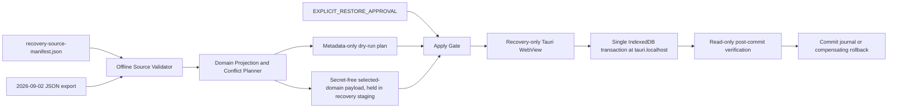

# P32-W.5 · Installer Authority & UX Unification

日期：2026-09-22（Asia/Shanghai）  
阶段：Post-Uninstall Verification only

P32-W.5 当前状态：**BLOCKED BEFORE CANONICAL REINSTALL**。

P32-W.4 的历史事故记录保留不变。人工卸载已使原 cross-installer live takeover path 不再适用；当前机器应重新分类为：

```text
POST_UNINSTALL / PRE_CANONICAL_REINSTALL
```

本轮没有 build、install、upgrade、uninstall、restart、stop、registry cleanup、shortcut cleanup 或 user-data write。Credential migration/R10.2/P32-S 均未开始。

## A. Scope

本轮只完成：

- post-uninstall process/root/registry/shortcut preflight；
- user-data authority location audit；
- WebView profile authority audit；
- canonical reinstall gate decision；
- Installer/UX authority preparation boundary。

## B. Post-Uninstall Preflight

### Processes

没有发现仍从以下旧路径运行的 IB process：

- `[local path redacted]`；
- `[local path redacted]`；
- `[local path redacted]`。

### Install roots

| Root | Result |
|---|---|
| `[local path redacted]` | GONE |
| `[local path redacted]` | GONE |

### Registry

| Identity | Result |
|---|---|
| Tauri `HKCU\...\Uninstall\InternalBeyond` | **RESIDUAL**，仍存在，仍指向 `[local path redacted]` |
| Existing Inno GUID `_is1` | GONE |
| `HKCU\Software\InternalBeyond\InternalBeyond` | key residual；未删除，未假设其用途 |
| HKLM matching entries | absent |

### Shortcuts

- Desktop `InternalBeyond.lnk`：GONE。
- Start Menu normal `InternalBeyond.lnk`：GONE。
- Start Menu `卸载 InternalBeyond.lnk`：GONE。
- Workspace `InternalBeyond.html.lnk`：仍存在，指向 `E:\InternalBeyond-main\InternalBeyond.html`；分类为 development shortcut，不是 production authority。

Post-uninstall preflight：**DEGRADED**，原因是 Tauri uninstall identity residual 和 user-data authority loss/uncertainty。

## C. User Data Authority

### C1. `%LOCALAPPDATA%\InternalBeyond`

当前目录不存在，以下 runtime/user data paths 均不存在：

- `active-message-service.json`；
- `credential-vault.json` / `credential-vault.key`；
- `home-node\`；
- `bridge\`；
- `boot-state.json`；
- `logs\` / `updates\`。

这意味着不能宣称 Active state、Vault、Home Node state 或 Bridge state 已被保留。不能在此状态下安装新版本。

### C2. WebView profile

`[local path redacted]` 仍存在，且 metadata 显示：

- `Default\IndexedDB\http_127.0.0.1_23120.indexeddb.leveldb` 存在；
- `Default\IndexedDB\http_tauri.localhost_0.indexeddb.leveldb` 存在；
- `Default\Local Storage\leveldb` 存在；
- `Default\WebStorage` 存在。

源码 `assets/js/core.js` 的 IndexedDB schema 包含 `apiConfigs`、`chatMessages`、`memories`、`chatThreads`、`roleLetters`、`moments`、`activities` 等 store。因此角色/聊天的 Web Core authority 可能位于 WebView profile，但本轮没有读取 LevelDB/IndexedDB 内容，不能确认记录数量或完整性。

### C3. Authority classification

| Domain | Expected authority | Current result |
|---|---|---|
| Roles/API configs/chat UI state | Web Core IndexedDB/localStorage under origin-specific WebView profile | profile exists; content not read; **NOT VERIFIED** |
| Home Node chat/memory state | `%LOCALAPPDATA%\InternalBeyond\home-node\home-node.db` | data root absent; **MISSING/UNVERIFIED** |
| Active state | `%LOCALAPPDATA%\InternalBeyond\active-message-service.json` | absent |
| Credential Vault | `%LOCALAPPDATA%\InternalBeyond\credential-vault.*` | absent |
| Bridge state | `%LOCALAPPDATA%\InternalBeyond\bridge` | absent |
| boot-state/update/log state | `%LOCALAPPDATA%\InternalBeyond` | absent |
| Tauri WebView cache/profile | `%LOCALAPPDATA%\com.internalbeyond.desktop\EBWebView` | preserved at metadata level |

因此不能错误地说“角色全部保留”或“角色全部丢失”：WebView profile 仍存在，但其 content 尚未验证；separate runtime data roots are gone。

## D. WebView Profile Authority

当前 app identifier/profile continuity remains `com.internalbeyond.desktop`。WebView profile 与 `%LOCALAPPDATA%\InternalBeyond` 是两套 authority，不能互相替代。

本阶段不删除 WebView profile，不执行 storage migration，不打开/导出 IndexedDB/localStorage 内容。

## E. Production Installer Authority

冻结契约仍为：

- Production installer：Existing Inno only；
- Build：`scripts/build-installer.ps1`；
- Update：verified installer → Inno；
- Uninstall：Inno uninstaller；
- VERSION：root `VERSION` only；
- Tauri NSIS：package/acceptance only；
- Tauri Host executable：可以作为 Inno payload 中的 production Host。

本阶段没有修改 authority，也没有把 Tauri NSIS 升格为 production installer。

## F. Tauri NSIS Acceptance Boundary

Tauri NSIS 不再是当前安装目录，但残留 uninstall registry key 仍显示旧 identity。该 residual 不能手工删除，必须等未来明确的 cleanup/takeover approval 和 ownership proof。

## G. Release Pipeline Audit

现有 canonical source/build contract 仍有效：

```text
root VERSION
  → scripts/release-manifest.js
  → scripts/build-installer.ps1
  → Inno Setup
  → canonical payload
```

P32-W.5 尚未产生新的 installer source/build modification，因此无需重新 build。现有 production artifact 是否仍匹配当前 workspace，必须在 data gate PASS 后重新审计。

## H. Production Build Guard

继续保持：

- Inno artifact accepted as production only when generated by `scripts/build-installer.ps1`；
- Tauri NSIS artifact rejected as production installer；
- Host EXE allowed only as Inno-staged generated payload；
- `_up_` never accepted as production root。

## I. Installed-App Identity

当前 installed identity 不是 clean：Tauri uninstall registry residual 仍存在，Inno identity 已不存在。不能声称 Installed Apps 已统一为空或已统一为 Inno。

## J. Installer UX

P32-W.5 UX changes not started because user-data gate failed. Intended production UX remains:

- Chinese Inno setup/uninstall UI；
- InternalBeyond name/icon/version from root VERSION；
- one normal production shortcut to canonical `internalbeyond-host.exe`；
- VBS retained only as fallback artifact。

## K. Uninstaller UX

Production Inno source already documents personal-data preservation. Tauri NSIS English “Delete the application data” semantics are not production UX and are not being reintroduced.

No uninstaller was executed in this phase.

## L. Data Preservation Policy

Frozen policy remains:

```text
Uninstall App != Delete User Data
```

However, the current post-uninstall state shows `%LOCALAPPDATA%\InternalBeyond` absent. Because WebView IndexedDB/localStorage remains a possible role/chat authority, the loss/retention boundary is not yet explained. This is a hard stop before reinstall.

## M. Version Gate

No VERSION bump or rebuild was performed. Existing `1.0.6` artifact must not be treated as a current reinstall candidate until the user-data gate and current workspace payload audit pass.

## N. Canonical Build

NOT EXECUTED in P32-W.5. Build is prohibited until user-data authority is verified.

## O. Pre-Install Snapshot

Not authorized because the current post-uninstall data boundary is already degraded. A future snapshot must include:

- WebView profile metadata and origin storage metadata;
- any recoverable user-data roots;
- residual Tauri registry identity;
- workspace/installer artifact metadata;
- no credential plaintext.

## P. Canonical Clean Reinstall

**BLOCKED before installer spawn**。

Blocking facts:

1. `%LOCALAPPDATA%\InternalBeyond` runtime/user data root is absent。
2. WebView profile remains but role/chat content is unverified。
3. Tauri uninstall registry residual remains。
4. Reinstall could create a new empty runtime and obscure whether roles/chats survived。

Do not install until the WebView authority is safely verified or an approved recovery decision exists.

## Q. Runtime Authority Verification

Not executed; no production runtime exists after manual uninstall。

## R. R10.1 Installed Presence

Not executed; no installed production payload exists。

## S. User Data Preservation

**FAIL / STOP CONDITION** for reinstall gate: primary runtime/user data roots are absent, while WebView profile content remains unverified。

This phase does not infer whether roles are recoverable and does not read protected content to force a PASS。

## T. Installed Apps Verification

Current result: Tauri uninstall identity residual; Inno identity gone. Not unified。

## U. Shortcut Verification

Normal production shortcuts are gone. Workspace HTML shortcut remains and is not a production entry.

## V. Historical P32-W.4 Closure

P32-W.4 history remains intact. The old cross-installer takeover path is superseded operationally by manual uninstall, but its root-cause/authority-drift evidence remains valid.

## W. Final Gate

```text
Post-uninstall preflight: DEGRADED
User data authority: BLOCKED / NOT VERIFIED
WebView profile: PRESENT, content not read
Tauri identity: residual
Inno identity: gone
Old roots: gone
Old processes: gone
Canonical reinstall: BLOCKED
P32-W.5: BLOCKED BEFORE INSTALLER SPAWN
```

Do not build, install, upgrade, uninstall, clean registry/shortcuts, migrate data, resume R10.2 or start P32-S until the user-data authority issue is explicitly resolved. Do not commit or push.

# P32-W.5-R · User Data Recovery Audit

日期：2026-09-22（Asia/Shanghai）  
阶段：forensic/read-only recovery audit

## A. Recovery Inventory

### Original WebView profile

Original profile remains at:

\`[local path redacted]`

Targeted storage paths present:

- \`Default\\IndexedDB\`；
- \`Default\\Local Storage\`；
- \`Default\\Session Storage\`；
- \`Default\\WebStorage\`。

\`IndexedDB\` contains two origin databases:

- \`http_127.0.0.1_23120.indexeddb.leveldb\`；
- \`http_tauri.localhost_0.indexeddb.leveldb\`。

No process was using this specific InternalBeyond WebView profile during the audit. The original profile was not opened by Chromium/Tauri and was not modified.

A read-only forensic copy of only the four storage directories was made at:

\`[local path redacted]`

Copy inventory: 30 files, 7 directories, 1,542,470 bytes；metadata manifest hash \`bdfefa67c3c2923330cf1d36a44edba65371f9884e0b2b1b558d245b0fd8bd01\`。这不是 restore artifact，不写回原 profile。

### \`%LOCALAPPDATA%\\InternalBeyond\`

The directory is absent. No new directory was created.

### Explicit recovery artifacts

Existing Downloads artifacts found by filename/metadata:

| Artifact | Size | SHA256 | Use |
|---|---:|---|---|
| \`[local path redacted]` | 45,062,434 bytes | \`1170f2a805f25ce2e151b880858e0ab1fdd2aad61281a16754da08a843238401\` | existing business-data recovery export |
| \`[local path redacted]` | 59,759,447 bytes | \`a214bee3cba8e02668fca4f8f287c227dcda5816f519e77b3c01db780c7c85e8\` | existing encrypted credential recovery artifact; not opened |

No new canonical backup format was created.

## B. Deletion Root Cause

Source evidence does not attribute the missing \`%LOCALAPPDATA%\\InternalBeyond\` directory to the Tauri uninstaller:

- generated Tauri NSIS optional “Delete app data” path removes \`APPDATA/LOCALAPPDATA\\com.internalbeyond.desktop\` (`installer.nsi:1976-1992`), not \`%LOCALAPPDATA%\\InternalBeyond\`;
- Existing Inno uninstall source explicitly states personal data is preserved (`installer/InternalBeyond.iss:505-514`) and has no user-data deletion contract;
- the WebView profile still exists, so the Tauri optional profile deletion was not observed as complete.

The actual deletion actor for \`%LOCALAPPDATA%\\InternalBeyond\` is **UNDETERMINED** from current source/filesystem evidence; it may be manual or another cleanup action. No further deletion was attempted.

## C. WebView DB / Store Map

Source authority is \`InternalBeyondDB\`, schema version \`24\` (`assets/js/core.js:3-4`). The Web Core defines stores including:

| Data class | WebView store | Authority classification |
|---|---|---|
| Role/API configuration | \`apiConfigs\` | Web Core role/config record; may contain legacy credential-bearing fields |
| Chat messages | \`chatMessages\` | Web Core export/snapshot; runtime service contract separately names Home Node as canonical chat authority |
| Chat threads | \`chatThreads\` | Web Core thread store / recovery source |
| Groups | \`groups\` | Web Core group configuration |
| Memory | \`memories\`, \`autoMemory\` | Web Core recovery stores; Home Node has canonical memory runtime authority |
| Diary | \`diary_entries\` | Web Core store |
| Moments | \`moments\` | Web Core recovery store; Home Node has canonical Moments runtime authority |
| Role letters | \`roleLetters\`, \`roleLetterMemories\` | Web Core stores |
| Activity/favorites | \`activities\`, \`favorites\` | Web Core stores |
| Understanding/threads | \`understandings\`, \`threads\` | Web Core stores |
| Settings | \`apiSettings\`, \`active_message_settings\` | Web Core settings/snapshot stores |

The origin split is real: Browser-origin and Tauri-origin IndexedDB databases both remain. No claim is made that one origin supersedes the other without record-level inspection.

## D. Recovery Export Results

The existing \`InternalBeyond_auto_2026-09-02.json\` was parsed without outputting record values or credential values.

### Characters/API configs

- \`apiConfigs\` records: **12**。
- All 12 records contain credential-bearing field names (\`apiKey\` / \`imageGenApiKey\`); values were not output。
- Character status: **PRESERVED_IN_RECOVERY_ARTIFACT / RECOVERABLE**。
- Current WebView profile record count: **not independently decoded**；original profile remains untouched。

### Chats

- \`chatMessages\`: **341**。
- Timestamp range: 2026-07-28 through 2026-09-01 (UTC) in the export。
- \`chatThreads\`: **2**。
- Thread timestamp range: 2026-08-02 through 2026-09-01 (UTC)。
- Message references: 258 match API-config IDs; 77 are group-shaped references; remaining references are not treated as loss without domain parsing。
- Chat status: **RECOVERABLE_FROM_BACKUP / PARTIAL**；the export is dated 2026-09-02 and does not prove later WebView changes。

### Memory / social data

| Domain | Export count | Status |
|---|---:|---|
| \`memories\` | 3 | RECOVERABLE_FROM_BACKUP |
| \`autoMemory\` | 3 | RECOVERABLE_FROM_BACKUP |
| \`diary_entries\` | 13 | RECOVERABLE_FROM_BACKUP |
| \`moments\` | 155 | RECOVERABLE_FROM_BACKUP |
| \`roleLetters\` | 1 | RECOVERABLE_FROM_BACKUP |
| \`groups\` | 7 | RECOVERABLE_FROM_BACKUP |
| \`activities\` | absent from this export | UNKNOWN |
| dedicated relationship store | not present as a top-level export store | UNKNOWN |

No正文、角色名、聊天内容或 credential value was placed in the report.

## E. Service-Side Lost Data Matrix

| Service state | Current observation | Classification |
|---|---|---|
| Active state | \`%LOCALAPPDATA%\\InternalBeyond\\active-message-service.json\` absent; export has 2 settings, 0 history/plans | PARTIAL / RECOVERABLE_FROM_BACKUP for export metadata only |
| Credential Vault JSON/key | absent from runtime data root | RECOVERABLE_FROM_BACKUP artifact exists; not restored/opened |
| Home Node DB | runtime data root absent; historical workspace research copies exist but are not adopted as user backup | UNKNOWN |
| Bridge state | runtime data root absent; no validated user backup selected | UNKNOWN |
| boot-state | absent | RECONSTRUCTIBLE diagnostic state |
| logs/update state | absent from runtime data root | RECONSTRUCTIBLE / UNKNOWN |

No new Vault/key was created. No service was started to recreate missing files.

## F. Credential Recovery Boundary

Credential-related evidence:

- 12 API-config records in the existing JSON export have credential-bearing field names；
- existing encrypted \`.ibvault\` artifact is present and hashed；
- plaintext key values were not output；
- Vault was not decrypted/restored；
- no credential data was written to production or any new Vault。

R10/R11 remain frozen.

## G. Original Profile Invariance

- Original \`EBWebView\` was not opened by Chromium/Tauri。
- Original profile was not modified。
- Only a temp copy of four storage directories was created。
- No IndexedDB upgrade, localStorage migration, cleanup, compaction or repair write occurred。
- \`%LOCALAPPDATA%\\InternalBeyond\` was not recreated。

## H. Reinstall Readiness

\`+Characters: PRESERVED_IN_RECOVERY_ARTIFACT / current profile UNKNOWN
Chats: RECOVERABLE_FROM_BACKUP / PARTIAL
Memory: RECOVERABLE_FROM_BACKUP
Diary: RECOVERABLE_FROM_BACKUP
Moments: RECOVERABLE_FROM_BACKUP
Relationship: UNKNOWN
Activity: UNKNOWN
Role Letters: RECOVERABLE_FROM_BACKUP

Active state: PARTIAL / backup metadata only
Credential Vault: RECOVERABLE_FROM_BACKUP artifact present; not restored
Home Node: UNKNOWN
Bridge: UNKNOWN

WebView original modified: 0
Production writes: 0
Credential writes: 0
Credential secret output: 0
Provider calls: 0

Recovery artifact: existing Downloads JSON + encrypted .ibvault; forensic WebView copy in Temp
Canonical reinstall readiness: BLOCKED_DATA_RECOVERY
\`

Do not build, reinstall, restore, create \`%LOCALAPPDATA%\\InternalBeyond\`, create Vault, start Active/Bridge/Home Node, clean registry, or resume R10/R11. Next step requires an explicitly approved P32-W.5-R2 recovery/rehydration design.

# P32-W.5-R2 Recovery Source Reconciliation

日期：2026-09-22（Asia/Shanghai）
阶段：copy-only/read-only recovery source reconciliation

P32-W.5-R2 当前状态：BLOCKED_DATA_RECOVERY。未执行 install、restore、rehydration、service start、Vault restore 或 production write。

## A. Source Inventory

- Existing JSON: [local path redacted],062,434 bytes；SHA256 1170f2a805f25ce2e151b880858e0ab1fdd2aad61281a16754da08a843238401。
- Original WebView: [local path redacted]
- Encrypted backup: [local path redacted],759,447 bytes；SHA256 a214bee3cba8e02668fca4f8f287c227dcda5816f519e77b3c01db780c7c85e8；not opened。
- E drive: workspace/research copies found; no additional validated user-owned canonical backup selected。
- Forensic copy: [local path redacted] files / 1,542,470 bytes；metadata hash bdfefa67c3c2923330cf1d36a44edba65371f9884e0b2b1b558d245b0fd8bd01。

## B. WebView Decode

The original profile was not opened by Chromium/Tauri. A copy of IndexedDB, Local Storage, Session Storage and WebStorage was made. No safe offline LevelDB parser is available in this environment; the headless probe could not be made a controlled disposable browser session. Record-level WebView counts are UNKNOWN and no schema upgrade/write was attempted.

## C. Origin Reconciliation

Both IndexedDB origins remain present: http://127.0.0.1:23120 and http://tauri.localhost. Source schema is InternalBeyondDB version 24. Browser/Tauri record differences are UNKNOWN; no newest-source overwrite was performed.

## D. Domain Source Matrix

| Domain | JSON | WebView origins | E backup | Action |
|---|---:|---|---|---|
| Roles/API configs | 12 | UNKNOWN | none validated | recoverable backup; secret fields count only |
| Chat messages | 341 | UNKNOWN | none validated | recoverable backup, partial cutoff |
| Chat threads | 2 | UNKNOWN | none validated | recoverable backup |
| Groups | 7 | UNKNOWN | none validated | recoverable backup |
| Memory/AutoMemory | 3/3 | UNKNOWN | none validated | recoverable backup candidate |
| Diary | 13 | UNKNOWN | none validated | recoverable backup candidate |
| Moments | 155 | UNKNOWN | none validated | recoverable backup candidate |
| Role Letters | 1 | UNKNOWN | none validated | recoverable backup candidate |
| Activities | UNKNOWN | UNKNOWN | none validated | unresolved |
| Relationship | UNKNOWN | UNKNOWN | none validated | unresolved |
| Favorites/Understanding/Letter memories | UNKNOWN | UNKNOWN | none validated | unresolved |

Merge policy remains stable-ID + timestamp + schema + referential integrity + explicit tombstone only; no automatic newest-file-wins.

## E. Roles

The existing export has 12 apiConfigs. All 12 contain credential-bearing field names apiKey/imageGenApiKey; values were not output. ROLE_RECOVERY = RECOVERABLE_FROM_BACKUP; current WebView record state = UNKNOWN.

## F. Chats

The export has 341 chatMessages and 2 chatThreads. Message range is 2026-07-28 through 2026-09-01 UTC; thread range is 2026-08-02 through 2026-09-01 UTC. 258 message friend references match API-config IDs; 77 are group-shaped. CHAT_MESSAGES = RECOVERABLE_FROM_BACKUP/PARTIAL_CUTOFF; CHAT_THREADS = RECOVERABLE_FROM_BACKUP. No正文 was dumped.

## G. Memory / Social

Backup candidates: memories=3, autoMemory=3, diary_entries=13, moments=155, roleLetters=1, groups=7. Activities and Relationship remain UNKNOWN. No social/business source was written.

## H. Media

Record-level WebView decode was unavailable; image/avatar/voice/file/moment-media reference counts are UNKNOWN. No bulk media was copied or restored.

## I. Active

The runtime Active root is gone. Export metadata has active_message_settings=2, active_message_history=0, active_message_plans=0. Future rehydration must not restore scheduler/outbox/cooldown state blindly; first boot must use a safe empty scheduler policy.

## J. Home Node

Home Node DB is absent. Export data may be a future migration source only through existing Home Node migration contracts. No DB was created and no second sync path was invented.

## K. Bridge

Bridge root is absent. Future classification: non-secret config RECONSTRUCTIBLE_CONFIG after review; ephemeral runtime RESET; user state UNKNOWN; provider/TTS/ASR secrets SECRET_DEPENDENT and separate.

## L. Credential Backup

The encrypted ibvault artifact is present. Source format is AES-256-GCM v1 with a local 32-byte key file. Container content was not opened or decrypted. Status: PRESENT / FORMAT KNOWN FROM SOURCE / CONTENT NOT VALIDATED; restore LOCKED_PENDING_EXPLICIT_RECOVERY_AUTHORITY.

## M. Credential Boundary

Credential-bearing recovery records counted: 12. Plaintext secret output: 0. Vault restore/write: 0. CredentialRef write: 0. Provider calls: 0. R10/R11 remain frozen.

## N. First-Boot Write Map

Before any future install start, control these writes: launcher boot-state/logs; Web Core IndexedDB schema/open/migration; Active data/Vault/scheduler initialization; Home Node SQLite/schema initialization; Bridge config/data initialization; WebView IndexedDB/localStorage initialization. Install must occur without launch, and restoration must precede full runtime start.

## O. Rehydration Order

Design only: freeze/hash artifacts → install without launch → preserve WebView identity → restore/verify Web Core business data → migrate eligible Home Node domains through existing contracts → restore safe Active metadata with scheduler disabled → restore non-secret Bridge config → validate Vault authority without plaintext restore → controlled first start → runtime/data verification → rollback on any mismatch.

## P. Recovery Manifest

Metadata-only manifest:

E:\InternalBeyond-main\tmp\p32-w5r-recovery\recovery-manifest.json

Bytes 3,558；SHA256 2ef66f80a6c04d1d9b6cb35d5a6ee6da4349966d55d9d9c50e0632f3dcafe0d4。It contains source/hash/schema/count/action metadata only.

## Q. Recovery Bundle

No new data bundle was created. The existing JSON export is the candidate business recovery source; ibvault remains encrypted and untouched; the forensic WebView copy is analysis-only.

## R. R3 Runbook

Next phase requires explicit approval as P32-W.5-R3 Canonical Reinstall & Controlled Rehydration: PRECHECK → SNAPSHOT → INSTALL WITHOUT LAUNCH → RESTORE WEB CORE → VERIFY → REHYDRATE HOME NODE → VERIFY → RESTORE ACTIVE SAFE STATE → RESTORE BRIDGE → RESTORE CREDENTIAL AUTHORITY → CONTROLLED FIRST START → RUNTIME AUTHORITY VERIFY → DATA VERIFY → ROLLBACK.

## S. Gate

JSON backup: PASS. WebView record decode: BLOCKED/UNKNOWN. Origin reconciliation: BLOCKED/UNKNOWN. Roles: recoverable from backup. Chats: partial recoverable backup. Memory/Diary/Moments: recoverable backup candidates. Activities/Relationship/media: UNKNOWN. Active/Home Node/Bridge: partial or unknown. ibvault: present, pending explicit validation. Recovery manifest: PASS metadata-only. Original profile: unchanged. Production/credential writes: 0. Provider calls: 0.

P32-W.5-R2 = BLOCKED_DATA_RECOVERY / PREPARED FOR EXPLICIT R3 DESIGN ONLY. Do not build, install, restore, start services, clean registry, resume R10/R11, commit or push.

# P32-W.5-R2.1 WebView Record Access Investigation

日期：2026-09-22（Asia/Shanghai）
范围：strict read-only；copy → analyze；不执行 restore、install、runtime start 或生产写入。

## 1. Forensic Copy Validation

- Original profile: `[local path redacted]`。
- Forensic copy: `[local path redacted]`。
- Copy inventory: 30 files, 7 directories, 1,542,470 bytes。
- Copy metadata/inventory hash: `bdfefa67c3c2923330cf1d36a44edba65371f9884e0b2b1b558d245b0fd8bd01`。
- Original profile was not opened as a Chromium/Tauri writable session. No process targeted the original profile during this investigation; original profile remains unchanged.
- Origin-level copy inventory:
  - `IndexedDB/http_127.0.0.1_23120.indexeddb.leveldb`: 9 files, 1,351,043 bytes。
  - `IndexedDB/http_tauri.localhost_0.indexeddb.leveldb`: 6 files, 31,100 bytes。
  - `Local Storage`: 8 files, 106,151 bytes。
  - `Session Storage`: 5 files, 392 bytes。
  - `WebStorage`: 2 files, 53,784 bytes。

The hash above is the copy inventory/metadata manifest hash; no secret-bearing file contents were emitted.

## 2. IndexedDB Access-Path Audit

- Existing workspace search found no usable IndexedDB dump, LevelDB parser, export/import helper, or recovery decoder that can safely read this copy offline.
- Available Node/Python LevelDB bindings were not present. No new persistence or migration tool was introduced.
- Source reference remains `InternalBeyondDB` version 24. Its declared object stores include `apiConfigs`, `chatMessages`, `chatThreads`, `memories`, `diary_entries`, `moments`, `roleLetters`, `groups`, `activities`, `favorites`, and other application stores; this is a source contract reference, not proof of the copied profile's actual record state.
- An analysis-only readonly probe was attempted against a separate copy. It did not produce a controlled record dump and was stopped. The original profile was not used.
- Result: no safe record-level decoder is available in the current environment; no schema upgrade, browser migration, localStorage write, or IndexedDB write was performed.

## 3. Two-Origin Analysis

| Origin | Copied storage observed | Database name | Schema version | Object stores | Record counts | Timestamp metadata |
|---|---:|---|---:|---|---:|---|
| `http_127.0.0.1_23120` | IndexedDB LevelDB present: 9 files / 1,351,043 bytes | UNKNOWN from copy | UNKNOWN from copy; source contract v24 | UNKNOWN | UNKNOWN | UNKNOWN |
| `http_tauri.localhost_0` | IndexedDB LevelDB present: 6 files / 31,100 bytes | UNKNOWN from copy | UNKNOWN from copy; source contract v24 | UNKNOWN | UNKNOWN | UNKNOWN |

Both requested origin directories are present in the forensic copy. Presence of LevelDB files is not treated as proof that either origin is readable, current, or internally consistent.

## 4. Domain Comparison Against JSON Backup

The comparison is metadata-only. Since record-level WebView decoding is blocked, the WebView value and delta are reported as `UNKNOWN`, not zero.

| Domain | JSON backup count | WebView count | Difference |
|---|---:|---:|---:|
| `apiConfigs` | 12 | UNKNOWN | UNKNOWN |
| `chatMessages` | 341 | UNKNOWN | UNKNOWN |
| `chatThreads` | 2 | UNKNOWN | UNKNOWN |
| `memories` | 3 | UNKNOWN | UNKNOWN |
| `diary_entries` | 13 | UNKNOWN | UNKNOWN |
| `moments` | 155 | UNKNOWN | UNKNOWN |
| `roleLetters` | 1 | UNKNOWN | UNKNOWN |
| `groups` | 7 | UNKNOWN | UNKNOWN |
| `activities` | UNKNOWN | UNKNOWN | UNKNOWN |
| `favorites` | UNKNOWN | UNKNOWN | UNKNOWN |

The JSON reference remains `[local path redacted]`; it was parsed read-only. No chat, diary, credential, or other record body was printed.

## 5. Recovery Decision

Current classification: **C — WebView unreadable at record level**.

- This is an access/decoder limitation, not a corruption finding. Classification D is not established.
- There is no evidence sufficient to classify the WebView as newer than the JSON backup (A).
- There is no evidence sufficient to classify the WebView as equal to the JSON backup (B).
- No candidate merge plan was generated because no WebView delta was measured.
- `P32-W.5-R2` remains `BLOCKED_DATA_RECOVERY`; `P32-W.5-R3` is not started.

## 6. Credential Boundary

- The JSON backup contains 12 `apiConfigs` records with credential-bearing field names, including `apiKey` and/or `imageGenApiKey` fields.
- Only the presence/count of credential-bearing fields was recorded. No credential value, fingerprint, or secret material was output.
- The encrypted `.ibvault` was not opened or decrypted. No Vault restore, credentialRef write, provider validation, or provider call occurred.

## 7. Safety and Production Invariance

| Guard | Result |
|---|---|
| Original EBWebView modification | 0 |
| IndexedDB/localStorage migration | 0 |
| Tauri/IB/runtime start | 0 |
| Install/restore/uninstall/takeover | 0 |
| Production registry/shortcut/AppData writes | 0 |
| Credential secret reads/writes | 0 |
| Provider calls | 0 |

R2.1 is complete as a read-only investigation. The next safe action requires a separate approved decoder or disposable analysis environment; it must not be substituted with production startup or recovery.

**P32-W.5-R2.1 = BLOCKED_DATA_RECOVERY / WEBVIEW_RECORDS_UNREADABLE. Original profile unchanged. R3 not started.**

# P32-W.5-R2.2 Recovery Policy Reclassification

日期：2026-09-22（Asia/Shanghai）
阶段：policy-only reclassification；不执行 install、restore、build 或 runtime start。

R2.1 的 `WEBVIEW_RECORDS_UNREADABLE` 结论仍然保留为取证事实；本节只调整恢复策略，不把 WebView 不可读继续泛化为所有业务数据的全局恢复阻塞。

## A. User-Accepted Recovery Boundary vs Forensic Fact

- **USER_CONFIRMED_CHAT_HISTORY_BOUNDARY:** 用户明确确认：2026-09-02 之后的聊天记录已经丢失。
- 这是用户提供的 recovery policy input，不是从 WebView forensic evidence 推导出的事实。
- **FORENSIC FACT:** WebView record-level contents remain unreadable/unknown；没有声称 WebView 不存在更新数据。
- **RECOVERY DECISION:** 对 Chat domain，用户接受 `InternalBeyond_auto_2026-09-02.json` 作为最后可信 recovery checkpoint。
- 该接受范围只适用于 Chat history cutoff，不自动扩展到角色、Memory、Diary、Moments、Activities、Relationship、Favorites、Role Letters、API config、credentials 或 media。

## B. Chat Domain Reclassification

- `chatMessages = 341`；时间范围：2026-07-28 → 2026-09-01 UTC。
- `chatThreads = 2`；时间范围：2026-08-02 → 2026-09-01 UTC。
- `WebView delta = UNKNOWN`；没有把 UNKNOWN 解释为零，也没有声称 WebView 没有更新数据。
- `chatMessages = RECOVERABLE_FROM_ACCEPTED_CHECKPOINT`。
- `chatThreads = RECOVERABLE_FROM_ACCEPTED_CHECKPOINT`。
- Chat 不再仅因 WebView record-level unreadable 而阻止后续 R3 设计或分阶段恢复；实际 restore 仍需单独批准并执行前置快照。

## C. Business Data Recovery Matrix

| Domain | Source / evidence | User acceptance | Recovery classification | Blocks R3? |
|---|---|---|---|---|
| Roles / API configs | JSON: 12 structurally parsed records; no evidence of a missing required role | No special waiver; backup accepted as current source for role metadata | `RECOVERABLE`; credential fields remain `SECRET_DEPENDENT` | No; provider gate remains separate |
| Chat messages | JSON: 341; cutoff through 2026-09-01 UTC | Explicitly accepted last trusted checkpoint | `RECOVERABLE_FROM_ACCEPTED_CHECKPOINT` | No |
| Chat threads | JSON: 2; cutoff through 2026-09-01 UTC | Explicitly accepted with Chat boundary | `RECOVERABLE_FROM_ACCEPTED_CHECKPOINT` | No |
| Groups | JSON: 7 | No later source identified; backup is the available source | `RECOVERABLE` | No |
| Memory | JSON: 3 | No separate later-data acceptance asserted | `RECOVERABLE` | No |
| AutoMemory | JSON: 3 | No separate later-data acceptance asserted | `RECOVERABLE` | No |
| Diary | JSON: 13 | No separate later-data acceptance asserted | `RECOVERABLE` | No |
| Moments | JSON: 155 | No separate later-data acceptance asserted | `RECOVERABLE` | No |
| Role Letters | JSON: 1 | No separate later-data acceptance asserted | `RECOVERABLE` | No |
| Activities | JSON/WebView source unresolved | No acceptance of loss; no boot dependency established | `UNKNOWN_NONBLOCKING` | No |
| Relationship | JSON/WebView source unresolved | No acceptance of loss; no boot dependency established | `UNKNOWN_NONBLOCKING` | No |
| Favorites | JSON/WebView source unresolved | No acceptance of loss; no boot dependency established | `UNKNOWN_NONBLOCKING` | No |
| Understanding | JSON/WebView source unresolved | No acceptance of loss; no boot dependency established | `UNKNOWN_NONBLOCKING` | No |
| Media | No validated bulk-media source; WebView unreadable | No acceptance of loss; not required for canonical boot | `UNKNOWN_NONBLOCKING` | No |

`UNKNOWN_NONBLOCKING` means the domain remains unresolved for future optional recovery but is not currently evidence-backed as a reinstall or canonical-runtime boot dependency. It does not mean the data is known to be absent.

## D. Minimum Viable User Data Recovery

The minimum viable recovery set for re-establishing a canonical runtime is:

- Roles/API configuration metadata: recoverable from the JSON source; secret values remain outside this phase.
- Chat messages and threads: recoverable from the user-accepted JSON checkpoint.
- Groups, Memory, AutoMemory, Diary, Moments and Role Letters: recoverable backup candidates from the same validated export.

Activities, Relationship, Favorites, Understanding and media remain optional/unresolved and are not currently allowed to block reinstall or canonical runtime reconstruction because no dependency requiring them has been established. They remain separately tracked for a future recovery pass.

## E. Service-State Reclassification

| Service/state | Current evidence | Policy classification | Recovery rule |
|---|---|---|---|
| Active | `active_message_settings=2`; history=0; plans=0 | `SAFE_RESET / RECONSTRUCT` | Recreate settings only under an approved phase; scheduler/outbox must start empty and historical messages must not be replayed |
| Home Node | Canonical DB absent; Web Core recovery data exists | `RECONSTRUCTIBLE_FROM_RECOVERY_DATA` | Hydrate only through the existing migration contract; do not create a second sync path |
| Bridge | Runtime/config state absent or unresolved | `RECONFIGURABLE / SECRET_DEPENDENT / OPTIONAL` | Reconstruct non-secret config after review; defer provider/TTS/ASR secrets |
| boot-state / logs / update state | Runtime-generated state | `RECONSTRUCTIBLE` | Recreate under canonical runtime ownership; not user business data |

These are policy classifications only. No Active, Home Node, Bridge, boot-state or log state was created or modified in R2.2.

## F. Credential Recovery Policy

- The JSON contains 12 credential-bearing `apiConfigs`; the encrypted `.ibvault` exists; plaintext values were not output; the prior Vault runtime root is absent.
- Credential recovery is **not required before installer spawn by data policy**, but it is required **after install and before the first provider call**.
- `PROVIDER_READY` therefore remains blocked until credential authority is explicitly recovered/validated in its own approved phase.
- This policy does not authorize Vault decryption, credential restore, credentialRef write, provider validation, or provider execution.

## G. Independent Readiness Gates

| Gate | R2.2 status | Reason |
|---|---|---|
| `INSTALL_READINESS` | `BLOCKED_ENVIRONMENT` | Build evidence exists, but the disposable Windows installer acceptance environment is still unavailable; no real-user install is authorized |
| `DATA_REHYDRATION_READINESS` | `PREPARED_FOR_EXPLICIT_APPROVAL` | JSON schema/count audit, accepted Chat checkpoint, recovery manifest and source hashes are available; no restore has run |
| `FIRST_FULL_START_READINESS` | `NOT_READY` | Business data rehydration and safe runtime-state reconstruction have not run; first start remains controlled and gated |
| `PROVIDER_READY` | `BLOCKED_CREDENTIAL_AUTHORITY` | Vault/credential authority has not been recovered or validated; provider calls remain prohibited |

The WebView forensic limitation is not a global data-recovery blocker after this policy reclassification, but it also does not open any execution gate.

## H. R3 Eligibility and Split

`P32-W.5-R3 = NOT_READY_FOR_EXECUTION`. The remaining concrete execution blocker is the unavailable disposable installer environment, together with the required explicit approvals; the Chat WebView uncertainty is no longer the sole global blocker.

Proposed sequence after the relevant gates pass:

- **R3-A — Canonical Install Without Launch:** requires `INSTALL_READINESS` and isolated acceptance environment.
- **R3-B — Web Core Business Data Rehydration:** restore only approved JSON-backed domains, including the user-accepted Chat checkpoint, with pre/post verification.
- **R3-C — Runtime State Reconstruction:** safe-reset Active, reconstruct Home Node through the existing contract, and reconfigure non-secret Bridge state.
- **R3-D — Credential Authority Recovery:** separate explicit credential approval; no provider execution until `PROVIDER_READY` passes.
- **R3-E — Controlled First Start & Verification:** only after the preceding gates pass; provider readiness remains independently enforced.

## I. R2.2 Safety Boundary

No build, install, restore, Vault decryption, Vault creation, Host/Active/Home Node/Bridge start, original WebView modification, registry cleanup, R10/R11 continuation, commit or push occurred in this policy pass.

**P32-W.5-R2.2 = POLICY_RECLASSIFIED. Chat is recoverable from the user-accepted JSON checkpoint; WebView remains a forensic limitation; INSTALL_READINESS remains BLOCKED_ENVIRONMENT; R3 is not executed.**

# P32-W.5-R2.3 Recovery Execution Plan Freeze

日期：2026-09-22（Asia/Shanghai）
阶段：design-only execution freeze；不执行 install、build、restore、runtime start 或 provider call。

R2.3 只冻结恢复权威、写入边界、回滚点和 gate。它不改变 R2.2 的 `INSTALL_READINESS = BLOCKED_ENVIRONMENT`，也不授权 R3 执行。

## 1. Recovery Authority Matrix

| Domain | Source | Authority | Recovery action | Write timing | Rollback requirement |
|---|---|---|---|---|---|
| Roles / API configs | `InternalBeyond_auto_2026-09-02.json`, 12 structurally parsed records | JSON is the recovery source; Web Core owns runtime projection; credential authority owns secret material | Restore role/config metadata after schema, ID and referential checks; exclude raw secret values | R3-B | Snapshot source and target metadata; deterministic delete/revert of only newly written projection |
| Chat | JSON, 341 records; user-accepted checkpoint through 2026-09-01 UTC | JSON checkpoint during recovery; Home Node becomes runtime authority only after existing migration contract succeeds | Restore accepted checkpoint; preserve stable IDs and timestamps; no WebView newest-wins assumption | R3-B, then R3-C contract hydration | Pre/post counts and IDs; rollback only newly hydrated target state |
| ChatThreads | JSON, 2 records; user-accepted checkpoint through 2026-09-01 UTC | JSON checkpoint during recovery; existing runtime contract after hydration | Restore thread metadata and references; validate message/thread links | R3-B | Snapshot target and revert new thread projection on failure |
| Groups | JSON, 7 records | JSON recovery source; existing Web Core/Home Node contract remains owner | Restore structurally valid group records and references | R3-B | Stable-ID snapshot and target-only rollback |
| Memory | JSON, 3 records | JSON recovery source; Home Node memory authority after approved hydration | Restore records through existing contract; no parallel memory store | R3-B, then R3-C | Snapshot and target-only rollback; preserve source export |
| AutoMemory | JSON, 3 records | JSON recovery source; existing memory authority | Restore as explicit AutoMemory records; do not trigger unsolicited generation | R3-B | Revert only generated target records |
| Diary | JSON, 13 records | JSON recovery source; Web Core business-data contract | Restore records with schema and timestamp checks | R3-B | Stable-ID and count verification before commit; target-only rollback |
| Moments | JSON, 155 records | JSON recovery source; Home Node moments authority after contract hydration | Restore through the existing migration path; do not invent a second sync path | R3-B, then R3-C | Snapshot target; rollback only newly hydrated records |
| RoleLetters | JSON, 1 record | JSON recovery source; existing Web Core role-letter contract | Restore record and references; no credential material | R3-B | Stable-ID target rollback |
| Activities | No validated source; WebView record-level data unknown | Unresolved; no new authority may be invented | No automatic restore; preserve as optional future investigation | No write in R3-B/C | No rollback point because no write is allowed |
| Relationship | No validated source; WebView record-level data unknown | Unresolved; no new authority may be invented | No automatic restore; classify as optional/unresolved | No write in R3-B/C | No rollback point because no write is allowed |
| Favorites | No validated source; WebView record-level data unknown | Unresolved; no new authority may be invented | No automatic restore; do not synthesize records | No write in R3-B/C | No rollback point because no write is allowed |
| Media | No validated bulk-media source; WebView record-level data unknown | Unresolved; no new authority may be invented | No bulk copy or placeholder generation in R3 | No write in R3-B/C | No rollback point because no write is allowed |
| Active | JSON metadata: settings=2, history=0, plans=0 | Active service owns runtime state; JSON is metadata source only | Safe reset/reconstruct settings; scheduler, outbox and history remain empty | R3-C only | Snapshot target runtime state; discard only newly generated safe-reset state |
| Home Node | Recovered Web Core data through existing migration contract; canonical DB currently absent | Home Node owns canonical runtime DB after successful hydration | Reconstruct schema and hydrate eligible domains through existing contract; no second sync path | R3-C | Isolated target snapshot; rollback newly created DB/runtime state only |
| Bridge | Non-secret configuration only; secret-bearing state deferred | Bridge owns its runtime/config projection; credential authority owns secrets | Reconfigure non-secret state; leave secret config absent until approved credential phase | R3-C for non-secret config; R3-D for secrets | Snapshot target config; remove only newly generated non-secret projection |
| Credential Vault | Encrypted `.ibvault` artifact; no plaintext output | Credential authority / Vault contract | Run explicit recovery workflow later; do not decrypt or restore in R2.3 | R3-D only | Preserve original artifact and rollback pointer; never delete source artifact |
| boot-state | Runtime-generated canonical host state | Canonical Host runtime | Reconstruct only under canonical runtime ownership and controlled first start | R3-E | Snapshot generated runtime metadata; discard newly generated state on failed isolated run |

No row authorizes writing to the original EBWebView, real-user registry, real-user shortcuts, current Vault, or Home Node DB during R2.3.

## 2. R3 Write Boundaries

### R3-A — Canonical Install Without Launch

Allowed only in a disposable isolated acceptance environment: installer payload files, canonical install root, installer-owned identity and shortcut artifacts inside that environment. Production/user registry, Desktop, Start Menu, AppData, LocalAppData, TEMP, Vault, Active, Bridge and Home Node data remain forbidden. The installer must not launch IB.

### R3-B — Web Core Business Data Rehydration

Allow only approved JSON-backed business domains from the authority matrix, with schema, stable-ID, referential-integrity and pre/post count checks. Do not write plaintext credentials, credentialRef authority, Active history, scheduler outbox, provider cache, Bridge secrets or unresolved optional domains.

### R3-C — Runtime State Reconstruction

Allow safe empty runtime state: Active settings without history replay, Home Node schema/hydration through the existing contract, and reviewed non-secret Bridge configuration. Forbid historical message replay, scheduler/outbox replay, provider cache creation, secret Bridge config and any second ownership path.

### R3-D — Credential Authority

Allow only the explicit credential recovery workflow and its metadata/authority checks. Credential recovery does not authorize provider execution. No provider call, provider validation call, plaintext export, Vault cleanup or apiKey deletion is allowed.

### R3-E — Controlled First Start

First start is allowed only after R3-A through R3-D gates pass. Checks must include canonical install root and payload manifest identity, runtime mode, version, business-data counts, stable-ID/reference integrity, empty Active history/outbox, Home Node and Bridge ownership, absence of unapproved secret writes, credential gate state, provider-call prohibition until `PROVIDER_READY`, and rollback telemetry.

## 3. First-Start Write Guard List

Before `PROVIDER_READY`, the first start must not generate:

- `credential-vault` or any plaintext credential store
- empty `Active` history records
- scheduler outbox or historical replay queue
- provider cache or provider-derived response cache
- a new Home Node database outside the approved R3-C migration contract
- Bridge secret configuration
- raw `apiKey` or `imageGenApiKey` values in Web Core, localStorage, logs or diagnostics

Safe boot-state and ordinary per-user logs may be reconstructed only under the canonical runtime owner and only during the explicitly approved controlled-start phase.

## 4. Rollback Point Design

### Before-install snapshot

The pre-install snapshot is metadata-only and must include:

- installer artifact: `dist/InternalBeyond-Setup-1.0.6.exe`, size 54,514,701 bytes, SHA256 `afa64160c4ad5dac2fd2d9141eecd4d129747cd931f34967b8d8a7fca6fd1a15`
- original WebView path, forensic-copy path, copy inventory hash, file/directory counts and origin inventory; no record values
- recovery JSON size/hash: 45,062,434 bytes, SHA256 `1170f2a805f25ce2e151b880858e0ab1fdd2aad61281a16754da08a843238401`
- encrypted `.ibvault` size/hash: 59,759,447 bytes, SHA256 `a214bee3cba8e02668fca4f8f287c227dcda5816f519e77b3c01db780c7c85e8`
- recovery manifest path/hash: `tmp/p32-w5r-recovery/recovery-manifest.json`, SHA256 `2ef66f80a6c04d1d9b6cb35d5a6ee6da4349966d55d9d9c50e0632f3dcafe0d4`
- registry snapshot metadata: relevant key paths, value-name inventory, owner/profile scope and before-state fingerprints; no destructive cleanup and no secret values
- pre-run process, shortcut, install-root, AppData/LocalAppData and TEMP metadata for the isolated test environment

### Failure rollback scope

Rollback may remove or revert only artifacts newly created by the approved isolated R3 stage: staged installer files, isolated install root, installer-owned isolated registry/shortcut entries, newly generated runtime files, newly hydrated target records and newly created isolated runtime databases.

Rollback must not delete or rewrite the original WebView, JSON export, encrypted `.ibvault`, existing user registry/shortcuts, source artifacts, or any user data outside the isolated target. It cannot recreate chat history that the user confirmed was already lost after 2026-09-02, and it cannot infer or restore UNKNOWN domains.

## 5. Credential Boundary

Credential recovery does not block the installer policy gate. It does block `PROVIDER_READY` and every provider execution path. The installer may be evaluated without provider access only in the approved isolated environment; no credential material is restored or validated in R2.3.

## 6. Final Gates

| Stage | Ready? | R2.3 decision |
|---|---|---|
| R3-A Canonical Install Without Launch | NO | `BLOCKED_ENVIRONMENT`; build artifact is available but disposable Windows acceptance is not available |
| R3-B Web Core Business Data Rehydration | DESIGN READY ONLY | `PREPARED_FOR_EXPLICIT_APPROVAL`; execution waits for R3-A, snapshot and explicit approval |
| R3-C Runtime State Reconstruction | DESIGN READY ONLY | Safe-reset/reconstruction plan is frozen; execution waits for approved R3-B output and isolated target |
| R3-D Credential Authority Recovery | NO | Workflow boundary is defined, but explicit credential recovery approval and `PROVIDER_READY` are absent |
| R3-E Controlled First Start & Verification | NO | Depends on R3-A through R3-D and all controlled-start checks |

Remaining blockers:

- disposable Windows installer acceptance environment is unavailable
- R3 execution approval has not been granted
- credential authority recovery is not complete; provider execution remains prohibited
- WebView record-level data remains a forensic limitation

**P32-W.5-R2.3 = EXECUTION_PLAN_FROZEN. No R3 stage executed. INSTALL_READINESS remains BLOCKED_ENVIRONMENT.**

# P32-W.5-R3.0 Environment Unblock Audit

日期：2026-09-22（Asia/Shanghai）
阶段：read-only environment discovery；未执行 installer、IB、registry、shortcut、WebView、restore 或 build。

## 1. Windows Isolation Options

| Capability | Current result | Acceptance consequence |
|---|---|---|
| Windows edition | Windows 10 Pro for Workstations, 64-bit, build 26200 | OS edition can support the concept, but does not provide an enabled disposable boundary by itself |
| Windows Sandbox feature | `Containers-DisposableClientVM = Disabled`; `WindowsSandbox.exe` missing | Not available; no enablement or reboot attempted |
| Hyper-V | `Microsoft-Hyper-V-All = Disabled`; `vmconnect.exe` missing; `Get-VM` unavailable; `vmms` unavailable | No observable disposable Hyper-V VM provider |
| Existing VM tools | VirtualBox, QEMU, VMware `vmrun` and libvirt `virsh` commands missing | No existing temporary VM path |
| Firmware/hypervisor signal | `HypervisorPresent = True` | Insufficient by itself; no Windows guest/profile provider is exposed |
| WSL | `wsl.exe` present, default version 2, no distribution installed | Not a Windows registry/Desktop/Start Menu/AppData isolation boundary |
| Docker Windows containers | `docker.exe` missing | No Docker provider; even a Windows container would not provide faithful Explorer/Desktop/Start Menu installer acceptance without an explicit GUI/profile harness |
| Project CI | No `.github`, GitLab, Azure Pipelines, Jenkins, AppVeyor or Circle configuration; CI/runner environment variables unset | No existing repository-linked Windows acceptance path was found |
| Existing acceptance provider | `tests/p32-w4b-disposable-acceptance-provider.js` exists as discovery/plan/refusal logic only | It reports `BLOCKED_ENVIRONMENT` when no provider is supplied; its execution path remains `not-started` |

The `HypervisorPresent=True` signal is not treated as a VM. It does not prove registry, shortcut, AppData or rollback isolation.

## 2. Installer Acceptance Alternatives

### Candidate A — Real Disposable Windows

- Isolation level: full disposable Windows user/machine boundary, if supplied by Windows Sandbox or an already-provisioned disposable guest.
- Registry isolation: YES, when the installer runs inside the disposable guest.
- Shortcut isolation: YES, because Desktop and Start Menu belong to the disposable guest.
- AppData isolation: YES, when no host profile is mounted.
- Rollback: YES, by discarding the Sandbox/guest or reverting its snapshot.
- Pros: closest to the real Inno installer contract and faithful SpecialFolders behavior.
- Cons: unavailable on this host; enabling Sandbox would mutate host features and may require reboot.
- Security boundary: provider-owned disposable Windows boundary; only synthetic fixtures and the byte-verified installer may cross it.
- Recommendation: **RECOMMENDED when externally provisioned; CURRENTLY UNAVAILABLE**.

### Candidate B — Isolated Local Profile

- Isolation level: partial process/profile redirection only.
- Registry isolation: NO; installer registry APIs still resolve to the real user/machine hives unless the installer itself is changed or mocked.
- Shortcut isolation: NO; Windows SpecialFolders still resolve to the real Desktop/Start Menu/Programs locations.
- AppData isolation: PARTIAL at best for application code, not reliable for Inno installer shell behavior.
- Rollback: NO safe rollback for unknown registry/shortcut/profile side effects.
- Pros: easy to create and useful for non-installer unit tests.
- Cons: violates the known BG2 failure mode and would require mock/bypass behavior that is explicitly forbidden.
- Security boundary: current interactive user session; not a disposable boundary.
- Recommendation: **REJECTED for R3-A**.

### Candidate C — Temporary VM

- Isolation level: full disposable Windows guest with a provider-owned virtual disk and user profile.
- Registry isolation: YES.
- Shortcut isolation: YES.
- AppData isolation: YES.
- Rollback: YES, through snapshot/revert or guest disposal.
- Pros: strong boundary, repeatable snapshots, suitable for install/upgrade/uninstall acceptance.
- Cons: no existing VM provider or VM is present; installing a hypervisor is outside this audit and prohibited by the current task.
- Security boundary: isolated guest with no credential-vault, Active, Bridge, Home Node DB, WebView profile or real user-data mounts.
- Recommendation: **RECOMMENDED FALLBACK when externally pre-provisioned; CURRENTLY UNAVAILABLE**.

### Candidate D — CI Windows Runner

- Isolation level: fresh provider-owned Windows runner/job workspace, subject to runner implementation.
- Registry isolation: YES for a fresh hosted/ephemeral runner; must be proven by before/after snapshot.
- Shortcut isolation: YES if the runner has a real interactive Windows profile and shell folders; a non-interactive build-only runner is insufficient.
- AppData isolation: YES when the job receives a fresh profile and no real-user data mounts.
- Rollback: YES by destroying the runner/job workspace after bounded evidence collection.
- Pros: no mutation of this workstation; clean repeatability and natural artifact transfer contract.
- Cons: no repository workflow or supplied runner exists; hosted-runner availability, permissions and interactive-shell behavior are not established locally.
- Security boundary: CI job/runner with synthetic fixtures only; artifact hash verification before and inside the runner.
- Recommendation: **RECOMMENDED if an existing disposable Windows runner is explicitly supplied; CURRENTLY UNAVAILABLE**.

### Candidate E — Workspace Installer Simulation

- Isolation level: source/test-process simulation only.
- Registry isolation: NO real installer registry behavior is exercised.
- Shortcut isolation: NO real Desktop/Start Menu/SpecialFolders behavior is exercised.
- AppData isolation: NO real installer profile behavior is exercised.
- Rollback: YES only for simulation files, not for real installer side effects.
- Pros: can validate payload manifest, version, hash, path policy and refusal logic without host mutation.
- Cons: cannot prove Inno install root, registry identity, shortcut targets, uninstall entry or shell-folder behavior.
- Security boundary: workspace/test process boundary; no Windows installer acceptance authority.
- Recommendation: **REJECTED as R3-A acceptance; ALLOWED only as supplementary build/contract testing**.

Docker Windows containers and WSL do not create additional accepted candidates: Docker is absent, and neither option supplies the required faithful Windows Desktop/Start Menu/SpecialFolders acceptance boundary in the current machine state.

## 3. R3-A Environment Gate

Current `R3-A environment = BLOCKED`.

Blocking evidence:

- Windows Sandbox is disabled and its executable is absent.
- Hyper-V and VM management tooling are unavailable.
- No existing disposable Windows VM was observable.
- Docker is absent and WSL has no distribution; neither is an accepted Windows installer boundary here.
- No repository CI Windows runner or existing acceptance workflow was found.
- Workspace simulation cannot satisfy registry, shortcut and AppData isolation requirements.

No feature enablement, reboot, hypervisor installation, installer execution, registry mutation, shortcut mutation or IB start was performed.

**P32-W.5-R3.0 = ENVIRONMENT_AUDIT_COMPLETE / R3-A BLOCKED. Stop before R3 execution.**

# P32-W.5-R3.0.1 Recovery Development Environment

日期：2026-09-22（Asia/Shanghai）
阶段：WSL2 recovery tooling scope audit；不执行 Windows installer acceptance、restore、runtime start 或 provider call。

## 1. WSL2 Capability

| Capability | Current result | Meaning |
|---|---|---|
| `wsl.exe` | Present, version `10.0.26100.9278` | WSL host interface is available |
| WSL engine | WSL `2.7.11.0`; default version 2 | WSL2 architecture is installed |
| `Microsoft-Windows-Subsystem-Linux` | Enabled | WSL component is enabled; no change made in this audit |
| `VirtualMachinePlatform` | Enabled | WSL2 virtualization component is enabled; no change made in this audit |
| Linux distribution | None installed; observed distro count 0 | No runnable WSL2 userland is currently available |
| Windows acceptance boundary | Not provided by WSL2 | WSL2 is not a Windows HKCU/Desktop/Start Menu/AppData/installer boundary |

WSL2 can become a recovery development environment after an explicitly supplied disposable Linux distribution is available. The current host has no distribution, so no recovery command was run inside WSL2 and no distro was installed.

## 2. WSL2 Applicable Scope

| Task | WSL2 suitability | Safe contract |
|---|---|---|
| Recovery manifest validation | YES | Read the metadata-only manifest; verify schema, paths, hashes and action metadata; do not apply actions |
| JSON backup analysis | YES | Read a copied or explicitly read-only JSON input; output counts/metadata only; never print credential values or business正文 |
| Schema inspection | YES | Inspect source schema and migration contracts without opening a writable WebView session |
| Restore plan generation | YES | Generate a plan and authority matrix only; no target writes and no runtime creation |
| Hash verification | YES | Recompute hashes for approved input artifacts and compare to frozen metadata |
| Migration dry-run logic | YES | Evaluate mappings, stable IDs, counts and conflicts in memory or disposable files; no IndexedDB, localStorage, Vault or Home Node writes |

Approved WSL2 inputs must be copied analysis artifacts only: recovery manifest, JSON backup, source schema/contract files and non-secret metadata. The encrypted `.ibvault` may be hashed or inspected as a container metadata artifact only; no decryption is authorized.

## 3. WSL2 Not-Applicable Scope

WSL2 must not be used to claim or simulate any of the following:

- Windows Inno installer acceptance or `R3-A` pass
- real Windows registry identity, HKCU behavior or uninstall entry
- Desktop, Start Menu, Programs shortcut creation or target verification
- Windows SpecialFolders behavior
- Windows AppData/LocalAppData installer semantics
- Windows install root, takeover, upgrade or uninstall behavior
- Tauri/IB/Host/Active/Home Node/Bridge startup
- provider validation or provider execution
- writes to original `EBWebView`, IndexedDB, localStorage, Vault, Active, Bridge or Home Node data

WSL file access to `/mnt/c` or `/mnt/e` does not create a safety boundary. Any future WSL2 tooling must consume an explicitly scoped copy and must not use host profile paths as writable targets.

## 4. Tasks That Can Progress After a WSL Distribution Exists

- Validate `tmp/p32-w5r-recovery/recovery-manifest.json` against its frozen hash and metadata contract.
- Recheck the JSON backup hash and domain counts without outputting record bodies or secrets.
- Inspect schema/version declarations and generate R3-B/R3-C dry-run plans.
- Compare stable IDs, timestamps, references and conflict counts in memory or a disposable WSL work directory.
- Produce bounded reports for authority, rollback and write-guard decisions.

These are development/recovery planning tasks only. They do not change `INSTALL_READINESS` and do not authorize a Windows install.

## 5. Tasks That Cannot Progress Through WSL2

- R3-A canonical installer acceptance.
- Registry, shortcut, Desktop, Start Menu or AppData isolation proof.
- Inno install/upgrade/uninstall/takeover acceptance.
- Any first start that creates runtime data.
- Credential Vault recovery or provider readiness.
- WebView record-level recovery requiring a safe Chromium/Edge decoder.

## 6. Final Gates

| Gate | Result | Reason |
|---|---|---|
| `R3-A` | `BLOCKED_ENVIRONMENT` | WSL2 is not a Windows installer acceptance boundary; Windows Sandbox/VM/CI provider remains unavailable |
| `R3.0.1` | `BLOCKED` | WSL2 components are enabled but no Linux distribution is installed, so no WSL2 recovery userland is available |

No feature was enabled, no reboot occurred, no distribution was installed, no installer or IB service was started, and no registry, shortcut, AppData, WebView, Vault or runtime data was modified.

**P32-W.5-R3.0.1 = BLOCKED. WSL2 capability is defined as a future recovery-tooling scope only; R3-A remains BLOCKED_ENVIRONMENT.**

# P32-W.5-R3-B.0 Recovery Engine Preparation

日期：2026-09-22（Asia/Shanghai）
阶段：design-only recovery engine preparation；不执行真实 restore、install、build、runtime start 或 provider call。

`R3-B.0` 只准备恢复引擎的逻辑结构、输入输出契约、计划 schema、dry-run 报告和 apply gate。任何真实 mutation 都必须经过 `EXPLICIT_RESTORE_APPROVAL`；R3-B.0 不具备该批准，也不启用 apply adapter。

## 1. Recovery Engine Architecture

Recovery engine is a non-production, read-only planner with the following logical modules:

- `ManifestReader`: reads and validates `internalbeyond.recovery-manifest` v1; verifies source metadata and frozen hashes.
- `SourceAdapter.JsonExport`: parses export version 9, normalizes top-level domain arrays and exposes metadata-only records to validators.
- `SourceAdapter.SchemaContract`: loads the source contract reference (`InternalBeyondDB`, version 24) and keyPath/index declarations without opening a writable WebView session.
- `DomainPolicyRegistry`: loads the R2.2/R2.3 authority matrix, accepted Chat checkpoint and secret boundaries.
- `SchemaValidator`: validates domain shape, required identifiers, timestamp format, uniqueness and referential integrity.
- `DomainMapper`: maps each approved source domain to its future owner/target and write stage; unresolved domains become explicit `SKIP` decisions.
- `ConflictDetector`: computes stable-ID, timestamp, schema, reference and policy conflicts without newest-file-wins behavior.
- `RestorePlanBuilder`: emits a deterministic metadata-only plan; it never embeds record bodies or secret values.
- `DryRunReporter`: emits bounded counts, deltas, conflicts, unresolved domains, gate state and mutation counters.
- `RollbackPlanner`: builds target-only rollback pointers from the pre-install/pre-restore snapshot contract.
- `ApplyGate`: reserved future adapter; disabled in R3-B.0 and rejects every mutation unless `EXPLICIT_RESTORE_APPROVAL` is valid.
- `RedactionGuard`: rejects raw `apiKey`, `imageGenApiKey`, Authorization, Vault plaintext and business正文 from plans/reports.

The engine has no direct dependency on Tauri, Chromium, IndexedDB, localStorage, Vault runtime, Home Node DB, Active, Bridge or provider clients during planning.

## 2. Input / Output Contract

### Inputs

| Input | Contract | R3-B.0 handling |
|---|---|---|
| Recovery manifest | `internalbeyond.recovery-manifest` v1 | Read-only parse; schema, source path, size, hash and policy fields must validate |
| JSON backup | Existing `InternalBeyond_auto_2026-09-02.json`, export version 9 | Read-only parse; counts and structural metadata only |
| Source DB contract | `InternalBeyondDB` version 24 and declared store/index schema | Reference-only validation; no browser database open |
| Authority policy | R2.2 accepted Chat cutoff and R2.3 authority/write matrix | Read-only policy input; determines domain actions and blockers |
| Forensic WebView metadata | Copy inventory/origin metadata only | Optional evidence reference; record-level content remains unknown |
| Encrypted credential artifact | `.ibvault` size/hash metadata only | Hash/metadata reference; no decrypt/open/restore |
| Target descriptor | Future isolated target class and environment identity | Descriptor only; no target creation and no path write |

Input rejection conditions: missing source, hash mismatch, unsupported schema, duplicate primary keys, invalid required references, raw secret material entering a report, target classified as production, or absence of a rollback pointer.

### Outputs

| Output | Contract | Mutation rule |
|---|---|---|
| Restore plan | `internalbeyond.restore-plan` v1 | Metadata-only; `mode=dry-run` in R3-B.0 |
| Dry-run report | `internalbeyond.restore-dry-run` v1 | Counts/conflicts/gates only; no record body or secret value |
| Rollback plan | Target-scoped snapshot/pointer metadata | Planning only; no snapshot write in R3-B.0 |
| Validation result | Stable status/error codes | No provider, Vault, WebView or runtime calls |

R3-B.0 output counters must be `mutation.attempted=0`, `mutation.committed=0`, `productionWrites=0`, `webViewWrites=0`, `credentialWrites=0` and `providerCalls=0`.

## 3. Domain Mapping Contract

| Domain | Source | Future target/authority | Planner action | Write stage |
|---|---|---|---|---|
| Roles / API configs | JSON, 12 records | Web Core metadata; credential authority owns secrets | `PLAN_RESTORE_METADATA_ONLY`; redact secret fields | R3-B metadata; secrets deferred |
| Chat | JSON, 341 records; user-accepted checkpoint | JSON during recovery; Home Node after existing hydration contract | `PLAN_RESTORE_ACCEPTED_CHECKPOINT` | R3-B then R3-C contract hydration |
| ChatThreads | JSON, 2 records; user-accepted checkpoint | JSON during recovery; existing runtime contract after hydration | `PLAN_RESTORE_ACCEPTED_CHECKPOINT` | R3-B |
| Groups | JSON, 7 records | Existing Web Core/Home Node contract | `PLAN_RESTORE` after reference checks | R3-B |
| Memory | JSON, 3 records | Home Node memory authority after contract hydration | `PLAN_RESTORE_THROUGH_CONTRACT` | R3-B then R3-C |
| AutoMemory | JSON, 3 records | Existing memory authority | `PLAN_RESTORE_EXPLICIT_RECORDS` | R3-B |
| Diary | JSON, 13 records | Web Core business-data contract | `PLAN_RESTORE` | R3-B |
| Moments | JSON, 155 records | Home Node moments authority after contract hydration | `PLAN_RESTORE_THROUGH_CONTRACT` | R3-B then R3-C |
| RoleLetters | JSON, 1 record | Existing Web Core role-letter contract | `PLAN_RESTORE` | R3-B |
| Activities | No validated source | Unresolved | `SKIP_UNKNOWN_NONBLOCKING` | No write |
| Relationship | No validated source | Unresolved | `SKIP_UNKNOWN_NONBLOCKING` | No write |
| Favorites | No validated source | Unresolved | `SKIP_UNKNOWN_NONBLOCKING` | No write |
| Media | No validated bulk-media source | Unresolved | `SKIP_UNKNOWN_NONBLOCKING` | No write |
| Active | JSON metadata only: settings=2, history=0, plans=0 | Active runtime authority | `DEFER_SAFE_RESET_RECONSTRUCTION` | R3-C |
| Home Node | Existing migration contract plus approved Web Core data | Home Node canonical DB | `DEFER_RECONSTRUCT_THROUGH_CONTRACT` | R3-C |
| Bridge | Non-secret config only | Bridge runtime/config authority | `DEFER_NON_SECRET_RECONFIGURATION` | R3-C |
| Credential Vault | Encrypted artifact metadata only | Credential authority | `DEFER_CREDENTIAL_WORKFLOW` | R3-D |
| boot-state | Runtime-generated | Canonical Host runtime | `DEFER_RUNTIME_RECONSTRUCTION` | R3-E |

## 4. Restore Plan Schema

Schema name: `internalbeyond.restore-plan`; version: `1`.

| Field | Type | Required rule | R3-B.0 value/policy |
|---|---|---|---|
| `schema` | string | Exact schema name | `internalbeyond.restore-plan` |
| `version` | integer | Supported version only | `1` |
| `planId` | opaque string | Unique per generated plan | Generated without secret material |
| `generatedAt` | timestamp | UTC | Metadata only |
| `mode` | enum | `dry-run` or future `apply` | Must be `dry-run` |
| `inputRefs` | array | Manifest/export/hash references | Exact frozen hashes; no embedded payload |
| `policyRefs` | array | Authority/write policy references | Includes R2.2/R2.3 policy IDs |
| `target` | object | Target class and isolation descriptor | Descriptor only; production targets rejected |
| `domains` | array | One decision per mapped domain | Counts, action, owner, write stage, conflict summary |
| `summary` | object | Aggregate counts | candidate/resolved/conflict/unresolved/skipped counts |
| `approval` | object | Always required for future apply | `required=true`, `status=MISSING` |
| `rollback` | object | Pointer and scope required | Pointer design only; no snapshot write |
| `redaction` | object | Secret/body protection required | raw secrets and record bodies excluded |
| `mutation` | object | Required audit counter | all counters zero |

Each domain entry contains only: `domain`, `sourceRef`, `authority`, `action`, `sourceCount`, `candidateCount`, `resolvedCount`, `conflictCount`, `unresolvedCount`, `writeStage`, `targetClass`, `rollbackRef` and `decisionReason`. It must not contain raw records, message正文, diary正文, credential values, fingerprints or Vault plaintext.

## 5. Dry-Run Report Format

Schema name: `internalbeyond.restore-dry-run`; version: `1`.

Required report sections:

1. `run`: run ID, timestamp, engine version, mode=`dry-run`.
2. `inputs`: manifest/export references, sizes, hashes and schema validation status.
3. `policy`: accepted Chat checkpoint, domain policy version, secret boundary and target isolation classification.
4. `domains`: one bounded result per domain with source count, candidate count, resolved count, conflict count, unresolved count, skipped count and action.
5. `conflicts`: only type, domain, stable conflict key digest and reason class; no record body.
6. `gates`: `EXPLICIT_RESTORE_APPROVAL=MISSING`, target isolation status, rollback pointer status and provider-call prohibition.
7. `mutation`: attempted, committed, production, WebView, localStorage, Vault, credential and provider counters; all zero in R3-B.0.
8. `redaction`: rawSecretValuesEmitted=0, rawRecordBodiesEmitted=0, plaintextVaultOpened=0.
9. `recommendation`: `PLAN_ONLY / READY_FOR_EXPLICIT_APPROVAL` or a bounded blocking reason.

A dry-run report may say that records are candidates or structurally valid, but it must not claim that any target was restored.

## 6. Apply Gate Design

Future mutation sequence:

`READ_ONLY_PRECHECK → DRY_RUN_REQUIRED → INPUT_HASH_FREEZE → TARGET_ISOLATION_CHECK → EXPLICIT_RESTORE_APPROVAL → BEFORE_WRITE_SNAPSHOT → DOMAIN_TRANSACTION → POST_WRITE_VERIFY → COMMIT_OR_ROLLBACK`

`EXPLICIT_RESTORE_APPROVAL` must be a separate approval object containing:

- approval ID and approving scope
- exact plan ID and input hashes
- exact domain allowlist
- isolated target identity and target root classification
- rollback pointer and snapshot requirement
- expiration/time window
- explicit declaration that raw credential values, provider calls and unresolved domains are excluded

The apply gate must reject when approval is missing, scope differs from the plan, hashes differ, target is production/current user profile, rollback is unavailable, provider execution is requested, or any raw secret enters the plan.

R3-B.0 keeps `ApplyGate` disabled. No apply command, IndexedDB transaction, localStorage write, Home Node write, Active write, Bridge write, Vault write or runtime directory creation is permitted.

## 7. R3-B.0 Status

| Item | Status |
|---|---|
| Recovery engine architecture | DESIGN READY |
| Input/output contract | DESIGN READY |
| Restore plan schema | DESIGN READY |
| Dry-run report format | DESIGN READY |
| Apply gate | DESIGN READY / DISABLED |
| Real restore | NOT EXECUTED |
| Production mutation | 0 |
| WebView/profile mutation | 0 |
| Credential/Vault mutation | 0 |
| Provider calls | 0 |

**P32-W.5-R3-B.0 = DESIGN READY. Recovery engine structure is frozen; `EXPLICIT_RESTORE_APPROVAL` is mandatory for every future mutation; no restore, install or runtime start occurred.**

# P32-W.5-R3-A.0 Canonical Installer Artifact Verification

日期：2026-09-22（Asia/Shanghai）
阶段：artifact-only preparation for an external disposable Windows acceptance machine。

## 1. Artifact Source

- Canonical build authority: `scripts/build-installer.ps1`。
- Installer authority: `installer/InternalBeyond.iss`。
- The build flow reads repository `VERSION`, materializes a whitelist staging tree through `scripts/release-manifest.js`, runs `scripts/release-audit.js`, compiles with Inno Setup `ISCC`, hashes the resulting EXE, reads PE `ProductVersion`, and writes `dist/update-stable.json` from the produced bytes.
- No build was started in this verification pass; the existing artifact and build evidence were read only.

## 2. Artifact Identity

| Field | Verified value | Result |
|---|---|---|
| Artifact path | `E:\InternalBeyond-main\dist\InternalBeyond-Setup-1.0.6.exe` | PRESENT |
| Artifact size | 54,514,701 bytes | MATCHES `SHA256SUMS.txt` and `update-stable.json` |
| SHA256 | `afa64160c4ad5dac2fd2d9141eecd4d129747cd931f34967b8d8a7fca6fd1a15` | MATCHES checksum and stable manifest |
| Artifact file timestamp | 2026-09-22 19:41:52 +08:00 | OBSERVED |
| Build timestamp | 2026-09-22 19:41:56 +08:00 | Recorded in `dist/SHA256SUMS.txt` |
| Root `VERSION` | `1.0.6` | MATCHES |
| PE `ProductVersion` | `1.0.6` | MATCHES `VERSION` and update manifest |
| PE `FileVersion` | `1.0.6.0` | CONSISTENT |
| PE product/company | `InternalBeyond` | CONSISTENT |
| Authenticode | `NotSigned` | No code-signing trust claim; use SHA256 transfer verification |

## 3. Payload Manifest and Runtime Summary

| Payload item | Evidence | Result |
|---|---|---|
| Payload manifest | Build script generates `internalbeyond.payload-manifest` version 1, product `1.0.6`, generated by `scripts/build-installer.ps1`; compile log compresses `ib-payload-manifest.json` | INCLUDED |
| Payload count | 354 whitelist-staged files + `internalbeyond-host.exe` + `ib-payload-manifest.json` = 356; compile log contains 356 `Compressing:` entries | MATCHES build contract |
| Host executable | `src-tauri/target/release/internalbeyond-host.exe`; 9,081,856 bytes; SHA256 `710b3f33965c335816e4837b858222784ba1a8120d07bc87b2aaaa0db0e84d02`; PE version `1.0.6` | SOURCE INPUT VERIFIED |
| Bundled Node runtime | `runtime/node/node.exe`; 92,534,088 bytes; SHA256 `9a4eb5f1c29c6a2e93852ead46b999e284a6a5ca8bab4d4e241d587d025a52de`; version `24.18.0`; pinned `runtime/node/VERSION=24.18.0` | SOURCE INPUT VERIFIED |
| Runtime compile evidence | `runtime\\node\\node.exe` and `runtime\\node\\VERSION` both appear in the 356 compressed payload entries | INCLUDED |

The build staging directory is intentionally absent after the completed build. Therefore the payload-manifest content is confirmed from the build script contract and the recorded Inno compile log, not re-read from an extracted installer archive. No installer extraction or execution was performed.

## 4. Installer Integrity

- Inno compiler log: `Verification successful` before setup creation and again during setup verification.
- Inno compiler: version `6.7.1`.
- Compile result: `Successful compile (33.672 sec)` with the expected output filename.
- `dist/SHA256SUMS.txt`, the live EXE hash and `dist/update-stable.json` agree on filename, size and SHA256.
- `dist/update-stable.json` agrees on version, PE product version, asset filename and size.
- Authenticode is not present; external acceptance must independently recompute SHA256 before any use.

## 5. Forbidden Data Boundary

The release manifest and release-audit source contracts deny browser profiles and development/user-data roots, and scan staged text/binary bytes for secret markers and developer paths. The recorded compile log contains no `EBWebView`, `.ibvault`, recovery JSON, backup, Downloads or user AppData path tokens.

The payload log does include the runtime code module `active/credential-vault.js`, which is expected application code. This is not a Vault data file and does not indicate that credential material was bundled.

The artifact is not accompanied by, and this verification did not transfer or embed:

- user data
- credential values or plaintext secrets
- encrypted `.ibvault` data
- WebView/EBWebView profile
- JSON backup or recovery bundle
- Active/Home Node/Bridge runtime state

## 6. External Transfer Contract

The external disposable Windows machine must receive only the installer EXE as a byte-exact input. Before acceptance, it must independently verify:

1. filename `InternalBeyond-Setup-1.0.6.exe`
2. size `54,514,701` bytes
3. SHA256 `afa64160c4ad5dac2fd2d9141eecd4d129747cd931f34967b8d8a7fca6fd1a15`

Only synthetic acceptance fixtures may be introduced after transfer. No credential-vault, Active state, Bridge state, Home Node DB, WebView profile or real user data may be copied to that machine.

## 7. Final Classification

| Gate | Status |
|---|---|
| Canonical installer artifact | `VERIFIED_FOR_EXTERNAL_TRANSFER` |
| Artifact contains user data/credential/Vault/WebView/backup | `NO EVIDENCE / EXCLUDED BY BUILD CONTRACT` |
| External disposable Windows environment | `NOT PROVIDED` |
| R3-A installer acceptance | `BLOCKED_ENVIRONMENT` |

**P32-W.5 artifact preparation = COMPLETE. The verified EXE is ready to be transferred to an external disposable Windows acceptance machine; R3-A was not executed.**

# P32-W.5 · Fresh-Install Database-Wipe False Positive

日期：2026-09-22（Asia/Shanghai）
范围：只处理 fresh-install data-loss detection semantics；不涉及 recovery、Credential Authority、R10/R11、P32-S 或 provider。

## 1. External Acceptance Evidence

User-provided observation on an external clean Windows machine using the previous `InternalBeyond-Setup-1.0.6.exe`:

- canonical Inno installer executes: PASS
- installation succeeds: PASS
- production shortcut targets `D:\Softwares\Internal Beyond\internalbeyond-host.exe`: PASS
- Host starts: PASS
- Web Core reaches the main UI: PASS
- clean-machine first launch displays the database-wipe warning: FAIL

The external machine had no prior InternalBeyond user data, backup import, WebView restore or credential/Vault import. The installer chain is therefore not classified as failed; the independent first-launch warning semantics were defective.

## 2. Root Cause and Startup Call Chain

### Historical-evidence implementation before the fix

The warning implementation was in `assets/js/core.js` at the `空库熔断` block (pre-fix lines 1246-1256). It treated `localStorage['ib_lastActive']` as historical evidence:

- `assets/js/core.js:1248` read `localStorage.getItem('ib_lastActive')`.
- `assets/js/core.js:1249` returned only when that key was absent.
- `assets/js/core.js:1252-1253` then counted only `chatMessages`, `posts`, `letters`, `memories`, `apiConfigs` and `projectFiles`; zero caused the warning.
- `assets/js/core.js:1266-1271` rendered the exact warning, backup-import and mute actions.

`ib_lastActive` was not business-data evidence. It is the Presence/welcome-back timestamp written by `assets/js/communication.js:6359`.

### What the old check did and did not inspect

| Evidence surface | Pre-fix behavior | Finding |
|---|---|---|
| localStorage | Read `ib_lastActive`; read `ib_resetAt` and `ib_guardMuted` after the active check | Active timestamp was incorrectly promoted to data history |
| IndexedDB | Counted six stores through `_ibVitals` | Empty fresh stores were indistinguishable from wiped stores once `ib_lastActive` existed |
| Cookies | Not inspected | Not the source of the warning |
| sessionStorage | Not inspected | Not the source of the warning |
| Cache Storage | Not inspected | Not the source of the warning |
| Schema/store creation | `openDB()` creates schema stores | Initialization alone was incorrectly combined with the active timestamp |

### First-launch sequence and first history-evidence writer

1. `InternalBeyond.html:3129` loads `assets/js/communication.js` before `assets/js/active-diary.js:3176`.
2. `assets/js/communication.js:6399-6400` registers click, keydown, scroll, mousemove and visibility listeners.
3. Those listeners call `assets/js/communication.js:6359` `_updateLastActive()`, which writes `localStorage['ib_lastActive']`.
4. A browser/WebView pointer, scroll or visibility event during the initial page lifecycle can therefore create `ib_lastActive` before the main initializer reaches the guard.
5. `assets/js/active-diary.js:1448` runs `await openDB(); _ibGuardCheck(); ... _updateLastActive(); ...`; the guard is called after schema open but before the later normal activity update.
6. The old guard sees an empty business surface plus the activity timestamp and displays the database-wipe warning.

Therefore the fresh-install false positive was caused by `communication.js` activity tracking being used as a durable business-history marker. `openDB()`/empty store creation alone did not prove data loss.

## 3. Required Three-State Semantics

| State | Required meaning | Implementation result |
|---|---|---|
| `TRUE_FRESH_INSTALL` | No business record has ever successfully persisted; empty DB is normal | No marker; no warning |
| `REAL_DATA_LOSS_SUSPECTED` | Durable business-data evidence exists, current canonical business stores are empty | Business marker present + business count zero; warning allowed |
| `INITIALIZATION_ONLY` | Boot marker, `ib_lastActive`, schema/store creation, settings/theme/window/runtime state or Active runtime state only | Excluded from business marker and warning evidence |

## 4. Minimal Fix

### New single policy module

`assets/js/data-presence-core.js` is loaded before `assets/js/core.js` at `InternalBeyond.html:3098`.

- Marker key: `ib_hasEverHadBusinessData_v1`.
- Business stores are explicitly enumerated in the shared Browser/Tauri policy module.
- `active_message_settings`, `active_message_history`, `active_message_plans`, `apiSettings` and runtime markers do not qualify.
- The built-in demo letter (`isDemo=true` / `__demo_deleted__`) does not qualify.
- The marker contains no business content, credential, fingerprint or secret.

### Marker write timing

- `assets/js/core.js:9` calls `_ibMarkBusinessDataPresent(s,d)` only from the IndexedDB transaction `oncomplete` path.
- The marker is therefore set only after a qualifying business record has successfully persisted.
- API-config fallback persistence also calls the same marker helper from `assets/js/social.js` when IndexedDB is unavailable.
- Existing healthy profiles with business records backfill the marker during the read-only guard check; fresh empty profiles do not.

### Guard behavior after the fix

`assets/js/core.js:1266-1279` now:

1. fails closed if the policy module is unavailable
2. computes `businessTotal` from the audited business-store set
3. clears the mute state and returns when business data is present
4. reads `ib_hasEverHadBusinessData_v1`, not `ib_lastActive`
5. shows the warning only when the durable business marker exists and `businessTotal === 0`

`ib_lastActive` remains available only to the welcome-back/presence flow in `communication.js`.

## 5. Regression Coverage

Added `tests/test_fresh_install_data_loss_guard.js` and registered it in `tests/test-all.js`.

The dedicated regression passed **12/12** cases:

1. fresh install, empty business data → no warning
2. initialized schema/stores, empty business data → no warning
3. settings/theme/window-only state → no warning
4. durable business evidence plus empty stores → warning
5. healthy business profile → no warning
6. backup restore with business data → warning clears
7. Browser mode regression
8. Tauri fresh-profile regression
9. initialization-only and demo records do not set the marker
10. policy script load order before core
11. startup call chain and removal of `ib_lastActive` from the guard
12. `ib_lastActive` remains isolated to welcome-back behavior

Additional verification: JavaScript syntax checks passed for the changed source/test files; release audit passed with 357 files and 0 errors.

The broader pre-existing static suite still reports unrelated dirty-worktree issues: the installer test expects `VERSION` without a trailing newline, and the frontend structure scan reports existing BOM gaps in other files. These are outside this defect and were not changed.

## 6. New Installer Artifact

The old 1.0.6 artifact with the false-positive implementation is superseded and must not be used as the final acceptance artifact.

| Field | New verified value |
|---|---|
| Path | `E:\InternalBeyond-main\dist\InternalBeyond-Setup-1.0.6.exe` |
| Size | 54,516,633 bytes |
| SHA256 | `8ba51e0e3912838aa609bd859dcab91c24de598c187fdd61438d78cddb28eadd` |
| Product / PE version | `1.0.6` / `1.0.6.0` |
| Payload | 357 files, including `data-presence-core.js`, payload manifest, Host and bundled Node |
| Release audit | PASS; 0 errors, 8 non-blocking human-review warnings |
| Install audit | Not executed |

`dist/update-stable.json` and `dist/SHA256SUMS.txt` match the new artifact bytes. The new artifact is ready for external clean-machine re-test; no install was run locally.

## 7. P32-W.5 Acceptance Classification

- Installer execution/install/shortcut/Host/Web Core: PASS as observed on the external machine with the previous artifact.
- Fresh-install database-wipe detection semantics: FIXED in source and rebuilt artifact.
- External re-test with the new artifact: PENDING.
- Old 1.0.6 artifact: superseded; not final acceptance artifact.

**P32-W.5 Fresh-Install Database-Wipe False Positive = FIXED / NEW ARTIFACT READY FOR EXTERNAL RETEST.** No recovery data, WebView profile, credential/Vault, Active authority, provider, R10/R11 or P32-S work was touched.

# P32-W.5-R3-A · Canonical Local Install Without Launch

日期：2026-09-22（Asia/Shanghai）
阶段：Phase A preflight stopped before snapshot/install because the recovery execution host was not quiescent。

## 1. Artifact Preflight

| Field | Result |
|---|---|
| Artifact | `E:\InternalBeyond-main\dist\InternalBeyond-Setup-1.0.6.exe` |
| Size | 54,516,633 bytes |
| SHA256 | `8ba51e0e3912838aa609bd859dcab91c24de598c187fdd61438d78cddb28eadd` |
| VERSION / PE | `1.0.6` / `1.0.6.0` |
| Release audit | 357 files, 0 errors |
| R10.1 structural source | `active/persistence.js` present in source/payload build contract |
| Installer execution | NOT STARTED |

## 2. Stop Condition

The required preflight rule was triggered: an existing InternalBeyond runtime was running. No broad kill was attempted and no process was terminated.

| PID | Executable | Command/path evidence |
|---:|---|---|
| 27308 | `runtime/node/node.exe` | `E:\InternalBeyond-main\runtime\node\node.exe E:\InternalBeyond-main\runtime\local-services-runner.js` |
| 17132 | `runtime/node/node.exe` | `E:\InternalBeyond-main\services\ib-bridge-service.js` |
| 26652 | `runtime/node/node.exe` | `E:\InternalBeyond-main\services\active-message-service.js` |
| 7196 | `runtime/node/node.exe` | `E:\InternalBeyond-main\services\home-node-service.js` |
| 16044 | `runtime/node/node.exe` | `E:\InternalBeyond-main\services\internal-beyond-server.js` |

Canonical port state at the stop point:

| Port | State | PID |
|---:|---|---:|
| 23120 | LISTEN | 16044 |
| 23115 | LISTEN | 17132 |
| 23114 | LISTEN | 26652 |
| 23118 | LISTEN | 7196 |
| 23116 | LISTEN | 27308 |

## 3. Existing Runtime State Observed

Before any installer action, `[local path redacted]` already existed and contained runtime state including:

- `credential-vault.key` and `credential-vault.json`
- `home-node/home-node.db` plus SQLite WAL/SHM files
- `active-message-service.json` and its backup
- `bridge/config.json`
- `boot-state.json`, update state and service logs

Only names, sizes and timestamps were inspected. No credential or runtime file contents were opened. No file was deleted, moved or overwritten.

The pre-existing uninstall identity was also recorded read-only:

- HKCU uninstall key: `InternalBeyond`
- DisplayName: `InternalBeyond`
- DisplayVersion: `1.0.6`
- InstallLocation: `[local path redacted]`
- UninstallString: `[local path redacted]`

The old install root itself was absent, while the stale registry identity remained. The only matching Desktop shortcut was the pre-existing workspace link `[local path redacted]` targeting `E:\InternalBeyond-main\InternalBeyond.html`; no canonical production shortcut was created.

Recovery artifacts remained present and were not modified: original EBWebView, JSON recovery export, encrypted `.ibvault` and recovery manifest. No pre-install snapshot was written because the mandatory live-runtime stop condition occurred before Phase A could be completed.

## 4. Gate Result

| Gate | Result |
|---|---|
| Canonical artifact preflight | PASS |
| Recovery execution host quiescent | FAIL |
| Pre-install snapshot | NOT CREATED |
| Canonical installer execution | NOT STARTED |
| Host/IB/services launched by this phase | 0 |
| Registry/shortcut mutation by this phase | 0 |
| Recovery evidence mutation by this phase | 0 |

**P32-W.5-R3-A = BLOCKED_LIVE_RUNTIME. Stop. Do not kill processes broadly, do not install, do not start/restore IB, and do not enter R3-B.**

# P32-W.5-R3-A.1 · Live Runtime Provenance & Safe Shutdown Audit

日期：2026-09-22（Asia/Shanghai）
阶段：read-only provenance and safe-shutdown planning；未停止进程、未安装、未删除/移动 runtime data。

## 1. Process Provenance

All five target processes are classified as **A. WORKSPACE / DEVELOPMENT RUNTIME**:

| PID | PPID | Executable | Command | Start time | Classification |
|---:|---:|---|---|---|---|
| 27308 | 7364 (exited) | `E:\InternalBeyond-main\runtime\node\node.exe` | `runtime/local-services-runner.js` | 2026-09-22 20:49:11 +08:00 | A / workspace runner |
| 17132 | 27308 | `E:\InternalBeyond-main\runtime\node\node.exe` | `services/ib-bridge-service.js` | 2026-09-22 20:49:11 +08:00 | A / runner child |
| 26652 | 27308 | `E:\InternalBeyond-main\runtime\node\node.exe` | `services/active-message-service.js` | 2026-09-22 20:49:11 +08:00 | A / runner child |
| 7196 | 27308 | `E:\InternalBeyond-main\runtime\node\node.exe` | `services/home-node-service.js` | 2026-09-22 20:49:11 +08:00 | A / runner child |
| 16044 | 7364 (exited) | `E:\InternalBeyond-main\runtime\node\node.exe` | `services/internal-beyond-server.js` | 2026-09-22 20:49:13 +08:00 | A / workspace sibling |

The executable path, command line and boot-state all identify `E:\InternalBeyond-main` as the runtime root. `boot-state.json` reports `launcherRoot=E:\InternalBeyond-main`, product version `1.0.6`, phase `complete` and overall `normal`.

No target process is from the canonical installed root, the old install roots, or an `_up_` tree. The original launcher parent PID 7364 has exited, so the exact initiating shell/process is no longer observable; the runtime provenance itself is proven by path, command line, parent relationship and boot-state.

## 2. Port Ownership

| Port | PID | Executable | Command | Runtime root |
|---:|---:|---|---|---|
| 23120 | 16044 | bundled workspace Node | `services/internal-beyond-server.js` | `E:\InternalBeyond-main` |
| 23115 | 17132 | bundled workspace Node | `services/ib-bridge-service.js` | `E:\InternalBeyond-main` |
| 23114 | 26652 | bundled workspace Node | `services/active-message-service.js` | `E:\InternalBeyond-main` |
| 23118 | 7196 | bundled workspace Node | `services/home-node-service.js` | `E:\InternalBeyond-main` |
| 23116 | 27308 | bundled workspace Node | `runtime/local-services-runner.js` | `E:\InternalBeyond-main` |

All five port owners map to the same workspace runtime. No process was ended.

## 3. Startup Provenance

- Registry `Run`/`RunOnce`: no matching InternalBeyond entry found.
- Startup folders: no matching InternalBeyond entry found.
- Scheduled tasks: no matching InternalBeyond task/action found.
- Shortcut evidence: only the pre-existing workspace `InternalBeyond.html.lnk`; it targets `E:\InternalBeyond-main\InternalBeyond.html` and is not an installed shortcut.
- Launcher log metadata records `Starting local services manager`, starting the web server on 23120 and opening `http://127.0.0.1:23120/InternalBeyond.html?ibv=1.0.6` at 2026-09-22 20:49 local time.

Startup classification: **WORKSPACE_STARTED**. The exact original parent trigger is unknown because PPID 7364 has exited, but this is not an installed-app or automatic registry/task launch.

## 4. LocalAppData Timeline

`[local path redacted]` was created at 2026-09-22 20:49:11 +08:00, coincident with the workspace runner/service start.

| State family | Metadata result | Classification |
|---|---|---|
| `boot-state.json`, logs, Bridge directories/config | Created around 20:49:11–20:49:15 | `FRESH_INITIALIZATION` / runtime-generated |
| `home-node/home-node.db` + WAL/SHM | Created around 20:49:12 | `FRESH_INITIALIZATION` / runtime-generated; content not read |
| `active-message-service.json` + `.bak` | Created around 20:49:17; later modified while runtime remained live | `FRESH_INITIALIZATION` / live mutable runtime state |
| Active structure | Metadata-only parse found properties `tasks`, `plans`, `events`, `history`, `moments`, `replyChains`, `bgAi`; container counts were recorded without values | Runtime state present; no正文 read |
| `credential-vault.key` | 44 bytes; created around 20:49:17 | `UNKNOWN` |
| `credential-vault.json` | 4,166 bytes; created around 20:55:20 | `UNKNOWN` |

The Vault files are not classified as recovered credentials. No decrypt, `get()`, `ensureKey()`, enumeration or plaintext comparison was performed.

## 5. Active / Home Node / Bridge Classification

- Active: runtime-generated state exists; metadata indicates tasks/plans/events/history containers, but no content was read. Classification: `FRESH_INITIALIZATION / LIVE_RUNTIME_STATE`, not recovery evidence.
- Home Node: DB/WAL/SHM were created in the same 20:49 startup window. Classification: `FRESH_INITIALIZATION / LIVE_RUNTIME_STATE`; no SQLite content was opened.
- Bridge: config and standard directories were created in the same startup window. Classification: `FRESH_INITIALIZATION / LIVE_RUNTIME_STATE`; config values were not read.

No service was started by this audit. No state was deleted, reset, migrated or quarantined.

## 6. Recovery Evidence Invariance

| Artifact | Current result |
|---|---|
| JSON backup | 45,062,434 bytes; SHA256 `1170f2a805f25ce2e151b880858e0ab1fdd2aad61281a16754da08a843238401` |
| Encrypted `.ibvault` | 59,759,447 bytes; SHA256 `a214bee3cba8e02668fca4f8f287c227dcda5816f519e77b3c01db780c7c85e8`; not decrypted |
| Recovery manifest | 3,558 bytes; SHA256 `2ef66f80a6c04d1d9b6cb35d5a6ee6da4349966d55d9d9c50e0632f3dcafe0d4` |
| Original EBWebView | Exists; metadata inventory 632 files / 82 directories / 26,878,350 bytes; last write 2026-09-22 10:30:13 +08:00 |

No recovery JSON, `.ibvault`, recovery manifest or original EBWebView mutation was observed in this audit.

## 7. Safe Shutdown Plan

This is a plan only; it was not executed.

### Primary canonical path

1. POST `http://127.0.0.1:23116/shutdown` to the identified workspace runner PID 27308.
2. The runner disables recovery timers and uses the registry-derived lifecycle order: cooperative `POST /__shutdown` to Bridge 23115, Active 23114 and Home Node 23118, with bounded waits and identity re-checks.
3. The runner exits after its managed components stop and port 23116 is released.
4. POST `http://127.0.0.1:23120/__shutdown` to the static server PID 16044, then verify port 23120 is released.
5. Verify all five target PIDs are gone and no residual process under `E:\InternalBeyond-main` remains.

### Bounded fallback

If the cooperative path cannot complete, use only the existing root-scoped helper against `E:\InternalBeyond-main` with JSON reporting and its own identity re-check. Fallback is PID-scoped and only after cooperative refusal/timeout. Never use `taskkill /IM node.exe`, broad process-name matching, or any operation against unrelated Node/Chrome/Codex/DSH processes.

Expected released ports: `23115`, `23114`, `23118`, `23116`, `23120`.

## 8. Runtime-Data Disposition

`RUNTIME_DATA_DISPOSITION = PRESERVE`.

Shutdown is not deletion. Do not delete, move, quarantine or overwrite `[local path redacted]` in this phase. Vault classification remains `UNKNOWN`; no credential recovery conclusion is drawn from file presence.

## 9. Final Gate

| Gate | Result |
|---|---|
| All five runtime PID provenance | PASS |
| Same IB runtime tree / known components | PASS |
| Safe shutdown path determined | PASS |
| Recovery evidence invariant | PASS |
| LocalAppData classified | PASS |
| Vault not treated as recovered | PASS |
| Shutdown executed | NO |

**P32-W.5-R3-A.1 = READY_FOR_SAFE_SHUTDOWN.** The next action may execute the documented shutdown plan only after explicit continuation; this audit itself performed no shutdown.

# P32-W.5-R3-A.1-SHUTDOWN · Workspace Runtime Safe Shutdown

日期：2026-09-22（Asia/Shanghai）
阶段：executed approved workspace-root graceful shutdown；未 install、restore、启动新 IB 或删除 runtime data。

## 1. Shutdown Result

| Step | Result |
|---|---|
| Runner `POST http://127.0.0.1:23116/shutdown` | HTTP 202 `{"ok":true,"state":"shutting-down"}` |
| Bridge / Active / Home Node / runner | Cooperative shutdown completed; target PIDs exited |
| Managed-port wait | PIDs gone; port 23116 had transient connection residue during the bounded wait |
| Root-scoped fallback | `ib-stop.js --root E:\InternalBeyond-main --json --timeout-ms 12000`; graceful static stop; `fallbackKills=0`; residual=0 |
| Static server direct POST | Not sent because root-scoped fallback had already confirmed static server absent and stopped it cooperatively |
| New IB runtime started | 0 |

The fallback was workspace-root scoped and identity-checked. No `taskkill /IM`, broad kill, Chrome/Codex/DSH termination or unrelated Node termination was used.

## 2. PID Before / After

| PID | Before | After |
|---:|---|---|
| 27308 runner | `runtime/local-services-runner.js` | exited |
| 17132 Bridge | `services/ib-bridge-service.js` | exited |
| 26652 Active | `services/active-message-service.js` | exited |
| 7196 Home Node | `services/home-node-service.js` | exited |
| 16044 static server | `services/internal-beyond-server.js` | exited |

A post-shutdown workspace scan found no matching IB runtime process under `E:\InternalBeyond-main`.

## 3. Port Before / After

| Port | Before | After |
|---:|---|---|
| 23120 | LISTEN by PID 16044 | no listener; transient `TIME_WAIT` only |
| 23115 | LISTEN by PID 17132 | no listener; transient `TIME_WAIT` only |
| 23114 | LISTEN by PID 26652 | no listener; transient `TIME_WAIT` only |
| 23118 | LISTEN by PID 7196 | no listener; transient `TIME_WAIT` only |
| 23116 | LISTEN by PID 27308 | no listener; no owning process |

`TIME_WAIT` entries had owning PID 0 and were not active listeners.

## 4. LocalAppData Preservation

`[local path redacted]` still exists. It was not deleted, moved, quarantined or overwritten.

Graceful shutdown caused expected runtime persistence effects:

- Home Node SQLite WAL/SHM were checkpointed into `home-node.db`; the DB grew from 4,096 bytes plus WAL/SHM to 651,264 bytes.
- Runtime logs were appended.
- `bridge/push_history.json` appeared as a 2-byte runtime metadata file during the live session.
- Credential-vault files remained present; no contents were opened or changed by this task.

Therefore LocalAppData is **PRESERVED structurally**, not byte-identical. The observed changes are runtime shutdown/state persistence, not cleanup or recovery mutation.

## 5. Recovery Artifact Invariance

| Artifact | Before SHA256 | After SHA256 | Result |
|---|---|---|---|
| `InternalBeyond_auto_2026-09-02.json` | `1170f2a805f25ce2e151b880858e0ab1fdd2aad61281a16754da08a843238401` | same | unchanged |
| `InternalBeyond_encrypted_2026-09-01.ibvault` | `a214bee3cba8e02668fca4f8f287c227dcda5816f519e77b3c01db780c7c85e8` | same | unchanged; not decrypted |
| `tmp/p32-w5r-recovery/recovery-manifest.json` | `2ef66f80a6c04d1d9b6cb35d5a6ee6da4349966d55d9d9c50e0632f3dcafe0d4` | same | unchanged |
| Original EBWebView metadata inventory | 632 files / 83 directories / 26,878,350 bytes; metadata hash `abfa3fd2b612d865e6d9ad6d6e3b9e09022f06b57df98ad2065b2cad78e56670` | same | unchanged |

No recovery artifact was opened for write, restored, deleted or moved.

## 6. Final Gate

| Gate | Result |
|---|---|
| Shutdown path accepted | PASS |
| All target PIDs exited | PASS |
| All target ports released from LISTEN | PASS |
| LocalAppData deleted/cleaned | NO |
| Recovery artifacts unchanged | PASS |
| Installer executed | NO |
| Restore/provider/IB start | NO |

**P32-W.5-R3-A.1-SHUTDOWN = PASS. Final state: READY_FOR_R3_A_INSTALL.**

# P32-W.5-R3-A · Canonical Local Install Without Launch

观察时间：2026-09-22 23:58（Asia/Shanghai）
阶段：canonical Inno production install only；安装后立即停止。

## 1. Artifact and Install Result

| Field | Result |
|---|---|
| Artifact | `E:\InternalBeyond-main\dist\InternalBeyond-Setup-1.0.6.exe` |
| Size / SHA256 | 54,516,633 bytes / `8ba51e0e3912838aa609bd859dcab91c24de598c187fdd61438d78cddb28eadd` |
| Installer exit code | `0` |
| Actual install root | `[local path redacted]` |
| Launch mode | `/SILENT /NORESTART /TASKS=desktopicon`; Host not launched |

## 2. Installed Payload Closure

- Installed payload manifest: `internalbeyond.payload-manifest`, version 1, product `1.0.6`, declared 357 files.
- Missing manifest files: 0.
- Installed root inventory: 359 files / 28 directories; the additional files are installer-owned uninstall metadata outside the payload manifest.
- `internalbeyond-host.exe`: present.
- `VERSION`: present and `1.0.6`.
- Bundled Node/runtime: present.
- Web Core, services and Active-related payload: present.
- `active/persistence.js`: present; R10.1 transaction/metadata structural markers present. The writer was not invoked.
- `_up_` path entries: 0.

## 3. Installed Identity and Shortcuts

Canonical Inno identity created:

- Key: `HKCU\Software\Microsoft\Windows\CurrentVersion\Uninstall\{78B427F6-A48F-4443-86D5-2F50DC899D07}_is1`
- DisplayName: `InternalBeyond 1.0.6`
- DisplayVersion: `1.0.6`
- InstallLocation: `[local path redacted]`
- UninstallString targets the installed `unins000.exe`.

Shortcuts created by this install:

- Desktop `InternalBeyond.lnk` → `<INSTALL_ROOT>\internalbeyond-host.exe`.
- Start Menu `InternalBeyond.lnk` → `<INSTALL_ROOT>\internalbeyond-host.exe`.
- Start Menu uninstall shortcut → `<INSTALL_ROOT>\unins000.exe`.

The pre-existing legacy uninstall identity `HKCU\...\Uninstall\InternalBeyond` pointing to absent `[local path redacted]` remains untouched. It is a known stale, noncanonical legacy identity from the pre-install snapshot; no cleanup or registry mutation was performed.

## 4. Runtime and LocalAppData Guard

- `internalbeyond-host.exe` process: absent.
- IB Node/service processes: absent.
- Canonical ports: no active listeners.
- `%LOCALAPPDATA%\InternalBeyond`: pre-existing workspace runtime state preserved; not deleted, moved or overwritten.
- No new production runtime state was observed at install time. Existing state remained outside the installed root.

The read-only audit shell itself was excluded from IB process classification; no Host, Bridge, Active, Home Node, static server or runner was started by R3-A.

## 5. Recovery Evidence Invariance

| Artifact | Result |
|---|---|
| `InternalBeyond_auto_2026-09-02.json` | SHA256 unchanged |
| `InternalBeyond_encrypted_2026-09-01.ibvault` | SHA256 unchanged; not decrypted |
| `tmp/p32-w5r-recovery/recovery-manifest.json` | SHA256 unchanged |
| Original EBWebView | Metadata inventory unchanged |
| Credential migration/provider calls | 0 |
| Business-data restore | 0 |

## 6. Pre/Post Diff

Recorded in:

- `tmp/p32-w5-r3a/pre-install-snapshot.json`
- `tmp/p32-w5-r3a/post-install-snapshot.json`
- `tmp/p32-w5-r3a/r3a-diff.json`

Diff summary: canonical install root and Inno identity changed from absent to present; canonical Desktop/Start Menu shortcuts changed from absent to present; legacy workspace shortcut and stale legacy registry identity were preserved; recovery artifacts remained unchanged; no runtime launch occurred.

## 7. Gate

| Gate | Result |
|---|---|
| Canonical artifact hash | PASS |
| Canonical Inno install | PASS |
| Canonical production identity | PASS; legacy noncanonical identity preserved and explained |
| Shortcut targets | PASS |
| Installed manifest closure | PASS |
| R10.1 structural presence | PASS |
| `_up_` production dependency | PASS; none found |
| IB runtime/service launched | NO |
| Recovery evidence integrity | PASS |
| Production business-data restore | 0 |
| Credential/Vault/provider activity | 0 |

**P32-W.5-R3-A = PASS. Final state: CANONICAL PRODUCTION INSTALLATION EXISTS / INTERNALBEYOND HAS NEVER BEEN STARTED ON THIS RECOVERY INSTALL. Stop before R3-B.**

# P32-W.5-R3-B.0 · Web Core Business Data Rehydration Preflight

日期：2026-09-23（Asia/Shanghai）
阶段：read-only source validation and restore-mechanism audit；未执行 restore、WebView open、IndexedDB/localStorage write、runtime start 或 provider call。

## 1. Recovery Source Validation

Metadata-only source manifest:

`E:\InternalBeyond-main\tmp\p32-w5-r3b\recovery-source-manifest.json`

| Field | Observed value |
|---|---|
| Source | `[local path redacted]` |
| Size | 45,062,434 bytes |
| SHA256 | `1170f2a805f25ce2e151b880858e0ab1fdd2aad61281a16754da08a843238401` |
| Observed top-level export version | `8` |
| Source exportDate | `2026-09-02T03:07:15.995Z` |
| DB contract reference | `InternalBeyondDB` v24; reference only |
| Credential-bearing records | 12 |
| Secret values emitted | 0 |

The observed JSON top-level version is 8. The repository contract explicitly keeps version 8 and earlier imports compatible; this is distinct from the current IndexedDB schema version 24. No source record body was printed.

Observed top-level sections include `apiConfigs`, `chatMessages`, `chatThreads`, `groups`, `memories`, `autoMemory`, `diary_entries`, `moments`, `roleLetters`, Active metadata stores and legacy export stores. `activities`, `favorites`, `understandings`, `threads` and `disclosureFacts` are not present in this source export; they are not synthesized.

## 2. Recovery Domain Mapping

| Backup domain | Count | Canonical production target | Migration required? | Conflict possibility | Rollback requirement |
|---|---:|---|---|---|---|
| Roles / API config metadata | 12 | Web Core IndexedDB `apiConfigs` metadata projection | Yes; metadata only | Stable ID, duplicate role, schema/reference drift | Target key snapshot; never include secret fields |
| Chat messages | 341 | Web Core IndexedDB `chatMessages`; Home Node hydration remains a later contract step | Yes; accepted 2026-09-02 checkpoint | Message ID, friend/thread reference, timestamp/schema drift | Target key/count snapshot; delete/revert only newly written target keys |
| Chat threads | 2 | Web Core IndexedDB `chatThreads` | Yes | Thread ID and message/thread references | Target snapshot and referential verification |
| Groups | 7 | Web Core IndexedDB `groups` | Yes | Group ID, member role references, duplicate keys | Target snapshot and stable-ID rollback |
| Memory | 3 | Web Core IndexedDB `memories`; Home Node migration remains separate | Yes | Memory ID, role reference, schema drift | Target snapshot; no parallel Home Node writer |
| AutoMemory | 3 | Web Core IndexedDB `autoMemory` | Yes | Record ID, role reference, duplicate key | Target-only rollback |
| Diary | 13 | Web Core IndexedDB `diary_entries` | Yes | Entry ID, role/date/reference drift | Target snapshot and count validation |
| Moments | 155 | Web Core IndexedDB `moments`; Home Node hydration remains separate | Yes | Moment ID, role/reference/schema drift | Target snapshot; no runtime producer |
| Role Letters | 1 | Web Core IndexedDB `roleLetters` | Yes | Letter ID, from/to role references | Target snapshot and stable-ID rollback |

API config metadata is the only permitted part of the API-config domain for R3-B. `apiKey` and `imageGenApiKey` are classified as secret and are excluded from any R3-B plan/apply output.

## 3. Credential Boundary

- Credential-bearing field names observed: `apiKey`, `imageGenApiKey`.
- Credential-bearing records observed: 12.
- Plaintext values emitted: 0.
- Credential restore: 0.
- credentialRef creation: 0.
- `.ibvault` decrypt/open: 0.
- Provider calls: 0.

R3-B does not depend on `PROVIDER_READY`. Provider readiness remains an independent later gate; business-data rehydration must operate with secrets unavailable.

## 4. Runtime Boundary

R3-B is required to remain data-only. It must not start Active, Bridge, Home Node, runner, scheduler, Host or WebView, and must not trigger message replay, proactive delivery, provider request, backup generation or runtime-state initialization.

## 5. Existing Restore-Mechanism Audit

### A. Must recovery happen before or after first full start?

Code evidence selects **A: restore approved business data before the first full runtime start**. The current normal startup is not a safe restore shell:

- `assets/js/active-diary.js:1448` calls `openDB()` → `_ibGuardCheck()` → settings/migrations/config loads → `_ibGuardInit()` → `initActiveMessages()`.
- `InternalBeyond.html` loads the browser business modules before `active-diary.js` runs.
- `assets/js/core.js:4` can create the IndexedDB schema during `openDB()`.

A first full start can therefore create empty stores, boot/runtime metadata, localStorage markers, Active timers and other side effects before a manual restore is attempted.

### B. Existing offline restore path?

No safe offline restore path exists in the current code.

The existing UI path is:

`importFile` → `assets/js/local-vault.js:202-218` → `window.importAll` → `assets/js/core.js:1329` `importAll(e)`.

`importAll` is a browser UI/runtime path, not an offline transaction engine. It requires the Web Core page and writes one store at a time.

### C. Existing import write side effects?

`assets/js/core.js:1329` loops through source domains and calls `dbPut` repeatedly. `assets/js/core.js:9` performs individual IndexedDB `readwrite` transactions. The same import path also:

- calls `_persistApiConfig` for full API-config records;
- calls `migrateLockedPosts`;
- removes `ib_guardMuted` from localStorage;
- schedules `_ibMirrorNow(true)`, which writes localStorage mirror state;
- reloads API configs and navigates the UI.

`assets/js/social.js:779` `_persistApiConfig` can write the complete config, including secret fields, to IndexedDB or fallback storage. This path is prohibited for R3-B.

`assets/js/local-vault.js:188-191` decrypts an encrypted backup and forwards plaintext to `importAll`; this is explicitly outside R3-B.

### D. Destructive migration / empty DB behavior?

- `assets/js/core.js:4` creates missing stores/indexes on schema upgrade; this is initialization, not a restore transaction, and it does not provide rollback.
- `assets/js/core.js:539-547` `migrateLockedPosts` mutates legacy post records and deletes a legacy category after startup.
- `assets/js/site-operations.js:18-25` `resetAllData` is an explicitly destructive clear path; it is not invoked by R3-B and must not be reused.
- Existing `importAll` uses per-record `put` and can overwrite same-key target records without a precomputed conflict decision or global rollback boundary.

Conclusion: current import is not acceptable for R3-B because it is post-start, writes secrets, writes localStorage/mirrors, has no global transaction, and can trigger runtime/UI side effects.

## 6. Expected Post-R3-B Target State

A future approved R3-B apply must result in:

- only approved JSON-backed business stores populated in the canonical Web Core target;
- Chat at the user-accepted 2026-09-02 checkpoint;
- API configs restored as metadata only, with secret fields absent/redacted;
- stable IDs, schema and references verified;
- no Active history/outbox/scheduler replay;
- no Bridge/Home Node runtime state created by the Web Core restore;
- no Vault or credentialRef write;
- no provider readiness or provider request;
- no Host/WebView full start;
- a non-secret business-presence marker set only after the approved business transaction commits, if required by the fresh-install guard contract.

## 7. Rollback Plan

Future R3-B apply must use:

1. Pre-apply source/hash freeze and target metadata snapshot.
2. In-memory normalization and conflict plan before any target write.
3. A dedicated target-scoped restore transaction/adapter, not `importAll`.
4. Allowlisted business stores only; no `apiConfigs` secret fields, runtime stores, localStorage or Vault.
5. Post-write count, stable-ID, schema and referential checks before commit.
6. Rollback of only newly written target records/state on any failure; source JSON, `.ibvault`, EBWebView and existing recovery artifacts remain untouched.

No snapshot target, transaction or rollback writer was created or executed in R3-B.0.

## 8. First-Start Interaction Decision

**Decision: restore before first full start.**

There is no evidence for a safe “minimal runtime first” path: the existing initializer opens DB, runs migration/config paths and starts Active scheduling from `active-diary.js:1448`. The safe implementation therefore requires a dedicated pre-first-start restore engine/adapter in R3-B.2, followed by validation, and only then a separately approved controlled first start.

## 9. Readiness Gates

| Gate | Status | Reason |
|---|---|---|
| `R3-B.1 source validation` | READY | Source exists, hash matches, metadata manifest generated, counts and secret boundary recorded |
| `R3-B.2 restore engine` | BLOCKED | No safe offline transaction adapter exists; current `importAll` is post-start and side-effectful |
| `R3-B.3 apply restore` | BLOCKED | No approved engine, target transaction or `EXPLICIT_RESTORE_APPROVAL` |
| `R3-B.4 validation` | BLOCKED | Apply has not occurred; no target state exists to validate |
| Overall R3-B implementation readiness | `BLOCKED_RESTORE_ENGINE_MISSING` | R3-B.0 design/source preflight complete only |

R3-B.0 mutation counters: IndexedDB writes=0; localStorage writes=0; WebView writes=0; Vault writes=0; provider calls=0; runtime starts=0.

**P32-W.5-R3-B.0 = COMPLETE / BLOCKED_RESTORE_ENGINE_MISSING. No restore executed. Stop before R3-B.1 implementation or apply.**

# P32-W.5-R3-B.2 · Offline Business Data Recovery Engine Design

日期：2026-09-23（Asia/Shanghai）
阶段：design only；未执行 restore、未启动 IB/Web Core、未写 IndexedDB/localStorage、未解密 Vault。

## 1. `importAll` Is Not the Recovery Engine

当前普通导入调用链与风险点：

`InternalBeyond.html:158` file input `onchange="importAll(event)"` → `assets/js/local-vault.js:200-219` `interceptImport()` → `assets/js/local-vault.js:386` replaces `window.importAll` → native `assets/js/core.js:1329` `importAll(e)`.

`assets/js/local-vault.js:188-192` is a separate encrypted path: decrypts the envelope, creates plaintext JSON, then forwards it to the native importer. It is excluded from R3-B.

| Evidence | Risk for disaster recovery |
|---|---|
| `assets/js/core.js:1329` | Reads a UI `File` and processes many stores sequentially; it is not one cross-domain transaction |
| `assets/js/core.js:9` | Each `dbPut` starts its own IndexedDB readwrite transaction, so a later error leaves earlier rows committed |
| `assets/js/core.js:1329` | Calls `_persistApiConfig` on entire `apiConfigs` rows, which may contain `apiKey` and `imageGenApiKey` |
| `assets/js/social.js:779-800` | `_persistApiConfig` writes the full row to IndexedDB and may fall back to localStorage/sessionStorage/memory |
| `assets/js/core.js:1329` | Runs `migrateLockedPosts`, removes `ib_guardMuted`, schedules `_ibMirrorNow(true)`, reloads config and navigates UI |
| `assets/js/core.js:1110-1130` | Emergency mirror writes export data into localStorage; it is a second persistence path and may contain credential fields |
| `assets/js/active-diary.js:1448` | Normal startup opens DB, checks guard, loads/migrates UI state, initializes persistence and starts Active scheduling |
| `src-tauri/src/lib.rs:1361-1392` | Normal Tauri setup builds the main window and unconditionally calls `spawn_existing_launcher()` |

`importAll` remains a user-facing import path; R3-B must use a dedicated RecoveryEngine and recovery-only adapter.

## 2. RecoveryEngine Architecture

“Offline” here means local-only: no network/provider access. The planner can run as a Node CLI. IndexedDB itself can only be written by code executing in the correct WebView origin, so the future apply adapter must be a recovery-only WebView at the canonical Tauri origin. It must not run the normal app initializer or service launcher.



Components:

- `ManifestReader`: checks manifest schema/version, source path identity, byte size and SHA256.
- `OfflineSourceReader`: validates export version 8 and reads selected source sections; skips unselected sections.
- `CredentialFirewall`: projects API configs through a positive metadata allowlist; excludes secret fields and unknown fields.
- `SchemaValidator`: checks object shape, required IDs, timestamps and source duplicate IDs.
- `DomainMapper`: maps selected source domains to the Web Core IndexedDB stores below; rejects Active/runtime domains.
- `ConflictPlanner`: compares primary keys using IndexedDB key-only operations; no record body is read to detect an ID collision.
- `PlanBuilder`: emits counts, stable IDs or opaque key digests, conflict classes and intended actions; never emits business bodies.
- `RecoveryShell`: recovery-only WebView at the same Tauri origin/profile; contains only the recovery UI and storage adapter.
- `RecoveryDBAdapter`: uses native IndexedDB transactions directly; it does not call `dbPut`, `_persistApiConfig`, `importAll` or mirror helpers.
- `JournalGate`: records transaction phase and blocks normal service launch while a transaction is unresolved.

The current Tauri Host cannot serve as this shell unchanged: `src-tauri/src/lib.rs:1392` starts the normal launcher. A future implementation needs an explicit recovery-only mode that branches before that call and omits normal app scripts, window-state writes and service startup.

## 3. Domain Isolation and Storage Mapping

Canonical Web Core database is `InternalBeyondDB` v24 (`assets/js/core.js:3-4`). The recovery target is the production Tauri origin’s IndexedDB. The Browser `127.0.0.1` origin is a separate database and is not a second write target.

| Source field | Recovery target store | R3-B write API | Later runtime authority / notes |
|---|---|---|---|
| `apiConfigs[]` role/config metadata | `apiConfigs` | `RecoveryDBAdapter.add()` with a strict metadata projection | Secret fields omitted; absent target config reports `MISSING / NEEDS_REBIND` |
| `chatMessages[]` | `chatMessages` | `RecoveryDBAdapter.add()` | Browser mirror/source; canonical Home Node hydration remains a separate R3-C contract step |
| `chatThreads[]` | `chatThreads` | `RecoveryDBAdapter.add()` | Web Core thread store |
| `groups[]` | `groups` | `RecoveryDBAdapter.add()` | Web Core store; preserve source stable IDs |
| `memories[]` | `memories` | `RecoveryDBAdapter.add()` | Web Core mirror/source; Home Node migration remains R3-C |
| `autoMemory[]` | `autoMemory` | `RecoveryDBAdapter.add()` | Web Core store |
| `diary_entries[]` | `diary_entries` | `RecoveryDBAdapter.add()` | Web Core store |
| `moments[]` | `moments` | `RecoveryDBAdapter.add()` | Web Core mirror/source; Home Node authority remains R3-C |
| `roleLetters[]` | `roleLetters` | `RecoveryDBAdapter.add()` | Web Core store |

Target writes during the future R3-B apply:

- Canonical business target: selected IndexedDB stores only.
- Filesystem: only a recovery-owned, access-controlled transaction journal and temporary sanitized package if needed; never the install root and never source backup overwrite.
- localStorage/sessionStorage: no writes.
- Emergency mirror, folder sync, Active, Bridge, Home Node DB, scheduler/outbox and Vault: no writes.

## 4. Credential Firewall

- API config source rows are projected through a positive allowlist based on the known role metadata writer (`assets/js/social.js:1387-1469`). Initial top-level allowlist: `id`, `provider`, `model`, `endpoint`, `systemPrompt`, `nickname`, `relationship`, `handle`, `bio`, `signature`, `publicProfile`, `joinedAt`, `temperature`, `storyPersonalize`, `vision`, `streaming`, `webSearch`, `replyStyle`, `naturalEnding`, `conversationContinuity`, `imageGen`, `imageGenModel`, `imageGenProvider`, `imageGenEndpoint`, `autoMem`, `autoMemMode`, `autoMemBudget`, `amRecordOnly`, `promptCache`, `cacheTtl1h`, `showThinking`, `thinkingEnabled`, `voice` preferences, `sortOrder`, `created`, `updatedAt`, `sealTimestamp`, `archived` and `archivedAt`. `avatar`, `banner`, binary/data-URL fields, media references and unknown fields are excluded. Nested `voice` data is separately allowlisted and does not carry credential/config secrets.
- `apiKey`, `imageGenApiKey`, authorization/token/secret/password fields and unknown fields are excluded recursively; endpoint URLs containing credential-like query parameters are rejected for review.
- Avatar/banner binary or data-URL media and voice reference-file payloads are outside this R3-B business-data set.
- Secret values are never copied into the restore plan, sanitized package, journal, logs, snapshot or diagnostics.
- Existing target `apiConfigs` primary-key collisions are conflicts. The engine does not fetch those record bodies, merge their secret fields or overwrite them. The user must resolve a conflict under a separately scoped plan.
- Restored role metadata has no credential value. The plan reports `credentialState=MISSING_NEEDS_REBIND`; it does not create a durable `credentialRef` or Vault record.
- `PROVIDER_READY` remains independent and false until a separately approved credential-authority phase.

## 5. Dry-Run and Conflict Contract

The plan is metadata-only and binds:

- source manifest hash, source JSON size/hash and observed export version;
- target origin, DB name/version and selected store list;
- per-domain source count, valid count, rejected count and conflict count;
- stable source IDs or opaque digests, never record bodies;
- role/API secret-field counts only;
- target DB existence/version and per-store existing key sets/counts;
- exact intended insert keys, rollback key set and plan hash;
- gates: `EXPLICIT_RESTORE_APPROVAL`, target-origin identity, schema compatibility and recovery journal state.

Conflict rules:

1. Duplicate IDs within the backup are a source conflict.
2. Any selected source ID already present in the target store is a target conflict; no overwrite or “newest wins”.
3. A conflict blocks the selected transaction until the user changes domain selection or resolves it and regenerates the plan.
4. Missing selected section, invalid schema, broken references, unsupported DB version or source hash mismatch fails closed.
5. Unselected optional domains are `NOT_SELECTED`, not errors and not synthesized.

## 6. Transaction and Rollback Model

Future apply sequence:

`PREPARE → VALIDATE → DRY_RUN → INPUT_HASH_FREEZE → EXPLICIT_RESTORE_APPROVAL → TARGET_SNAPSHOT → APPLY → VERIFY → COMMIT`

Implementation rules:

- Snapshot before apply: DB existence/version, selected-store key sets/counts, selected source IDs/counts, and transaction journal metadata. Do not snapshot or serialize credential values.
- Insert-only semantics: queue `objectStore.add()` requests, not `put()`. Existing primary keys are never overwritten.
- Use one IndexedDB readwrite transaction spanning all selected business stores. Queue all requests synchronously or from IndexedDB callbacks; do not await network/filesystem work while the transaction is open.
- IndexedDB transaction abort is the primary rollback: a failed request aborts the whole selected-domain transaction, so no subset of domain rows commits.
- Post-commit verification is read-only: compare expected key/count deltas and selected ID/reference invariants.
- If post-commit verification fails, a compensating transaction deletes only the newly inserted keys recorded in the pre-snapshot/journal. Existing keys remain untouched.
- If compensation fails, journal state becomes `ROLLBACK_REQUIRED`; normal Host startup must refuse to launch the service runner until recovery-only reconciliation finishes.
- Journal contains hashes, plan ID, domain names, target keys and phase status only; no messages, role content or secrets.
- If the DB is newer than supported v24, block. If absent or older, reuse a single shared schema descriptor and include additive schema creation plus inserts in the same versionchange transaction; abort must leave the prior DB/schema intact.

The current schema/store declarations are inline in `assets/js/core.js:4`. Before implementation, extract a shared declarative schema contract used by normal `openDB()` and RecoveryShell so the recovery path cannot drift or invent a second schema.

## 7. First-Boot Compatibility

Recovery runs before the first full app start. The recovery-only Host path must:

- preserve the canonical Tauri origin and existing WebView profile so it reaches the same `InternalBeyondDB`;
- load no `InternalBeyond.html`, `core.js`, `active-diary.js`, `local-vault.js`, provider clients or normal bootstrap chain;
- skip `spawn_existing_launcher()` and all service, scheduler, update and provider startup;
- make no localStorage writes. After successful business inserts, a later normal `_ibGuardCheck()` sees non-empty business stores and backfills the business-presence marker (`assets/js/core.js:1272`);
- close the recovery window after commit/rollback and leave normal Host startup for a separately approved later stage.

This is why the target is a recovery-only same-origin WebView adapter rather than a Node filesystem edit of Chromium LevelDB or the ordinary Host startup path.

## 8. Test Plan (Design Only)

| Case | Setup | Expected result |
|---|---|---|
| Valid backup | Version 8 JSON, known hash, valid IDs and references | Plan validates; selected-domain counts match manifest; no writes in dry-run |
| Missing section | Selected domain missing versus optional unselected section missing | Selected missing section blocks; unselected section is `NOT_SELECTED` |
| Credential-bearing config | Synthetic `apiKey`/`imageGenApiKey` sentinels and unknown nested secret-shaped fields | Projection omits them; sentinels absent from plan/package/journal/log; status is `MISSING_NEEDS_REBIND` |
| Duplicate source records | Same primary key repeated in one selected domain | Conflict count >0; apply gate rejects plan |
| Existing target key | `count(id)>0` without retrieving record body | Conflict; target record unchanged; no secret value read |
| Atomic write failure | Inject one `add()` failure among selected stores | IDB transaction aborts; zero inserted rows remain |
| Post-commit verify failure | Deliberately wrong expected count | Compensating transaction removes only plan-owned inserted keys |
| Rollback failure | Inject failure in compensating transaction | Journal=`ROLLBACK_REQUIRED`; normal Host launch remains blocked |
| Empty runtime state | No Active/Bridge/Home Node DB or scheduler state | Dry-run/apply touches only selected business stores; no service starts |
| First boot guard | Successful recovery payload, normal services still stopped | Business-store count is non-zero; full startup remains a later gated phase |

Tests are specified only; none were executed in R3-B.2.

## 9. R3-B.2 Status

| Item | Status |
|---|---|
| `importAll` separation and risk audit | COMPLETE |
| RecoveryEngine architecture and I/O contract | DESIGN COMPLETE |
| Domain/storage mapping | DESIGN COMPLETE |
| Transaction/rollback model | DESIGN COMPLETE |
| Credential firewall | DESIGN COMPLETE |
| Recovery-only Tauri startup requirement | IDENTIFIED; NOT IMPLEMENTED |
| Shared DB schema descriptor requirement | IDENTIFIED; NOT IMPLEMENTED |
| Restore execution | NOT AUTHORIZED / NOT EXECUTED |
| Tests | DESIGN ONLY / NOT RUN |

**P32-W.5-R3-B.2 = DESIGN COMPLETE. R3-B apply remains BLOCKED until the recovery-only Host/schema adapter is implemented, reviewed, dry-run validated and separately approved with `EXPLICIT_RESTORE_APPROVAL`.**

# P32-W.5-R3-B.2.1 · Recovery Storage Contract Audit

日期：2026-09-23（Asia/Shanghai）
阶段：read-only storage/authority audit；不实现或执行 restore，不启动 IB/Web Core，不写 IndexedDB/localStorage。

## 1. Web Core Storage Contract

Current DB contract: `InternalBeyondDB`, `DB_VER=24`, IndexedDB (`assets/js/core.js:3-4`). The `openDB()` schema declares all target stores in `core.js:4`; regular single-record writes go through `dbPut()` in `core.js:9`.

| Backup JSON field | IndexedDB store | Existing write API | Existing migration hook |
|---|---|---|---|
| `apiConfigs[]` | `apiConfigs` | `_persistApiConfig()` → `dbPut('apiConfigs', ...)` (`social.js:779-800`) or fallback storage | None to Home Node; remains Web Core role/config authority |
| `chatMessages[]` | `chatMessages` | `dbPut('chatMessages', ...)`; normal writes are intercepted by `home-node-bootstrap.js` when canonical authority is active | `IB.homeNode.migrate()` (`home-node-bootstrap.js:954-962`) migrates browser IndexedDB history to Home Node |
| `chatThreads[]` | `chatThreads` | `dbPut('chatThreads', ...)` (`social.js:2611-2613`) | No separate Home Node migration hook found; Web Core channel metadata |
| `groups[]` | `groups` | `dbPut('groups', ...)` (`social.js:1683`, `2154`, and group update paths) | None; groups remain Browser/Web Core IndexedDB only (`P24-M3-PARTICIPATION-CONTRACT.md:747`) |
| `memories[]` | `memories` | `dbPut('memories', ...)` through `memory.js` and diary producer (`memory.js:319`, `954-983`; `active-diary/diary.js:145`) | `IB.homeNode.memory.migrate()` (`home-node-bootstrap.js:997-1005`) |
| `autoMemory[]` | `autoMemory` | `dbPut('autoMemory', ...)` (`memory/auto-memory.js:297`, `319`, `550`) | No Home Node migration hook found; Web Core store |
| `diary_entries[]` | `diary_entries` | `dbPut` through diary persistence (`active-diary/diary.js`); store declared in `core.js:4` | No Home Node diary migration hook found; Web Core store |
| `moments[]` | `moments` | `dbPut('moments', ...)` only when local/mirror authority permits; direct writes are closed under canonical authority | `IB.homeNode.moments.migrate()` (`home-node-bootstrap.js:1135-1146`) |
| `roleLetters[]` | `roleLetters` | `dbPut('roleLetters', ...)` through the role-letter writer | No Home Node migration hook found; Web Core-only authority (`P25-3D-ROLE-LETTER-CAPABILITY.md:38-40`) |

R3-B must write only the Web Core IndexedDB targets listed above. Chat, Memory and Moments Home Node hydration remain subsequent R3-C actions through their existing migration APIs. Groups, chatThreads, AutoMemory, Diary and Role Letters do not get a new Home Node mirror or sync path.

## 2. Home Node Authority Boundary

| Domain | R3-B recovery target | Runtime canonical owner | Existing migration path |
|---|---|---|---|
| Chat messages | Web Core IndexedDB `chatMessages` mirror/source | Home Node chat store | `IB.homeNode.migrate()`; no direct Home Node write invented in R3-B |
| Memory | Web Core IndexedDB `memories` mirror/source | Home Node `memory_records` | `IB.homeNode.memory.migrate()` |
| Moments | Web Core IndexedDB `moments` mirror/source | Home Node moments store | `IB.homeNode.moments.migrate()` |
| Groups | Web Core IndexedDB `groups` | Web Core/browser only | None |

The migration methods are explicit APIs exposed by `home-node-bootstrap.js`; this audit found no call site that automatically invokes these full migrations during the normal startup chain. R3-C must invoke the existing explicit contracts with their current watermarks/idempotency semantics. R3-B must not write Home Node SQLite or call migration endpoints.

## 3. Credential Split

`apiConfigs` is a mixed business/secret store. The ordinary writer spreads `existing` and writes both API key fields (`social.js:1387-1419`), and `_persistApiConfig()` persists the complete row (`social.js:779-800`). Recovery must use a separate positive projection.

| Allowlist: business/config metadata | Denylist: never projected or persisted by R3-B |
|---|---|
| `id`, `provider`, `model`, `endpoint`, `systemPrompt`, `nickname`, `relationship` | `apiKey`, `imageGenApiKey` |
| `handle`, `bio`, `signature`, `publicProfile`, `joinedAt`, `created`, `updatedAt`, `sortOrder`, `archived`, `archivedAt` | `secret`, `token`, `authorization`, `password`, `credentialRef`, Vault key/ciphertext fields |
| `temperature`, `storyPersonalize`, `vision`, `streaming`, `webSearch`, `replyStyle`, `naturalEnding`, `conversationContinuity`, `showThinking`, `thinkingEnabled` | Unknown fields by default; no pass-through of the source object |
| `imageGen`, `imageGenModel`, `imageGenProvider`, `imageGenEndpoint`, `autoMem`, `autoMemMode`, `autoMemBudget`, `amRecordOnly`, `promptCache`, `cacheTtl1h` | Avatar/banner binary or data URLs and media-reference payloads |
| Sanitized voice preferences only: `enabled`, `provider`, `source`, `voiceId`, `rate`, `pitch`, `autoPlay`, `model`, `language`, `style`, `voiceType` | `voiceData`/reference audio payloads and any nested secret-shaped field |

Endpoint values containing credential-like query parameters are rejected for review; no key value is copied to the plan or restore payload. For a restored role row, credential status is `NEEDS_REBIND` (equivalent to missing); no Vault/credentialRef entry is created. Existing target `apiConfigs` primary-key collisions are reported by primary-key existence only and block overwrite; the adapter must not read the existing row body to preserve/merge a secret.

## 4. ID and Reference Integrity

Stable IDs are preserved. The engine never regenerates IDs, resolves collisions by timestamp or creates substitute role/group/thread IDs.

```mermaid
graph TD
  Roles[apiConfigs.id] -->|chatMessages.friendId for 1:1| Chat[chatMessages]
  Roles -->|groups.members[].characterId| Groups[groups.id]
  Groups -->|friendId = group ID| Chat
  Roles -->|memory.characterId| Memory[memories.id]
  Roles -->|autoMemory.friendId| AutoMemory[autoMemory.id]
  Roles -->|diary_entries.characterId| Diary[diary_entries.id]
  Memory -->|diary_entries.relatedMemoryIds[]| Diary
  Roles -->|moments.roleId / characterId| Moments[moments.id]
  Roles -->|roleLetters.fromRoleId / toRoleId| Letters[roleLetters.id]
  Letters -->|reply parentId| Letters
  ChatThreads[chatThreads.id] -->|chatMessages.threadId| Chat
  ChatThreads.friendId -->|role or group conversation owner| Roles
```

Validation rules:

- `chatMessages.id`, `chatThreads.id`, group IDs, memory/AutoMemory IDs, diary IDs, moment IDs and role-letter IDs must be non-empty and unique within their target store.
- `chatMessages.friendId` is polymorphic: a role ID, a `group_` ID, or a Role-DM conversation ID. Validate role/group ownership where the corresponding source domain defines it; do not invent missing role/group records.
- `threadId` is a channel identifier inside the `friendId` conversation; `chatThreads` carries its own `id` and `friendId`. A message/thread owner mismatch is a blocking conflict.
- Group `members[].characterId` must resolve to a selected source role ID or an existing target role ID; preserve member IDs/statuses.
- Memory/AutoMemory/Diary/Moments role references must resolve to role IDs; Diary `relatedMemoryIds[]` must resolve to memory IDs or be explicitly reported as dangling.
- Role-letter `fromRoleId`/`toRoleId` must resolve to role IDs; `parentId`, when present, must resolve to a role-letter ID.
- Any duplicate source key, dangling required reference or target key collision blocks the selected transaction pending a regenerated plan.

## 5. Empty Runtime Interaction

RecoveryEngine must not start or call Active, Bridge, Home Node, runner, scheduler, Host normal launcher, provider or Web Core application scripts.

The current ordinary Tauri Host setup calls `spawn_existing_launcher()` (`src-tauri/src/lib.rs:1361-1392`), which starts the local services runner. Therefore an ordinary `internalbeyond-host.exe` invocation would violate the R3-B boundary. Apply is blocked until a recovery-only startup branch is implemented and structurally verified before the normal launcher call.

The recovery-only window may access only IndexedDB under the canonical Tauri origin. It must not call `importAll`, `_persistApiConfig`, `dbPut`, mirror/folder sync, Active endpoints, Home Node endpoints or provider code. Scheduler/history/outbox/runtime stores remain outside the allowed store list.

## 6. RecoveryEngine v1 Contract

### Input

- `recovery-source-manifest.json` (R3-B.1 validated source/hash metadata).
- `InternalBeyond_auto_2026-09-02.json` with the frozen SHA256; observed export version 8.
- Explicit selected-domain list.
- Target descriptor: `tauri.localhost` origin, `InternalBeyondDB`, expected schema v24.
- Conflict policy and `EXPLICIT_RESTORE_APPROVAL` for any apply request.

### Output

- `internalbeyond.restore-plan` v1, dry-run mode by default.
- Per-domain source/valid/rejected/collision counts and action (`INSERT`, `BLOCKED_CONFLICT`, `NOT_SELECTED`).
- Expected record IDs/key digests, target key snapshot, source hashes, schema checks and rollback key set.
- Credential projection status and `NEEDS_REBIND`; no record bodies, message text, role private content, secret values or key fingerprints.

### Required adapters

| Adapter | Role | R3-B status |
|---|---|---|
| `OfflineSourceAdapter` | Read manifest/JSON, validate hash/version/sections and create a selected, sanitized in-memory payload | Required; no target write |
| `WebCoreAdapter` | Open `InternalBeyondDB` at the canonical Tauri origin; preflight key sets; apply one transaction | Required for future apply; not implemented |
| `RecoveryShellAdapter` | Launch a minimal same-origin recovery-only WebView without normal scripts/services | Required for future apply; not implemented |
| `RollbackJournalAdapter` | Record plan/hash/domain/key/phase metadata outside source artifacts and gate normal startup on unresolved status | Required for future apply; not implemented |
| `HomeNodeMigrationAdapter` | Call existing chat/memory/moments migrations after R3-B, as a separate R3-C operation | Deferred; reuse existing `IB.homeNode.migrate`, `.memory.migrate`, `.moments.migrate` contracts |
| `CredentialBoundaryAdapter` | Allowlist metadata, strip secret fields, report `NEEDS_REBIND`; no Vault or credentialRef access | Pure policy component; no secret read/write |
| Provider/runtime adapter | None | Forbidden |

## 7. Readiness

| Gate | Status |
|---|---|
| Storage/authority audit | COMPLETE |
| Existing migration contracts identified | COMPLETE |
| Credential split | COMPLETE |
| ID/reference graph | COMPLETE |
| Recovery-only host impact | BLOCKER IDENTIFIED |
| RecoveryEngine v1 contract | DESIGN COMPLETE |
| Restore/apply | NOT EXECUTED |

**P32-W.5-R3-B.2.1 = AUDIT COMPLETE. R3-B apply remains BLOCKED until the recovery-only Host/WebCore adapters and shared schema contract are implemented and separately approved.** No restore, runtime start, IndexedDB/localStorage write, Vault access, provider call, commit or push occurred.

# P32-W.5-R3-B.2.2 · Recovery-Only WebCore Adapter Implementation

日期：2026-09-23（Asia/Shanghai）
范围：recovery infrastructure + synthetic/temp tests；不执行生产 restore，不启动 Tauri Host，不打开生产 EBWebView。

## 1. Changed Files

- `assets/js/webcore-db-schema.js` — shared `InternalBeyondDB` v24 store/index schema and opener.
- `assets/js/core.js`, `InternalBeyond.html` — normal Web Core uses the shared schema module.
- `assets/js/recovery-engine.js` — pure source projection, domain validation, dependency checks, conflict plan and credential firewall.
- `assets/js/recovery-webcore-adapter.js` — temporary-target IndexedDB adapter with snapshot, atomic insert, verify and rollback; production apply is hard-closed.
- `Recovery.html`, `assets/js/recovery-shell.js` — minimal RecoveryOnly page with no normal app scripts and no automatic storage/network activity.
- `src-tauri/src/lib.rs` — explicit `--recovery-only` launch branch.
- `scripts/release-manifest.js` — Recovery.html enters the canonical payload whitelist.
- `tests/test_recovery_engine.js`, `tests/test_recovery_only_host_contract.js`, `tests/test_recovery_webcore_adapter_browser.js`, `tests/fixtures/recovery-adapter-browser.html`, `tests/fixtures/recovery-adapter-browser-spec.js`, `tests/test-all.js` — synthetic and isolated test coverage.

## 2. Shared Schema and Recovery-Only Boot Path

`assets/js/webcore-db-schema.js` is the single schema definition: `InternalBeyondDB` v24, all existing stores, key paths and indexes. Normal `core.js:4` now delegates upgrades/open to this module; the recovery adapter imports that same contract.

Host call path:

`internalbeyond-host.exe --recovery-only` → Rust `HostEntryMode::RecoveryOnly` → validate canonical production root and required recovery payload files → open `Recovery.html` → return before `ProjectKnowledgeState`, `HostLifecycle` and `spawn_existing_launcher()`.

RecoveryOnly also skips normal window-state persistence and normal native invoke commands. The single-instance guard stays active: a normal Host ignores a later recovery-only launch, and a RecoveryOnly Host cannot start the normal service graph. The page-load callback returns before normal Host markers/probes.

RecoveryShell is deliberately inert: it does not auto-open IndexedDB, read a backup, write localStorage, make network requests or enable production apply.

## 3. RecoveryEngine v1 Call Chain

`validated backup + recovery-source-manifest + explicit domain selection` → `RecoveryEngine.buildPlan()` → metadata-only dry-run plan + separate sanitized in-memory payload → temporary `RecoveryWebCoreAdapter.openTemporaryTarget()` → schema validation → dry-run conflict check → key-only target snapshot → one multi-store IndexedDB `add()` transaction → post-commit verification → commit result or rollback.

The plan excludes record bodies, message text, role content, credential values and fingerprints. Source hash/version verification is an explicit input to plan construction. The engine does not import storage, network, Host, Home Node or provider code.

## 4. Credential Boundary

- API config rows are projected through the R3-B.2.1 allowlist; no generic object spread is used.
- `apiKey`, `imageGenApiKey`, token/secret/password/credentialRef/Vault fields, unknown fields, media data and voice reference payloads are omitted.
- Credential-shaped endpoint query/user-info values are omitted from the projection.
- Synthetic sentinel tests confirm credential values do not appear in target rows or dry-run plan.
- Restored config status is `NEEDS_REBIND`.
- `PRODUCTION_APPLY_ENABLED=false`; production target open/apply is not enabled by this implementation.

## 5. Transaction and Rollback

- Temporary-target writes use a single IndexedDB readwrite transaction spanning all selected stores.
- `objectStore.add()` preserves stable IDs and refuses overwrites. Pre-existing target key collisions block the plan; a race collision aborts the entire IndexedDB transaction.
- Snapshot records DB existence/version and per-store key sets/counts, without reading target record bodies.
- A failed add aborts all queued domain writes. A post-commit verification mismatch triggers a compensating delete of only transaction-owned keys.
- If the adapter created the temporary DB and rollback succeeds, it deletes that temporary DB to restore the pre-test state.
- Production apply stays closed even when passed an approval-shaped object. No production approval was created.

## 6. Test Results

| Test | Result |
|---|---|
| RecoveryEngine synthetic unit checks | PASS — 14 checks |
| RecoveryOnly/static Host contract | PASS — 10 checks |
| Real Chromium IndexedDB in temporary profile | PASS — 15 checks |
| Tauri Host Rust library unit tests | PASS — 7 tests |
| Production profile access during tests | 0 |
| Provider/network calls | 0 |
| IB services started | 0 |

Browser integration profile used: `[local path redacted]`; the harness removed it after the test. Its `InternalBeyondDB` contained only synthetic fixture rows and was deleted during rollback.

Coverage includes all nine domains, secret stripping, missing unselected section, duplicate IDs, dangling friend/thread references, mid-transaction abort, verify-failure rollback, production apply rejection, localStorage preservation, no Active history/plans, and no Home Node DB or service startup.

The broader `test_frontend_structure.js` run still reports seven existing BOM failures in unrelated files (`economy-shell.css`, `autonomy-core.js`, `communication.js`, `economy-configuration-core.js`, `economy-shell-core.js`, `economy-shell.js`, `home-node-client.js`). All new recovery JS modules pass its UTF-8/BOM checks.

## 7. Production Invariance and Packaging

| Evidence | Before/after result |
|---|---|
| Production EBWebView | 632 files / 83 directories / 26,878,350 bytes; metadata SHA256 `abfa3fd2b612d865e6d9ad6d6e3b9e09022f06b57df98ad2065b2cad78e56670`; unchanged from R3-A snapshot |
| Existing `%LOCALAPPDATA%\InternalBeyond` workspace state | Preserved; 24 files / 5 child directories / 798,272 bytes; last-write timestamp remains 2026-09-22 23:51:01 +08:00 |
| Installed IB Host/service processes | None |
| Canonical service port listeners | None |
| Temporary Chromium profile | Removed |
| Backup JSON / `.ibvault` / recovery manifest | Not opened for write; existing hashes unchanged |

The installed 1.0.6 Host predates this RecoveryOnly implementation. No Host build, installer rebuild or install was performed in R3-B.2.2.

## 8. Final Gate

| Gate | Result |
|---|---|
| R3-B.2.2 infrastructure implementation | PASS |
| RecoveryOnly Host source boundary | PASS; Rust unit tests pass |
| Temporary WebCore adapter | PASS; Chromium IndexedDB tests pass |
| Production apply | BLOCKED; hard-disabled and no approval |
| R3-B.3 production apply | `BLOCKED_RECOVERY_ONLY_HOST_NOT_PACKAGED` |
| Restore / normal Host start | NOT EXECUTED |

**P32-W.5-R3-B.2.2 = PASS for recovery infrastructure and isolated tests. R3-B.3 remains BLOCKED until a reviewed RecoveryOnly Host artifact is packaged and `EXPLICIT_RESTORE_APPROVAL` is separately granted.** Stop here; no R3-B.3, R3-C, R3-D or R3-E work started.

No restore, IB/Web Core start, IndexedDB/localStorage write, Vault decrypt, provider call, commit or push occurred.

# P32-W.5-R3-B.2.3 · Recovery-Only Host Packaging

日期：2026-09-23（Asia/Shanghai）

范围：canonical release build / artifact verification；不安装、不启动 Host、不执行 production restore。

## 1. Changed Files and Artifacts

- `tests/test_recovery_artifact_contract.js` — release whitelist、RecoveryOnly boot boundary、fail-closed apply、staging/payload manifest、ISCC compressed inputs、installer hash/update manifest/PE version consistency checks.
- `docs/P32-W5-INSTALLER-AUTHORITY-UX-UNIFICATION.md` — this result.
- `dist/InternalBeyond-Setup-1.0.6.exe` — newly built canonical installer.
- `dist/SHA256SUMS.txt`, `dist/update-stable.json`, `dist/build-compile.log` — regenerated release metadata and compiler evidence.
- `dist/staging/` — preserved exact compiler input for audit (`-KeepStaging`); payload manifest declares 362 files.

Existing RecoveryOnly implementation files from R3-B.2.2 were packaged without changing their runtime contract in this phase.

## 2. Canonical Artifact

| Field | Result |
|---|---|
| Artifact | `E:\InternalBeyond-main\dist\InternalBeyond-Setup-1.0.6.exe` |
| VERSION / PE ProductVersion | `1.0.6` / `1.0.6` |
| Size | 54,528,829 bytes |
| SHA256 | `b145944fef198effb8edadf15c9dc336985982de307cd9247e42680b71611e25` |
| Build file timestamp | 2026-09-23 08:29:23 +08:00 |
| Staged Host SHA256 | `dc6dcc86993260fa61458d1d0978d85592914df8c46666abc49104e37c708d32` |

The release pipeline completed successfully. Staging had 360 whitelist files; the generated payload manifest adds `internalbeyond-host.exe` and itself for a total of 362. Content/release audit reported 0 errors and 8 non-blocking email/phone heuristic warnings. ISCC reported a successful compile. No install-audit or installer execution was requested or run. `SHA256SUMS.txt`, Stable update manifest size/hash/URL, and installer PE product version all agree with the built bytes.

## 3. Payload Manifest Diff and Recovery Capability

Compared read-only against the existing installed 1.0.6 payload manifest:

| Old payload | New payload | Added paths | Removed paths |
|---:|---:|---|---:|
| 357 files | 362 files | `Recovery.html`; `assets/js/webcore-db-schema.js`; `assets/js/recovery-engine.js`; `assets/js/recovery-webcore-adapter.js`; `assets/js/recovery-shell.js` | 0 |

`internalbeyond-host.exe` is rebuilt bytewise with the RecoveryOnly branch; the payload manifest is regenerated. Evidence: the staged PE contains `--recovery-only`, `RECOVERY_ONLY_REQUIRES_CANONICAL_PRODUCTION_ROOT`, and `Recovery.html`; the ISCC compile log has `Compressing:` entries for the Host, manifest, all five RecoveryOnly files, `active/persistence.js`, and bundled `runtime/node/node.exe`. `installer/InternalBeyond.iss` packages the staging tree recursively.

## 4. Host, Normal Launch, and Security Gates

- `--recovery-only` remains opt-in. No argument selects `HostEntryMode::Normal`; the normal setup still constructs the normal project state/lifecycle and calls `spawn_existing_launcher()` after the RecoveryOnly early return.
- RecoveryOnly validates the canonical Production root and required recovery payload before opening `Recovery.html`. It returns before normal launcher/service creation, normal native invoke commands (including credential status), and window-state persistence.
- The Recovery page loads only the shared schema, RecoveryEngine, WebCore adapter, and inert RecoveryShell. Its CSP sets `connect-src 'none'`; the shell does not open IndexedDB, read backup files, write browser storage, or perform network requests.
- `PRODUCTION_APPLY_ENABLED` remains `false`. Production `apply()` rejects both missing approval and an approval-shaped object before accessing IndexedDB. A valid `EXPLICIT_RESTORE_APPROVAL` was not created; this build cannot execute production apply.
- The full installer still carries the normal application payload, including normal-runtime modules; RecoveryOnly does not load the normal app, credential-vault module, provider client, Active, Bridge, Home Node, scheduler, or service runner.

## 5. Verification

| Check | Result |
|---|---|
| RecoveryOnly artifact contract | PASS — 7 checks |
| RecoveryOnly Host static boundary | PASS — 10 checks |
| RecoveryEngine synthetic tests | PASS — 14 checks |
| Temporary Chromium / IndexedDB adapter tests | PASS — 15 checks |
| Tauri Host Rust unit tests | PASS — 7 tests |
| Installer execution / install audit | NOT RUN |
| RecoveryOnly production Host launch | NOT RUN |
| Restore / production IndexedDB write | NOT RUN |
| Provider calls / credential reads by RecoveryOnly | 0 |

The temporary Chromium profile was removed after the synthetic test. No real Host or IB service process was started.

## 6. Production Invariance

Read-only snapshots immediately before and after packaging/tests matched:

| State | Before / after |
|---|---|
| Original EBWebView | 632 files / 82 child directories / 26,878,350 bytes; metadata SHA256 `e072c64da02c98a6142c872b0ef02d832e52a1a2cbbef27e53f1d698b175fde1` |
| `%LOCALAPPDATA%\InternalBeyond` | 24 files / 5 child directories / 798,272 bytes; metadata SHA256 `d4d3fafb04d8642f145d30e65b7dddc9bdd1fe9f5b05247be2a9085f69ceb6d3` |
| Recovery JSON | SHA256 `1170f2a805f25ce2e151b880858e0ab1fdd2aad61281a16754da08a843238401` |
| Encrypted `.ibvault` | SHA256 `a214bee3cba8e02668fca4f8f287c227dcda5816f519e77b3c01db780c7c85e8`; not decrypted |
| Recovery source manifest | SHA256 `5f2c6d555e9cb747281c6f5aad4108d29a9f4353dd3234e519800d3e03207175` |
| `internalbeyond-host.exe` processes / canonical service listeners | 0 / 0 |

The installed manifest was read only. No installer ran, and no install state, registry, shortcut, WebView, LocalAppData runtime, backup, Vault, or recovery manifest was written.

## 7. Final Gate

| Gate | Result |
|---|---|
| R3-B.2.3 RecoveryOnly Host packaged in canonical installer | **PASS** |
| Normal production launch regression | PASS by source contract and Rust tests; not launched |
| RecoveryOnly no-services / no-provider / no-credential-read boundary | PASS by static and synthetic tests; production Host not launched |
| R3-B.3 production apply | **NOT EXECUTED — still requires a separate explicit `EXPLICIT_RESTORE_APPROVAL`** |
| R3-C / R3-D / provider execution | NOT STARTED |

**P32-W.5-R3-B.2.3 = PASS.** The prior `BLOCKED_RECOVERY_ONLY_HOST_NOT_PACKAGED` condition is cleared for packaging. Stop here; no apply/restore, R3-C, R3-D, provider call, commit, or push occurred.

# P32-W.5-R3-B.2.4 · Recovery-Capable Production Upgrade Without Launch

日期：2026-09-23（Asia/Shanghai）

范围：将已验证的 canonical 362-entry installer 原位升级到当前 Inno 安装目录；不启动普通 Host/RecoveryOnly Host，不执行 restore。

## 1. Before Snapshot and Preflight

| Item | Before upgrade |
|---|---|
| Canonical install root | `[local path redacted]` |
| Installed version / payload | 1.0.6 / 357 entries / missing 0 |
| Installed Host | 9,195,520 bytes; SHA256 `3014b5623ea8be0e54bd627be52b7282bed4fcfbfaefe652ae848de377a834fd` |
| Current Inno uninstall identity | `{78B427F6-A48F-4443-86D5-2F50DC899D07}_is1`; InstallLocation matches the canonical root |
| Existing shortcuts | Desktop and Start Menu both target the installed `internalbeyond-host.exe` |
| Host / Runner / Active / Bridge / Home Node | 0 processes |
| Ports 23120, 23115, 23114, 23118, 23116 | 0 listeners |
| WebView2 prerequisite | Present, version `153.0.4234.48`; no bootstrap required |

An independent older uninstall record named `InternalBeyond` still points to `[local path redacted]`. It has a different uninstall key from the selected Inno AppId and was not selected or modified. `/DIR` explicitly targeted the canonical root above.

The installed-root metadata snapshot was 359 files / 28 child directories / 143,030,494 bytes; old manifest SHA256 `2ba6a44f7e595f55a4f3e26990cbdda7800c5750cf3c0a04d779a29ffc59f36b`.

## 2. New Installer and Launch Prevention

| Field | Value |
|---|---|
| Installer | `E:\InternalBeyond-main\dist\InternalBeyond-Setup-1.0.6.exe` |
| Size | 54,528,829 bytes |
| SHA256 | `b145944fef198effb8edadf15c9dc336985982de307cd9247e42680b71611e25` |
| ProductVersion | 1.0.6 |
| Target | Existing canonical root, explicitly passed with `/DIR` |

The installer was started hidden with `/VERYSILENT /SUPPRESSMSGBOXES /NORESTART /SP- /IBRELAUNCH=0`. Inno’s finish-page launch entry is `skipifsilent`; its separate updater relaunch predicate requires `/IBRELAUNCH=1`. The setup log records 0 Host execution entries and successful installation. WebView2 bootstrap was not invoked. Installer exit code: 0.

## 3. Static Post-Upgrade Payload Verification

| Check | Result |
|---|---|
| Installed payload manifest | 362 entries; missing 0 |
| `Recovery.html` | Present; SHA256 matches staged bytes |
| Shared Web Core schema | Present; v24; staged bytes match |
| RecoveryEngine / temporary-production adapter / RecoveryShell | All present; staged bytes match |
| Host recovery markers | Installed PE contains `--recovery-only`, canonical-root guard, and `Recovery.html` markers |
| `active/persistence.js` (R10.1) | Present; staged bytes match |
| Normal production entry | `internalbeyond-host.exe` remains the shortcut target |
| `_up_` payload paths | 0 in manifest and installed-root scan |
| Production apply | `PRODUCTION_APPLY_ENABLED=false`; remains closed |

The payload manifest diff is 357 → 362: added `Recovery.html`, `assets/js/webcore-db-schema.js`, `assets/js/recovery-engine.js`, `assets/js/recovery-webcore-adapter.js`, and `assets/js/recovery-shell.js`; removed 0. The installer’s `upgrade-prune.json` reports `pruned=[]`, `failures=[]`, and `errors=[]`.

Desktop and Start Menu shortcuts still resolve to `[local path redacted]`, with the same install root as working directory. The existing GUID uninstall identity still reports version 1.0.6 and the same canonical InstallLocation.

## 4. RecoveryOnly Boundary and No-Launch Result

The installed Host binary has the explicit `--recovery-only` branch. Normal mode remains the default when that argument is absent; the existing contract/Rust tests establish that the recovery branch returns before normal launcher/service construction. The installed Recovery page does not load normal Web Core, Active, Bridge, Home Node, scheduler, provider, or credential-vault scripts. The adapter is production-apply closed. No RecoveryOnly Host was launched and no production IndexedDB was opened.

After setup:

- Host / Runner / Active / Bridge / Home Node processes: 0.
- The five canonical ports: 0 listeners.
- Inno setup log: 0 Host execution entries.
- Provider calls / credential migration / restore: none.

`upgrade-stop.json` is the expected installer stop-helper report: all five components were `NOT_RUNNING`; detected/remaining/conflict/error lists were empty and fallback kill count was 0. `upgrade-prune.json` is installer cleanup metadata and records no deletions.

## 5. Recovery Evidence and LocalAppData Invariance

| Protected item | Before / after |
|---|---|
| Trusted JSON checkpoint | 45,062,434 bytes; SHA256 `1170f2a805f25ce2e151b880858e0ab1fdd2aad61281a16754da08a843238401`; unchanged |
| Encrypted `.ibvault` | 59,759,447 bytes; SHA256 `a214bee3cba8e02668fca4f8f287c227dcda5816f519e77b3c01db780c7c85e8`; unchanged and not decrypted |
| Recovery source manifest | 2,213 bytes; SHA256 `5f2c6d555e9cb747281c6f5aad4108d29a9f4353dd3234e519800d3e03207175`; unchanged |
| Forensic EBWebView copy | 30 files / 7 child directories / 1,542,470 bytes; before/after metadata SHA256 `3db277a5fb854b0335470f10a188bdf57ddb37200af1dcc680f1aa8e5925598e` |
| Original EBWebView | 632 files / 82 child directories / 26,878,350 bytes; metadata SHA256 unchanged at `e072c64da02c98a6142c872b0ef02d832e52a1a2cbbef27e53f1d698b175fde1` |

`%LOCALAPPDATA%\InternalBeyond` changed only by installer metadata:

| Observation | Before | After |
|---|---:|---:|
| Files / child directories | 24 / 5 | 25 / 5 |
| Total bytes | 798,272 | 798,647 |
| Added | — | `logs\upgrade-prune.json` (375 bytes) |
| Updated | — | `logs\upgrade-stop.json` metadata timestamp (same 3,149-byte file) |

All other recorded file metadata remained unchanged, including existing `credential-vault.json` / key, Active configuration/log, Bridge config/log, Home Node DB/log, and workspace boot state. No Vault was created, migrated, decrypted, or restored.

## 6. Final Gate

| Gate | Result |
|---|---|
| Canonical production installation uses recovery-capable 362-entry payload | **PASS** |
| InternalBeyond still not started | **PASS** |
| Production restore still not executed | **PASS** |
| R3-B.2.4 | **PASS** |
| R3-B.3 | **READY_FOR_EXPLICIT_RESTORE_APPROVAL** |

**P32-W.5-R3-B.2.4 = PASS.** Production apply remains closed and no approval was inferred. Stop here and wait for explicit restore approval; do not begin R3-B.3 apply, R3-C, R3-D, R3-E, provider execution, commit, or push.

# P32-W.5-R3-B.3.0 · Production Restore Final Checklist

日期：2026-09-23（Asia/Shanghai）

范围：只读代码/metadata checklist；没有打开 production IndexedDB，没有启动任一 Host/service，没有执行 restore。

## Checklist

### 1. Target Verification — SPEC CONFIRMED / PRODUCTION ADAPTER BLOCKED

- Installed root is `[local path redacted]`, product 1.0.6, payload manifest 362 entries, missing 0. Current Host/service processes and the five canonical port listeners remain 0.
- Host `resolve_runtime_root()` in release Production derives the root from the executable/resource directory, validates the production payload manifest, and rejects `IB_PROJECT_ROOT` outside Development. RecoveryOnly additionally rejects non-Production mode before opening `Recovery.html` (`src-tauri/src/lib.rs:955-1025, 1421-1442`).
- RecoveryOnly uses Tauri `WebviewUrl::App(Recovery.html)` with identifier `com.internalbeyond.desktop`; normal Web Core and Recovery page therefore share the intended Tauri App origin/profile. The intended WebCore contract is `tauri.localhost` + `InternalBeyondDB` schema v24 (`src-tauri/tauri.conf.json:4,9,17-21`; `assets/js/webcore-db-schema.js:10-11`). It does not target workspace, temporary, forensic, or browser-fallback profiles.
- **However, RecoveryShell is inert and never opens IndexedDB.** The current adapter only opens/snapshots/verifies/rolls back `targetClass === 'temporary'`; production apply is hard-disabled. No production target binding or read adapter exists. The canonical target is established as a design contract, not verified by a production DB connection; no such connection was attempted.

### 2. Source Verification — PASS

The trusted checkpoint was hashed and parsed in memory for metadata counts only; no record bodies or credential values were emitted or written.

| Field | Current result |
|---|---|
| Source | `[local path redacted]` |
| Size | 45,062,434 bytes |
| SHA256 | `1170f2a805f25ce2e151b880858e0ab1fdd2aad61281a16754da08a843238401` |
| Frozen R3-B.1 manifest | Size/hash match exactly |
| Export version / exportDate | 8 / `2026-09-02T03:07:15.995Z` |
| apiConfigs | 12 |
| chatMessages / chatThreads | 341 / 2 |
| groups | 7 |
| memories / autoMemory | 3 / 3 |
| diary_entries / moments / roleLetters | 13 / 155 / 1 |

There is no standalone top-level `roles` or `characters` array in this checkpoint; role metadata is represented in the 12 `apiConfigs` records per the existing mapping. The older R3-B.0 text saying export version 9 is stale/inconsistent; the current file and frozen R3-B.1 manifest both verify version 8.

### 3. Restore Scope — POLICY CONFIRMED

The RecoveryEngine allowlist is exactly `apiConfigs`, `chatMessages`, `chatThreads`, `groups`, `memories`, `autoMemory`, `diary_entries`, `moments`, and `roleLetters` (`assets/js/recovery-engine.js:11-18`). The source has role/API metadata in `apiConfigs`; its positive projection excludes `apiKey`, `imageGenApiKey`, token/secret/password/Vault/credentialRef material and unknown fields. Projected config status is `NEEDS_REBIND` (`recovery-engine.js:16-18, 63-78`).

Active settings/history/plans, Bridge, Home Node, scheduler, boot state, Vault, and credential material are outside the allowlist. The checkpoint itself reports 2 Active settings and 0 Active history/plans, but none is eligible for this restore. No role record is synthesized from a missing standalone `roles` section.

### 4. Pre-Restore Snapshot and Rollback — BLOCKED FOR PRODUCTION

- The implemented snapshot records DB name/version and selected-store key/count metadata only on the temporary adapter path, in process memory (`recovery-webcore-adapter.js:47-99`).
- Its transaction result and inserted-key rollback pointer are also in memory; `rollback()` explicitly rejects non-temporary targets (`:150-166`).
- There is no production IndexedDB metadata snapshot adapter, durable transaction snapshot, or crash-surviving rollback checkpoint. A live production restore cannot be considered rollback-ready. Production apply remains `PRODUCTION_APPLY_ENABLED=false`.

### 5. Runtime Isolation — RECOVERY-ONLY PATH PASS

The explicit `--recovery-only` branch validates Production root, opens only the Tauri Recovery page, and returns before `HostLifecycle`, normal launcher, runner, native credential-status commands, Active, Bridge, or Home Node startup. RecoveryShell itself makes no network/storage calls. This confirms isolation for RecoveryOnly; it does not enable production apply.

### 6. First Normal Boot — BLOCKED: ACTIVE REPLAY NOT GUARDED

- Shared schema `open()` only creates missing stores/indexes; it does not clear existing object-store records (`webcore-db-schema.js:10-74`). `importAll()` is a user-selected file input handler and is not called by RecoveryOnly (`core.js:1329`, `InternalBeyond.html:158`).
- But ordinary Web Core initialization calls `initActiveMessages()`, which schedules `_activeTick` after 2.5 seconds and every 30 seconds. `_activeTick` pulls companion events, executes due Active settings/plans and runs other scheduled ticks (`assets/js/active-diary.js:1196-1225, 1438-1449`).
- Normal Host startup calls the existing launcher; the runner starts Bridge, Active and Home Node; Active service calls `startScheduler()` (`src-tauri/src/lib.rs:1470-1472`; `runtime/local-services-runner.js:143-162`; `services/active-message-service.js:474`).
- The preserved LocalAppData Active companion state exists, and the Active service source documents that its state file contains credentials. Its contents were not read. Without a pre-first-boot suppression/arming gate and a verified handling policy for that pre-existing state, the checklist cannot guarantee “no Active replay” or “no provider request” on the first ordinary launch.

The additive DB schema and manual-only `importAll` are positive, but they do not neutralize the automatic Active startup path. No ordinary first start was performed.

### 7. Credential State — PROJECTION PASS / FIRST-BOOT BOUNDARY BLOCKED

The recovery projection strips credential-bearing fields and marks API config metadata `NEEDS_REBIND`; no key is restored and `.ibvault` is not opened or decrypted. However, the separately preserved Active companion state may carry credentials and can be started by the normal runner. Until the first-boot Active/provider gate is resolved, the end-to-end post-restore credential boundary is not proven.

### 8. Approval Gate — CLOSED

`EXPLICIT_RESTORE_APPROVAL REQUIRED`. No approval was inferred from this checklist request. The required explicit user instruction is exactly: **“执行 R3-B.3 production restore”**. Even with that approval, the current production adapter/snapshot/rollback and first-boot Active blockers must be resolved before any apply can be safe. `PRODUCTION_APPLY_ENABLED=false`; no target DB was opened or modified.

## Final Gate

| Gate | Result |
|---|---|
| Source hash/size/version/counts | PASS |
| Canonical Tauri target contract | Static contract confirmed; production adapter not implemented |
| Allowlist / secret projection | PASS by code contract; no apply |
| Production snapshot / rollback checkpoint | **BLOCKED** |
| RecoveryOnly service isolation | PASS by static contract |
| First ordinary boot without Active replay/provider activity | **BLOCKED** |
| Explicit approval | REQUIRED; not received |
| Production restore / IndexedDB or localStorage writes | NOT EXECUTED |

**Checklist result: BLOCKED_CHECKLIST_INCOMPLETE. R3-B.3 production apply remains CLOSED** until production target/snapshot/rollback capability and first-boot Active/provider suppression are implemented and re-verified. This phase made no restore, Host launch, IndexedDB/localStorage write, credential value emission/write/restore/decrypt, Vault access, provider call, commit, or push. The checkpoint was parsed in memory only for version/count metadata. Stop here.

# P32-W.5-R3-B.3.1 · Production Recovery Adapter & First Boot Safety

日期：2026-09-23（Asia/Shanghai）

范围：source implementation + synthetic/fake storage tests；不启用 production apply，不打开生产 IndexedDB，不启动 InternalBeyond/services，不执行 restore。

## 1. ProductionRecoveryAdapter

新增 `assets/js/recovery-production-adapter.js`，与既有 `TemporaryIndexedDBAdapter` 分离。兼容旧测试名 `RecoveryWebCoreAdapter` 的 alias 仍严格指向 temporary-only adapter。

- `prepareProductionTarget()` 仅接受 Tauri `tauri.localhost` origin；要求 IndexedDB 已枚举出 `InternalBeyondDB`，然后无版本参数打开既有 DB。若不存在、无法枚举、schema 不是 v24 或会触发 `onupgradeneeded`，均 fail closed；不创建空 DB、不升级 schema、不走 browser/workspace/temp/forensic fallback。
- `createRollbackCheckpoint()` 对 dry-run snapshot 再做一次 key/count snapshot，比对目标未变化后，构造只含 plan/source/origin/schema、store key/count 快照以及待插入 key+record SHA256 的 checkpoint。它不含 record body、credential value 或 Vault material。Tauri native writer 使用严格 typed/unknown-field-deny checkpoint，并采用 create-new 文件写入：`%LOCALAPPDATA%\InternalBeyond\recovery-checkpoint.json`。Apply 验证后另有独立 `recovery-checkpoint-verified.json` sidecar。
- `applyTransaction()` 的实现使用跨所选 stores 的单个 IndexedDB `readwrite` transaction 和 `add()`，不覆盖已有 key；target race/collision 使整笔 transaction abort。`verifyAfterApply()` 验证 key set 与插入记录 hash。`rollback()` 只删除 checkpoint 中列出的新增 key，且要求当前记录 hash 仍与 checkpoint 相符，再验证恢复到 before key set。
- **生产写入仍被双重关闭：** JS `PRODUCTION_APPLY_ENABLED=false`，Rust `PRODUCTION_RESTORE_ENABLED=false`。真实 target 的 checkpoint/apply/verify 写路径本阶段未执行；synthetic tests 直接驱动同一事务核心和 fake checkpoint store。
- Native checkpoint writer、verified sidecar writer 和 checkpoint clear 在当前 Rust flag 关闭时都拒绝写入；本阶段没有在 `%LOCALAPPDATA%` 创建 checkpoint/marker。

## 2. Explicit Approval Gate

- `issueExplicitRestoreApproval()` 只接受精确确认文本 `执行 R3-B.3 production restore`，生成一次性随机 token，并绑定 `planId`、source SHA256、Tauri origin、DB name、domain selection 与短时有效期。
- `validateBeforeApply(..., 'apply')` 缺少/不匹配 token 时 fail closed；审批有效也只允许 dry-run validation，因为 production apply flag 仍为 false。
- RecoveryOnly native checkpoint writer同样检查 typed approval 元数据，并受 Rust production restore flag 保护。RecoveryShell 没有自动申请 token 或 apply UI。

## 3. First Boot and Active Quarantine

新增 `assets/js/recovery-first-boot.js` 作为 metadata-only policy helper。

1. checkpoint 文件不存在：policy 为 `NORMAL`，Host 沿用既有正常 launcher；Browser/WebView ordinary startup 的 Active timer路径不变。
2. checkpoint 存在但 verified sidecar 缺失/损坏/planId 不匹配：policy 为 `BLOCKED`。Host 只打开 inert `Recovery.html` safe mode，不注册 normal native commands、不打开普通 Web Core、不消费 first-boot marker、不启动服务。
3. checkpoint + verified sidecar 匹配且 first-boot consumed sidecar 不存在：Host 跳过 `spawn_existing_launcher()`，并在初始化脚本设置 `__IB_RECOVERY_FIRST_BOOT__` / `__IB_RECOVERY_ACTIVE_HOLD__`。普通 Web Core 在 DB ready 和 guard check 后调用一次 `acknowledge_recovery_first_boot`，由 Host 用 create-new sidecar 消费一次性 first-boot marker。
4. checkpoint 仍存在且 consumed sidecar 匹配：后续 Host 继续 Active quarantine，不读取旧 Active companion plans；不会因为 first-boot marker 已消费而自动恢复旧计划。服务保持 hold，直到单独的显式 re-arm/rollback-release 阶段。

`active-diary.js` 在 Active 初始化计时器、`_activeTick`、provider-generation、manual run 和 Active companion request 入口处检查 hold；hold 时不设 interval/initial tick、不拉旧 events、不触发 scheduler/proactive/provider。因为 Host 暂不启动 launcher，Active service runner 也不会启动。此 hold 同时压住 Bridge/Home Node；这是当前 fail-closed 策略，不是长期 re-arm UX。

## 4. Tests

| Test | Result |
|---|---|
| Production adapter synthetic tests | PASS — 11 checks (canonical-origin/existing-DB gate, no migration, dry-run, approval deny/allow, atomic insert, collision abort, rollback, secret-free checkpoint metadata, first-boot Active/provider/scheduler/stale-event hold) |
| RecoveryOnly Host static contract | PASS — 11 checks |
| RecoveryEngine synthetic tests | PASS — 14 checks |
| Temporary Chromium IndexedDB regression | PASS — 15 checks; disposable profile removed |
| Tauri Rust unit tests | PASS — 11 tests (typed checkpoint rejects secret fields, apply hard-closed, one-shot marker, corrupt marker fail closed) |
| Rustfmt / changed JavaScript syntax | PASS |

All IndexedDB transaction tests use a fake in-memory database or an isolated temporary Chromium profile. The production adapter never received the real `window.indexedDB`; the installed EBWebView, LocalAppData, checkpoint, Vault, and business data were not opened or written.

## 5. Remaining Blockers and Gate

- `R3-B.3 apply` remains **CLOSED**. No approval was provided; `PRODUCTION_APPLY_ENABLED=false` and `PRODUCTION_RESTORE_ENABLED=false` remain in force.
- The current installed root and `dist/InternalBeyond-Setup-1.0.6.exe` remain the previous 362-entry artifact. It does not contain the new `recovery-production-adapter.js` / `recovery-first-boot.js` files or the updated Host/build.rs first-boot gate. A future canonical rebuild and no-launch upgrade is required before this code is active in the installed product; not performed here. The source whitelist will add two asset entries (expected payload manifest count 364 after rebuild, assuming no other source changes).
- RecoveryShell remains inert; no approval-entry UI or production apply flow is wired.
- The persistent checkpoint intentionally keeps all local services held after first-boot consumption. An explicit, reviewed Active/service re-arm or rollback-release phase is not implemented; do not remove the marker manually.
- The RecoveryOnly native checkpoint write command remains disabled by the Rust flag. Tests prove the typed persistence contract only against temporary/fake storage.

**P32-W.5-R3-B.3.1 = IMPLEMENTED / SYNTHETICALLY VERIFIED; PRODUCTION APPLY NOT READY.** Active first-boot safety is fail-closed in source, but not deployed in the current installer. No production restore, Host/service launch, production IndexedDB/localStorage write, credential/Vault read or write, provider call, R3-C/D/E, commit, or push occurred. Stop here.

# P32-W.5-R3-B.3.2 · Production Recovery Closure

日期：2026-09-23（Asia/Shanghai）

## 1. Changed / packaged files

本阶段 Recovery closure 涉及 `Recovery.html`、`assets/js/recovery-ui.js`、`assets/js/recovery-production-adapter.js`、`assets/js/recovery-first-boot.js`、`assets/js/recovery-shell.js`、`src-tauri/src/lib.rs`、`src-tauri/build.rs` 和 `scripts/release-manifest.js`。相关合成/产物测试：`tests/test_recovery_ui_state_machine.js`、`tests/test_recovery_production_adapter.js`、`tests/test_recovery_only_host_contract.js`、`tests/test_recovery_artifact_contract.js`、`tests/test_recovery_installed_payload_parity.js`、`tests/test-all.js`。

旧的 362 项 manifest 与本次 366 项 manifest 比较：新增 4 项、移除 0 项：

- `assets/js/recovery-first-boot.js`
- `assets/js/recovery-production-adapter.js`
- `assets/js/recovery-source-manifest.js`
- `assets/js/recovery-ui.js`

## 2. Artifact identity

| 项目 | 结果 |
|---|---|
| Canonical artifact | `dist/InternalBeyond-Setup-1.0.6.exe` |
| Build time | 2026-09-23 10:38:01 +08:00 |
| Size | 54,579,950 bytes |
| SHA256 | `5454f71a3f313268cc5bf98b73fb3194342b7530d945fe1f7703dc038f052b31` |
| Payload manifest | 366 entries；missing 0；release audit 0 errors / 8 heuristic warnings |
| Publish | 未发布；未上传 Stable manifest 或 installer |

## 3. Installed no-launch upgrade and parity

将 canonical installer 静默原位升级至 `[local path redacted]`。参数为 `/VERYSILENT /SUPPRESSMSGBOXES /NORESTART /SP- /IBRELAUNCH=0`；Inno exit code 0。WebView2 已在升级前存在，因此未触发其安装器。

`tests/test_recovery_installed_payload_parity.js` 逐项比较 manifest 所列 staging 与 installed 文件尺寸及 SHA256：**PASS，366/366 相同，missing 0、changed 0、unexpected non-Inno files 0**。安装根多出的两个文件仅为 Inno uninstaller (`unins000.exe/.dat`)。旧 manifest 中没有被 prune 的条目；`upgrade-prune.json` 报告 `pruned=[]`。

快捷方式位置和目标保持不变：Desktop 与 Start Menu 均指向 installed `internalbeyond-host.exe`，WorkingDirectory 为 canonical install root。卸载身份仍为 InternalBeyond 1.0.6、同一 InstallLocation/UninstallString。manifest 和安装目录均无 `_up_` payload/tree。Inno stop 报告 5 个组件全部 `NOT_RUNNING`，fallback kills 0、residual 0；安装日志没有 Host 执行项。安装后 Host、runner、Active、Bridge、Home Node 进程及五个 canonical ports 均为 0。

## 4. RecoveryOnly execution and approval seam

RecoveryOnly 页面加载不自动打开源文件或 IndexedDB。用户明确选择源后，状态机为：

`SOURCE_SELECT → SOURCE_VALIDATE → PLAN → DRY_RUN → APPROVAL_REQUIRED → APPLY → VERIFY → COMPLETE`

失败路径为 `ROLLBACK → FAILED`。源验证包括文件名、大小、SHA256、导出版本/日期和各 domain count；API config 在保留于工作流状态前仅投影 allowlisted metadata，credential 值不呈现、不保存到 checkpoint。普通启动不进入 RecoveryOnly，也不自动扫描源。

独立输入精确确认短语 `执行 R3-B.3 production restore` 才会产生短时、内存态 approval。其 binding 包含 source SHA256、plan ID、transaction ID、plan hash、target origin/identity、schema v24 和 selected domains；计划哈希覆盖目标快照与投影写入摘要。approval token 不落盘，JS 与 native 层都拒绝重放。点击本身不构成 approval。

JS `PRODUCTION_APPLY_ENABLED=false` 与 Rust `PRODUCTION_RESTORE_ENABLED=false` 均保持关闭。`withApprovedApplyWindow()` 是唯一 scoped apply seam，要求精确 R3-B.3 execution phase 和有效绑定 approval；当前构建会在进入回调前 fail closed，UI apply button disabled。普通 Host startup 没有启用路径。

## 5. Production adapter and rollback contract

`ProductionRecoveryAdapter` 仅接受由受信 RecoveryOnly Tauri Host 注入且不可写的 target identity、canonical `tauri.localhost` origin、已存在 `InternalBeyondDB` v24。数据库不存在、需要 `onupgradeneeded`、identity/origin 不符或不可信时拒绝；不创建 DB、不迁移 schema、不回退 workspace/temp/browser target。

apply 事务只执行 `add`，跨选定 store 的单一 IndexedDB transaction；任何 ID 冲突都会 abort，不覆盖/删除旧数据。native durable checkpoint contract 使用 create-new + `sync_all`，含 transaction ID、target/source/plan/domain 元数据、before-store key/count snapshot、planned-write hashes、`integritySha256`、first-boot quarantine 标记；不保存 record body 或 credential plaintext。Rust 与 JS stable-JSON checkpoint digest 有跨实现向量测试。rollback 先验证 checkpoint integrity 与写入记录归属，只删除本次插入且内容摘要匹配的 keys，再验证 baseline key set；apply 或 post-verify failure 均进入 rollback。**本阶段没有创建真实 checkpoint、打开生产 IndexedDB 或执行 rollback。**

## 6. First boot and Active quarantine / re-arm

checkpoint 缺失时沿用普通启动；checkpoint 无 matching verified sidecar 时 fail closed；restore verified 后第一次普通启动跳过 launcher/services，Active hold 生效并一次性消费 first-boot marker；之后仍保持 `ACTIVE_QUARANTINED`，不读取旧 Active plan/event，不启动 scheduler/provider。

显式 re-arm gate 要求 recovery COMPLETE、DB verification PASS/hash、R3-C migration COMPLETE、credential/provider boundary 已分类处理、stale Active events 已清理、canonical target 与独立 `EXPLICIT_ACTIVE_REARM` approval。它没有自动/按时间/按第二次启动的路径。当前 `ACTIVE_REARM_ENABLED=false`，且 R3-C 未执行，所以即使输入满足条件也返回 `ACTIVE_QUARANTINED`；没有 re-arm production Active。

## 7. Tests

| 检查 | 结果 |
|---|---|
| Recovery UI state machine synthetic | PASS — 6 checks |
| Production adapter approval/target/checkpoint/rollback synthetic | PASS — 15 checks |
| RecoveryOnly Host static contract | PASS — 11 checks |
| RecoveryEngine synthetic | PASS — 14 checks |
| Temporary Chromium IndexedDB regression | PASS — 15 checks；临时 profile |
| Tauri Rust unit tests | PASS — 12 tests |
| Recovery artifact contract | PASS — 7 checks；release artifact + whitelist + compile log |
| Installed payload parity | PASS — 366 entries; exact size/hash parity |
| `cargo fmt --check` / changed JS syntax | PASS |

普通 `node tests/test_installer.js` 另有 1 项既有静态期望不匹配：51 passed / 1 failed，测试要求 `VERSION` 文件无末尾换行，而当前文件内容是 `1.0.6` 加换行。发行构建脚本会 trim 该换行；本次 build 的 VERSION、Host PE ProductVersion 和 installer PE ProductVersion 均为 1.0.6，Recovery artifact contract 通过。为保持本阶段范围，未改 VERSION 或该通用测试。

## 8. Production invariance

| Protected data | Before / after |
|---|---|
| Trusted JSON checkpoint | 45,062,434 bytes；SHA256 `1170f2a805f25ce2e151b880858e0ab1fdd2aad61281a16754da08a843238401`；unchanged |
| Encrypted `.ibvault` | 59,759,447 bytes；SHA256 `a214bee3cba8e02668fca4f8f287c227dcda5816f519e77b3c01db780c7c85e8`；unchanged, not decrypted |
| Recovery manifest | 3,558 bytes；SHA256 `2ef66f80a6c04d1d9b6cb35d5a6ee6da4349966d55d9d9c50e0632f3dcafe0d4`；unchanged |
| Original EBWebView metadata only | 632 files / 82 dirs / 26,878,350 bytes；metadata SHA256 `06d6c29a9bea945817495e33cfedebe8a1071df183e9541756371a7c707a1f29`；unchanged |
| Forensic copy metadata only | 30 files / 7 dirs / 1,542,470 bytes；metadata SHA256 `2f9cf2dae2c986fddc4749cb7ab9b349f4dede44f8cf6449e1a5f2a2b90e1488`；unchanged |
| `%LOCALAPPDATA%\InternalBeyond` inventory | 25 files / 5 dirs / 798,647 bytes；only installer metadata timestamps changed: `logs/upgrade-stop.json`, `logs/upgrade-prune.json`; credential Vault, Active, Bridge and Home Node files were not modified |

No Host/RecoveryOnly launch, real IndexedDB/localStorage read/write, Vault content read/decrypt, provider call, credential restore, R3-C/D, commit or push occurred. `upgrade-stop.json` is `NOT_RUNNING` for all services; prune list is empty.

## 9. Final gate

- **P32-W.5-R3-B.3.2 = PASS.** Build, no-launch installed upgrade, payload parity, RecoveryOnly seam, dual kill switches, approval contract, durable rollback contract, packaged first-boot guard, Active re-arm gate, synthetic tests and production invariance passed.
- **R3-B.3 final checklist = READY_FOR_EXPLICIT_RESTORE_APPROVAL.** This is readiness only; no approval was issued. A future explicit execution must select the trusted source, generate and review the live dry-run plan, then receive approval bound to that exact plan before any apply attempt.
- **Production apply remains CLOSED.** R3-C is not started; Active re-arm remains blocked. Credential/provider readiness is separate. No restore was executed.

停止于此；不进入 R3-B.3 apply、R3-C、R3-D、R3-E、provider calls、commit 或 push。

# P32-W.5-R3-B.3 · Production Business Data Restore — PREFLIGHT BLOCKED

日期：2026-09-23（Asia/Shanghai）

## 1. Approval identity

- Approval source: `[local path redacted]`。
- Scope: one R3-B.3 business-data restore only; no credential recovery, R3-C/D/E, normal launch or Active re-arm.
- User authorization was explicit. A UI plan-bound token was **not issued**, because the live dry-run did not pass.

## 2. Source and target identity

| Field | Verified result |
|---|---|
| Source | `[local path redacted]` |
| Size / SHA256 | 45,062,434 bytes / `1170f2a805f25ce2e151b880858e0ab1fdd2aad61281a16754da08a843238401` |
| Export version | 8 |
| Manifest | unchanged; SHA256 `2ef66f80a6c04d1d9b6cb35d5a6ee6da4349966d55d9d9c50e0632f3dcafe0d4` |
| Target install | `[local path redacted]`, VERSION 1.0.6 |
| Target identity | `com.internalbeyond.desktop|canonical-inno|[local path redacted]|1.0.6|681b52eccef56e3724d1dfab3475b9f41da1860221350880c2f335b5c6c38f10` |
| Tauri origin / database | `http://tauri.localhost` / existing `InternalBeyondDB` v24; production adapter reached planner after its canonical-host, existing-DB and schema gates |

The encrypted `.ibvault` remained 59,759,447 bytes with SHA256 `a214bee3cba8e02668fca4f8f287c227dcda5816f519e77b3c01db780c7c85e8`; it was not decrypted or opened.

## 3. Approved domains and live source validation

All nine approved domain checkboxes were selected:

`apiConfigs metadata`, `chatMessages`, `chatThreads`, `groups`, `memories`, `autoMemory`, `diary_entries`, `moments`, `roleLetters`.

The RecoveryOnly UI validated the explicitly selected file as 45,062,434 bytes, the approved SHA256, export version 8, and counts `12 / 341 / 2 / 7 / 3 / 3 / 13 / 155 / 1` in that domain order. API config projection is metadata-only; no credential value was displayed or persisted. No Vault material was accessed.

## 4. Dry-run and stop condition

- RecoveryOnly opened the canonical Tauri page after the production custom-protocol build fix; normal Host, launcher and services were not started.
- The existing v24 target was opened for the adapter's read-only key snapshot; the planner returned **`restore-plan-blocked`**.
- The current Recovery UI rendered the generic error but did not expose `plan.errors`/summary on its failure path. Therefore the exact blocker category and counts (collision, reference, duplicate or rejected record) were not observable from the approved UI result.
- Per the approval's fail-closed rule, I did not try to infer or repair the plan, alter backup data, re-run with a different selection, or open Apply. No plan-bound token was minted.

**Dry-run gate: FAIL / STOP.** This is a preflight block, not an apply failure. The approval's further use is stopped here; a new attempt requires the planner diagnostics to be visible and a fresh explicit approval for the resulting exact plan.

## 5. Checkpoint, transaction, verification and rollback

| Required item | Result |
|---|---|
| Durable pre-apply checkpoint | NOT CREATED; dry-run failed first |
| Apply transaction | NOT STARTED |
| Per-domain post-apply verification | NOT RUN |
| Credential-bearing fields restored | 0; no apply occurred |
| Rollback | NOT REQUIRED; there was no restore transaction |
| Recovery completion / first-boot markers | NOT WRITTEN |
| Active quarantine/re-arm | No recovery marker was created; no Active or services were started |
| Provider calls | 0 |
| JS `PRODUCTION_APPLY_ENABLED` / Rust `PRODUCTION_RESTORE_ENABLED` | Both static flags remain `false`; the volatile native apply window was never opened |

No `recovery-checkpoint.json`, verified marker or first-boot-consumed marker exists. The RecoveryOnly process was closed gracefully after the blocked dry-run; no normal InternalBeyond launch followed.

## 6. Production data and WebView side effects

The adapter issued only `indexedDB.databases()`, an existing-database open without a version, and readonly `getAllKeys()` snapshots. It issued no IndexedDB readwrite transaction, localStorage write, credential read, provider request, or source-file modification. Recovery JSON and `.ibvault` hashes above match the pre-attempt values.

For transparency, starting WebView2 changed physical profile metadata/cache files. The original EBWebView inventory is now 641 files / 82 directories / 27,719,021 bytes (before this RecoveryOnly attempt: 632 / 82 / 26,878,350). The Tauri-origin IndexedDB LevelDB directory is 6 files / 31,119 bytes (previous metadata inventory: 6 files / 31,100 bytes); its `000003.log` and `LOG` timestamps advanced while RecoveryOnly was open. No file contents were inspected. The adapter requested readonly transactions only, but this physical LevelDB metadata delta means byte-for-byte profile invariance cannot be claimed. The forensic copy remains 30 files / 7 directories / 1,542,470 bytes with unchanged metadata inventory. LocalAppData runtime state shows only installer `upgrade-stop.json` / `upgrade-prune.json` metadata updates; both stop and prune reports show no running components and zero pruned entries.

## 7. Artifact and final status

The canonical 1.0.6 installer was rebuilt with Tauri `custom-protocol` explicitly enabled for the Host release, then silently installed with `/IBRELAUNCH=0`; it was not published. Artifact size is 75,532,974 bytes, SHA256 `f9274beedbf44d0a7e1eb505ab93f9005750efc64521e907dd21d11523a20bce`; installed payload manifest count is 366. This fixed the earlier RecoveryOnly fallback to `127.0.0.1` (the previous RecoveryOnly process was closed before any source or database access). The canonical build and release/content audit completed; `tests/test_installer_build.js --force` reported 14/15 because its nested PowerShell could not load `Get-AuthenticodeSignature` (`Microsoft.PowerShell.Security` unavailable). Its staging, content-audit, PE-version, checksum and manifest checks passed; no signing or publishing action was attempted.

**Final: `R3-B.3 = BLOCKED_PREFLIGHT` (`restore-plan-blocked`, no mutation transaction).** Approval was explicit, but its dry-run gate failed; apply window stayed closed. Stop here. Do not start normal IB, change the recovery source, retry apply, re-arm Active, call a provider, enter R3-C/D/E, commit or push.

## P32-W.5-R3-B.3-P1 Recovery Planner Diagnostics Closure

**Result: `P32-W.5-R3-B.3-P1 = PASS / PLAN_BLOCKERS_IDENTIFIED`. `R3-B.3` remains `BLOCKED_PREFLIGHT`.** This section closes the visibility gap from the preceding attempt only. Its explicit approval was consumed/terminated and was not reused; no new approval was issued.

### 1. Diagnostics loss root cause and call chain

The RecoveryEngine already retained typed planner diagnostics, aggregate errors, and domain summaries in the blocked plan. The prior RecoveryOnly UI failure path surfaced only the generic `restore-plan-blocked` result and did not render those plan diagnostics. P1 keeps the prepared plan in the failed state-machine view (`assets/js/recovery-ui.js:82-83`) and renders a bounded JSON projection (`assets/js/recovery-ui.js:157-161`). The blocked branch is `assets/js/recovery-ui.js:101`; the planner returns its diagnostics at `assets/js/recovery-engine.js:291-307`.

Call chain used by this run:

`internalbeyond-host.exe --recovery-only` (`src-tauri/src/lib.rs:30-51`) → RecoveryOnly WebView `Recovery.html` (`src-tauri/src/lib.rs:2365`, `Recovery.html:55`) → `recovery-shell.js:23` → UI dry-run event `recovery-ui.js:169` → state machine `recovery-ui.js:92-101` → production adapter snapshot/build `recovery-production-adapter.js:282-293` → planner `recovery-engine.js:168-307` → failure view and safe diagnostic rendering `recovery-ui.js:82-83,157-161`.

The production snapshot path opens only an existing v24 database and aborts if an upgrade would be needed (`recovery-production-adapter.js:140-154`); target key enumeration uses an IndexedDB `readonly` transaction (`:157-165`). The dry-run path calls that snapshot and `buildPlan` only (`:278-293`).

### 2. Diagnostic/privacy contract

Schema: `internalbeyond.p32-w5.r3b.planner-diagnostics`, version 1. Diagnostics are emitted at the planner validation sites; the UI does not create a second error authority. Record identities are transaction-local row aliases (`domain#NNNNNN`), not source IDs. Fields are static/allowlisted, `actualClass` reports only a type, and no record body, credential value, token, fingerprint, or raw stable ID is included. The UI/evidence bound is 25 entries while aggregate category counts cover all diagnostics.

Scoped P1 source changes: `assets/js/recovery-engine.js`, `assets/js/recovery-ui.js`, `tests/test_recovery_planner_diagnostics.js`, and `tests/test-all.js`. Machine-readable evidence is [planner-diagnostics.json](../tmp/p32-w5-r3b/planner-diagnostics.json).

### 3. Tests and installed artifact

- Planner diagnostics synthetic suite: PASS, 9 groups covering all 12 requested assertions: duplicate ID; dangling friend/thread references; missing required field; type mismatch; credential redaction; chat-body exclusion; bounded diagnostics; UI category/reason rendering; apply closed; no approval issued; and no readwrite transaction.
- Related suites: RecoveryEngine 14/14, Recovery UI state machine 6/6, Production Recovery Adapter 16/16, RecoveryOnly Host contract 11/11, RecoveryOnly artifact contract 7/7.
- Installed payload parity: PASS; 366 manifest entries, missing 0, changed 0, unexpected 0. Installed `recovery-engine.js` and `recovery-ui.js` hashes match the workspace files.
- Canonical installer artifact: `dist/InternalBeyond-Setup-1.0.6.exe`, 75,529,829 bytes, SHA256 `387e9c1550a394eaa32bc035f780283e2a956ffa1c87c37b55eafdeb8808633a`, build timestamp `2026-09-23T04:16:52Z`. It was installed without launching InternalBeyond; no publish/sign action occurred. The install log records success. Release audit had 0 errors and 8 heuristic warnings.

### 4. Source revalidation and one read-only production dry-run

The explicitly selected trusted source still matches size `45,062,434`, SHA256 `1170f2a805f25ce2e151b880858e0ab1fdd2aad61281a16754da08a843238401`, export version 8. Domain counts in planner order: `apiConfigs=12`, `chatMessages=341`, `chatThreads=2`, `groups=7`, `memories=3`, `autoMemory=3`, `diary_entries=13`, `moments=155`, `roleLetters=1`.

Exactly one production RecoveryOnly dry-run was invoked against `http://tauri.localhost`, `InternalBeyondDB` schema v24, canonical install identity `com.internalbeyond.desktop|canonical-inno|[local path redacted]|1.0.6|681b52eccef56e3724d1dfab3475b9f41da1860221350880c2f335b5c6c38f10`. Result: `restore-plan-blocked`, plan status `BLOCKED`; plan/transaction/hash identities are recorded in the evidence JSON. Target collisions 0, duplicate source IDs 0, rejected records 0, dangling references 26. API config state is `NEEDS_REBIND`; `secretValuesProjected=0`.

Blocker categories: `DANGLING_REFERENCE=26`, `DOMAIN_CONFLICT=3` (29 total). Conflicting domains are `chatMessages`, `diary_entries`, and `moments`. Safe visible examples identify missing `friendId` role/group references in chat aliases, missing diary owner/memory references, and missing moment `roleId` references. The display is bounded at 25/29 entries (`truncated=true`); counts remain complete. No blocker was repaired, ignored, or converted to a placeholder.

### 5. Closed-state and logical-data invariance

JS `PRODUCTION_APPLY_ENABLED=false`; Rust `PRODUCTION_RESTORE_ENABLED=false`. Approve and Apply remained disabled. No approval token was issued; no apply window was opened; no rollback checkpoint, verified marker, or first-boot-consumed marker exists. The RecoveryOnly Host was closed gracefully. No normal Host/services, Active, Bridge, Home Node, runner, scheduler, or provider was started; canonical service ports were all released afterward.

The only target read in dry-run was an existing-database enumeration/open plus readonly store-key snapshot. No readwrite IndexedDB transaction, restore, localStorage write, business-record mutation, credential restore, or provider call occurred. Trusted JSON hash remained `1170f2a805f25ce2e151b880858e0ab1fdd2aad61281a16754da08a843238401`; `.ibvault` hash remained `a214bee3cba8e02668fca4f8f287c227dcda5816f519e77b3c01db780c7c85e8` (hash only; no decrypt/read of secret material).

`LOGICAL_DATA_INVARIANCE = PASS`. Byte-for-byte WebView profile invariance is not claimed. No LevelDB/log contents were read. The post-run EBWebView inventory is 641 files / 82 directories / 27,741,120 bytes; Tauri-origin IndexedDB LevelDB metadata is 6 files / 31,138 bytes. Compared with the last documented inventory (641 / 82 / 27,719,021 and 6 / 31,119), physical metadata grew by 2,099 bytes and 19 bytes respectively. This is recorded as physical WebView/Chromium metadata drift, not evidence of business-record mutation; there was no immediate pre-run byte inventory, so no stronger per-run physical claim is made.

### 6. Remaining blocker and hard stop

`R3-B.3` remains `BLOCKED_PREFLIGHT` by 29 planner blockers. This P1 result authorizes no repair, approval, checkpoint, apply, restore, Active re-arm, normal startup, provider call, R3-C/D/E, commit, or push. Stop here; a future apply attempt requires separate explicit authorization after the planner conflicts are reviewed.

## P32-W.5-R3-B.3-P5.5 Composite Recovery Plan Dry-Run

**Result: `P32-W.5-R3-B.3-P5.5 = PASS`. `COMPOSITE_RESTORE_PLAN = READY_FOR_EXPLICIT_APPROVAL`. No approval was granted, no apply window was opened, and no restore was executed.** This is an in-memory composition of the trusted v8 checkpoint, one allowlisted role record, one exact historical memory record, and the user-asserted identity succession. It does not change the primary checkpoint or the current recovery plan.

### 1. Sources and provenance

| Plan input | Read-only validation | Use in composite |
|---|---|---|
| Primary `[local path redacted]` | 45,062,434 bytes; SHA256 `1170f2a805f25ce2e151b880858e0ab1fdd2aad61281a16754da08a843238401`; export v8; unchanged | All primary selected-domain records |
| Supplemental role `E:\存储\IB_backup_2026-09-03.json` | 44,861,782 bytes; SHA256 `37f45afe4c4477931dd475ec8be3816e75133bc361a6b471b088be7d70ed198d`; export v8; exact `NEW_ROLE_ID` appears once at `apiConfigs#000013`; unchanged | Only the projected role/API metadata record; credential-bearing fields excluded |
| Supplemental memory `[local path redacted]` | 6,263,200 bytes; SHA256 `5963c2d3957b4c1aaf1dba26e1ab94561998d2ac18566e0e51c378d404d4bd84`; export v8; unchanged | Only `memories#000001`, stable ID `mem_msgemsdp_l4lj76` |

The 2026-08-27, 2026-08-28, and 2026-08-29 exports were rechecked read-only. The same memory stable ID and canonical record SHA256 `ba4bdf6303e815cb2e23191f1f2b988020a77a294760c03f4f0cac5eb5037d9d` occur in all three. The deterministic source rule therefore selects the earliest identical verified export, 2026-08-27. The memory record body is not included in this report or the machine-readable artifact.

The user-designated 2026-09-11 v9 alternate backup was not loaded into this plan. Its prior P5.4 `BLOCKED` assessment is unchanged. The 2026-09-02 checkpoint is used as the requested trusted primary source, not modified or replaced.

### 2. Identity succession and scoped mapping

The mapping input is explicitly classified as `USER_ASSERTED` / `EXPLICIT_USER_ASSERTION`:

`friend_1785260690497` → `friend_1788318367937_tcmw0p`

This represents the user's asserted old/new instance succession. It is not a system-discovered migration and no old-to-new migration record was found or claimed. It is a dry-run input only; `systemConfirmed=false` and `explicitMappingApplyApproved=false`.

The exact-field mapper changed 26 reference values: `chatMessages.friendId=6`, `diary_entries.characterId=1`, `moments.roleId=18`, and the supplemental `memories.characterId=1`. It did not change group/chat/thread/letter identity fields in this data set. `memories.characterId` and `autoMemory.friendId` are included only as role-reference fields validated by the RecoveryEngine contract (`assets/js/recovery-engine.js:271-281`); there is no global string replacement. Record primary keys, `threadId`, group IDs, memory IDs, and diary `relatedMemoryIds` are preserved. The supplemental memory makes the one existing diary memory reference resolve; its own old-role owner reference is mapped to the user-asserted successor.

### 3. Composite planner result

The baseline was independently rebuilt from the primary source with synthetic empty target keys and no production database access. It reproduced `DANGLING_REFERENCE=26`, `DOMAIN_CONFLICT=3`, `OTHER_BLOCKERS=0` (29 blockers total). After adding the supplemental records and applying only the asserted reference mapping in memory:

| Planner measure | Before | Composite dry-run |
|---|---:|---:|
| Dangling references | 26 | 0 |
| Domain conflicts | 3 | 0 |
| Other blockers | 0 | 0 |
| Total blockers | 29 | 0 |

All nine selected domains validate. Composite counts are `apiConfigs=13`, `chatMessages=341`, `chatThreads=2`, `groups=7`, `memories=4`, `autoMemory=3`, `diary_entries=13`, `moments=155`, `roleLetters=1`. The only count changes from primary are the supplemental role metadata (+1 `apiConfigs`) and memory (+1 `memories`).

Referential verification passed with zero unresolved references for chat friend IDs and thread IDs, chat-thread owners, diary role and memory references, moment role/character IDs, group member IDs, role-letter actor/parent IDs, memory owners, and AutoMemory owners. The audit-only planner and regression checks do not open IndexedDB; the target key set is synthetic and empty.

### 4. Credential firewall, provenance, tests

The RecoveryEngine positive API-config projection detected and stripped credential-bearing fields from 13 config records (12 primary plus the supplemental role record). `credentialBearingFieldsImported=0`, `secretValuesProjected=0`, and resulting API config credential state is `NEEDS_REBIND`. No Vault or credential source was opened; provider calls are 0.

All 539 composite records have traceable source aliases. The machine artifact stores compressed, contiguous alias ranges and a digest over the full per-record provenance trace. It distinguishes `PRIMARY_2026_09_02`, `SUPPLEMENTAL_ROLE_2026_09_03`, and `SUPPLEMENTAL_MEMORY_2026_08_27`; supplemental records are not represented as 9/2 source records.

Synthetic-only tests: **13/13 PASS**, covering identity resolution, memory resolution and owner migration, exact-field-only mapping, unrelated-ID preservation, credential stripping, provenance, missing supplemental records, wrong mapping, hash mismatch, no IndexedDB access, and zero provider calls. Test file: `tests/test_p32_w5_composite_recovery_plan.js`; audit-only composition logic: `tmp/p32-w5-r3b/composite-recovery-planner.js`.

Composite plan ID: `p32-w5-r3b3-p5.5:f99b6f236ecd78d3c111d106`  
Composite plan SHA256: `f99b6f236ecd78d3c111d106d3c1714b9790f65f09c34937de62ba21a9aea117`  
Provenance trace SHA256: `420de82d7223ba160e5520c6abe4980e5aa6f066bd37ab430b8235bd2fdf82d5`

The plan identity binds all three source hashes, the memory ID and canonical record hash, old/new role IDs, `USER_ASSERTED` mapping authority, all selected domains, WebCore schema v24, credential-firewall policy, and the provenance digest. Machine-readable evidence: [composite-recovery-plan-dry-run.json](../tmp/p32-w5-r3b/composite-recovery-plan-dry-run.json).

### 5. Safety boundary and gate

`productionIndexedDbAccess=0`, production writes `0`, localStorage writes `0`, runtime/services started `0`, provider calls `0`, approval token created `false`, and apply window opened `false`. The prior R3-B.3 approval was not reused. This result authorizes neither legacy mapping application nor production restore. Any next production action requires a new explicit approval bound to this exact composite plan. Stop at `READY_FOR_EXPLICIT_APPROVAL`.

## P32-W.5-R3-B.3-P5.6 Composite Recovery Adapter Closure

**Canonical artifact build and install: `PASS`. Production-bound read-only dry-run: `BLOCKED`. Final gate: `BLOCKED_CANONICAL_DEPLOYMENT`.** The deployment authorization was used only to update the canonical program payload. No restore, production write, checkpoint, approval token, apply window, credential restore, or provider call was authorized or performed.

### 1. Composite implementation and frozen plan

- `assets/js/composite-recovery-plan.js` constructs the fixed three-source `CompositeRecoveryPlan` and validates filenames, sizes, pinned SHA256s, export version/date, selected record identities, and canonical memory-record hash.
- It uses the recovery API-config allowlist, strips credential-bearing fields, includes only the selected supplemental role and memory records, and maps only the approved reference fields for the user-asserted OLD→NEW identity succession. Per-record source aliases and provenance are retained.
- RecoveryOnly accepts the fixed composite package, displays its sources, succession, provenance-bound plan identity, and target-bound identity. The plan is not user-editable; P5.6 exposes no approval or apply control.
- The production adapter rejects single-backup input and missing/mismatched source hashes, supplemental records, succession evidence, provenance, frozen identity, or credential policy before target access. Apply stays disabled.
- Frozen P5.5 identity remains unchanged: plan ID `p32-w5-r3b3-p5.5:f99b6f236ecd78d3c111d106`; SHA256 `f99b6f236ecd78d3c111d106d3c1714b9790f65f09c34937de62ba21a9aea117`.

### 2. Canonical artifact and install

- Artifact: `dist/InternalBeyond-Setup-1.0.6.exe`; size **75,521,016 bytes**; SHA256 `e00f83324eaebae9e8e0a75b9e33736c94294ce90db43558c62bedabdc2a60e1`.
- Payload manifest: **367 files**. Compared with the prior installed payload: one file added (`assets/js/composite-recovery-plan.js`), none removed, five hashes changed (`assets/js/recovery-production-adapter.js`, `assets/js/recovery-ui.js`, `ib-payload-manifest.json`, `internalbeyond-host.exe`, and `Recovery.html`).
- Artifact contract: **7/7 PASS**; release audit: **0 errors, 8 heuristic warnings**. Artifact was not published.
- Canonical install updated in place at `[local path redacted]`; installed/staging parity: **PASS**, 367 entries, missing/changed/unexpected all zero. Canonical root and Desktop/Start Menu targets remained unchanged; `*up*` dependency count remained zero. The installer used no-relaunch mode; it did not start the normal Host or services.

### 3. Tests and source validation

- P5.6 composite adapter synthetic tests: **12/12 PASS**; artifact contract: **7/7 PASS**; installed payload parity: **PASS** (367/367); runner syntax: **PASS**.
- Earlier P5.6 verification: composite plan **13/13**, RecoveryOnly UI **5/5**, RecoveryEngine **14/14**, planner diagnostics **9/9**, Production Recovery Adapter **16/16**, RecoveryOnly Host boundary **11/11**, and Rust payload-presence **1/1**.
- Final read-only source revalidation matched the pinned values: 2026-09-02 primary, 45,062,434 bytes, SHA256 `1170f2a805f25ce2e151b880858e0ab1fdd2aad61281a16754da08a843238401`; 2026-09-03 role source, 44,861,782 bytes, SHA256 `37f45afe4c4477931dd475ec8be3816e75133bc361a6b471b088be7d70ed198d`; 2026-08-27 memory source, 6,263,200 bytes, SHA256 `5963c2d3957b4c1aaf1dba26e1ab94561998d2ac18566e0e51c378d404d4bd84`.

### 4. Production-bound dry-run blocker

The live runner is explicitly guarded to require a **MEDIUM** integrity token before it can launch the canonical Host with WebView2 remote debugging. The Codex PowerShell, Explorer-launched PowerShell, and the available `runas /trustlevel:0x20000` probe all reported **HIGH** integrity. The runner therefore refused to spawn the Host on the final attempt. Earlier RecoveryOnly diagnostic launches could not expose a CDP target, so no source selection, production planner run, or target-bound plan identity/hash was produced. No registry policy, DevTools policy, or production Host code was changed to bypass this restriction.

Consequently, the requested production-bound checks (target identity/snapshot, composite source binding in installed UI, provenance validation against the production target, and zero-conflict production preflight) remain **unverified**. Do not interpret the source-only dry-run or synthetic adapter tests as a production-bound PASS. No approval token was issued, apply remains closed, and no Apply action was called. Current Host process count and the five IB service ports were all zero/listening-none after the attempt.

### 5. Invariance and stop gate

- Installer upgrade itself left the recovery sources and production WebView profile unchanged; the three pinned JSON source hashes were rechecked after deployment. The `.ibvault` remained hash-only/no-decrypt, and no credential values were accessed. No install-triggered runtime, restore, or provider action occurred.
- Separate RecoveryOnly startup diagnostics produced physical WebView profile metadata drift: the observed inventory changed from 641 files / 27,741,120 bytes (aggregate `dfed79b03498a32066993baec8121ebbd7c7e20dc8f540bf276d016ce3225b6e`) to 642 files / 27,740,541 bytes (aggregate `5cd6cd1fd4ae78478841ca0783192ed314979c3304ba908444a346c4717e5dd4`). This is not claimed as byte-for-byte profile invariance; no recovery-source modification or production business-data write was observed. Do not delete, restore, or roll back profile files as part of P5.6.
- **Final: `R3-B.3-P5.6 = BLOCKED_CANONICAL_DEPLOYMENT`** under the requested failure classification. Canonical deployment is complete, but this elevated Windows session cannot safely execute the required production-bound read-only dry-run. Stop here. No restore, approval, apply, R3-C/D/E, Active re-arm, provider call, commit, or push.

## P32-W.5-R3-B.3-P5.6.1 RecoveryOnly Medium-Integrity Launch Closure

**Result: `P5.6.1 = BLOCKED_MEDIUM_INTEGRITY_LAUNCH`.** The audit found no normal interactive Medium-integrity Explorer in this session. Per the stop gate, no canonical Host was launched and no production-bound dry-run was attempted.

### 1. Integrity chain and launch context

Read-only token inspection on 2026-09-23 returned `S-1-16-12288` (HIGH) for the active process chain:

`pwsh.exe` → `codex.exe` → `ChatGPT.exe`

The observed Explorer process also returned `S-1-16-12288` (HIGH); only one Explorer instance was found. The ChatGPT parent PID was no longer queryable during the audit. Thus the shell process inherited/launched by this Codex desktop session is elevated, and this machine context supplied no verified Medium interactive shell. No UAC, registry, or token policy was changed.

The production dry-run runner still rejects HIGH: invoking its explicit read-only entry flag returned `BLOCKED refusing-to-enable-WebView2-CDP-outside-medium-integrity:HIGH` and exit code 1 before Host spawn or source selection. The workspace Host was not used.

### 2. Canonical executable, shortcuts, and manifest

- Desktop and Start Menu `InternalBeyond.lnk` both target `[local path redacted]`; working directory is the same canonical root. Arguments are empty, and the shortcut LinkFlags have no `RunAsUser` bit. Ordinary shortcut activation therefore delegates token choice to Explorer; this Explorer is HIGH.
- The installed Host PE contains a manifest resource, but its resource does not declare a `requestedExecutionLevel` element. No explicit `requireAdministrator` declaration was found for the Host; expected token inheritance under a normal Medium shell is an inference, not a live Host measurement in this phase.
- The canonical installer PE manifest declares `requestedExecutionLevel=asInvoker`; `installer/InternalBeyond.iss` sets `PrivilegesRequired=lowest`. Neither creates a Medium shell when its caller is already HIGH.
- No existing Medium-integrity Explorer or other verified normal interactive shell was available. No new launch mechanism was created, and no executable/shortcut was modified.

### 3. Runtime and production gates

| Check | P5.6.1 result |
|---|---|
| HIGH launch rejected | PASS; guard rejected before Host spawn |
| Medium canonical launch / live Host identity | NOT RUN; no Medium shell available |
| Canonical install root / RecoveryOnly live marker | NOT re-probed; Host not launched |
| Normal launcher, service runner, Active, Bridge, Home Node absent | No Host/service start was attempted; process count and five IB listener ports were zero after the guard check |
| Composite source hashes / provenance validation in installed UI | NOT RUN in this closure; pinned sources remain as recorded in P5.6 |
| Existing Tauri `InternalBeyondDB` schema v24 target binding | NOT RUN; production database was not opened |
| Production-bound planner / blocker count | NOT RUN; no production-bound plan ID or hash exists |
| Credential firewall | No credential/Vault read or restore; previous synthetic checks remain passing, but no live production preflight occurred |
| JS apply / Rust restore | Remain closed; no approval token, apply window, checkpoint, or restore transaction was created |
| Provider calls | 0 |

The P5.5 frozen inputs and user-asserted identity succession were not modified. This phase did not read those source files or open IndexedDB because the required Medium launch gate failed first. Consequently `PRODUCTION_BOUND_PLAN_ID` and `PRODUCTION_BOUND_PLAN_HASH` are **NOT GENERATED**, and `R3-B.3` is not ready for restore approval.

### 4. WebView invariance and stop

No Host/WebView was launched in this closure, so this attempt caused no new RecoveryOnly startup housekeeping. The physical profile drift observed in P5.6 remains documented there; no byte-identical claim is made. This phase created no production data, checkpoint, or recovery marker and performed no business-data mutation.

**Final gate: `P32-W.5-R3-B.3-P5.6.1 = BLOCKED_MEDIUM_INTEGRITY_LAUNCH`.** Stop here. Completing the dry-run requires a separately available normal Medium-integrity interactive Windows session. Do not lower/bypass the guard, alter system policy, use a workspace Host, or proceed to restore/approval/apply/R3-C/D/E.

## P32-W.5-R3-B.3-P5.6.1 Retry Audit

**Result: `BLOCKED_PREFLIGHT_SERVICES_ACTIVE_AND_FROZEN_AUTHORITY_MISMATCH`.** The Medium-integrity environment issue is resolved, but the production dry-run was not started because its other required preconditions failed.

### 1. Environment and canonical payload

- Current shell token: **Medium Mandatory Level**, SID `S-1-16-8192`; `EnableLUA=1`.
- Canonical install root remains `[local path redacted]`; installed Host, composite plan module, and production adapter are present.
- No `internalbeyond-host.exe` process was running at preflight. No RecoveryOnly Host was spawned by this retry.

### 2. Existing service listeners: preflight failed

Before any Host launch, all five canonical runtime ports already had listeners. Each listener was a `node.exe` from the canonical installed runtime path `[local path redacted]`:

| Port | PID | Component indicated by repository port contract |
|---:|---:|---|
| 23120 | 11924 | Web Core/static server |
| 23116 | 8344 | Restart/service runner |
| 23115 | 10716 | Bridge |
| 23114 | 25612 | Active |
| 23118 | 11288 | Home Node |

Therefore `services=false`, `Active=false`, `Bridge=false`, and `Home Node=false` could not be established. These listeners were only inspected; no process was stopped or modified. The RecoveryOnly Host was not started while services were present.

### 3. Frozen-plan authority mismatch

The installed P5.6 composite contract freezes `mappingAuthority=USER_ASSERTED` and `mappingStatus=EXPLICIT_USER_ASSERTION` in `assets/js/composite-recovery-plan.js:187-188,239`; that identity data is bound to the frozen P5.5 hash at line 196. The installed production adapter accepts only those exact values at `assets/js/recovery-production-adapter.js:336`.

This retry requests `USER_CONFIRMED_IDENTITY_SUCCESSION`. The current payload has no separate confirmation binding and rejects a different authority. Changing the frozen authority would change the composite identity and require a new plan/payload; I did not alter it or substitute an unbound assertion. Thus the requested authority cannot be reflected in a production-bound hash by the currently installed contract.

### 4. Dry-run and safety result

- RecoveryOnly marker, Host integrity, normal-launcher suppression, Active/Bridge/Home Node absence, production target binding, source revalidation in the installed UI, and planner blocker count: **NOT RUN** because preflight stopped before Host launch.
- `PRODUCTION_BOUND_PLAN_ID` / `PRODUCTION_BOUND_PLAN_HASH`: **NOT GENERATED**.
- No production IndexedDB was opened or written; no restore, approval token, checkpoint, apply window, credential/Vault read, or provider call occurred. Apply remains closed.
- No services were shut down, no installation or source data was modified, and no workspace Host was used.

**Final retry gate: `BLOCKED_PREFLIGHT_SERVICES_ACTIVE_AND_FROZEN_AUTHORITY_MISMATCH`.** Resume only after the canonical listeners are independently stopped and the plan authority is made consistent without silently changing the frozen P5.5 identity. No restore approval is implied.

## P32-W.5-R3-B.3-P5.6.3 · Canonical Payload & Authority Revision

### A. Graceful runtime shutdown

**Result: PASS_GRACEFUL.** The authorized canonical shutdown used the two configured shutdown endpoints, first on port 23116 and then on 23120. No broad process termination was used. Ports 23120, 23116, 23115, 23114, and 23118 were all released; no canonical Host remained.

Expected lifecycle artifacts changed: active.log, bridge.log, homenode.log, and restart.log received shutdown entries; Home Node WAL/SHM files disappeared on clean close. active-message-service.json content hash and bridge/push_history.json hash remained unchanged. The Home Node database retained its 651,264-byte size and prior modification time; its pre-shutdown hash was unavailable while locked, so byte identity is not claimed. The post-shutdown hash is recorded in tmp/p32-w5-r3b/p5.6.3-report.json. Recovery inputs were not restored or migrated.

### B. Canonical payload build and deployment

- Build source: scripts/build-installer.ps1; installer version 1.0.6 (updated artifact).
- Artifact: dist/InternalBeyond-Setup-1.0.6.exe, 75,522,725 bytes; SHA-256 c832253f4c5f1950705a6a2416e00817d3366688b7732aba56f4f168aaf06606.
- Canonical install root remains [local path redacted]
- Payload manifest: 368 files. Installed parity: PASS, 368 expected; missing 0, changed 0, unexpected 0.
- Desktop and Start Menu shortcut targets remain the canonical installed internalbeyond-host.exe; _up_ dependency count is 0.
- Runtime services were not launched by deployment.

### C. Authority compatibility

The installed RecoveryOnly payload supports the new P5.6.2 authority revision USER_CONFIRMED_IDENTITY_SUCCESSION while preserving the legacy USER_ASSERTED path. Revision identity: p32-w5-r3b3-p5.6.2:f14b0deee333a2bcb51b24ca; revision SHA-256 f14b0deee333a2bcb51b24ca93e74028ebfc11be6687e83bf49da47dd99a57f7. The frozen P5.5 parent identity/hash remains unchanged. Targeted synthetic tests passed: authority revision compatibility and 14 composite adapter checks.

### D. Production-bound read-only dry-run

The installed canonical Host ran at Medium integrity with --recovery-only; normal launcher/services remained off and Active remained quarantined. The production-bound plan was generated against canonical Tauri origin http://tauri.localhost, InternalBeyondDB schema v24:

- Plan ID: r3b3:f263ac9138bcabcfe5b718215fc1b49f7221785c648edd87e71c4399313aff6f
- Plan SHA-256: f263ac9138bcabcfe5b718215fc1b49f7221785c648edd87e71c4399313aff6f
- Source hashes, authority revision, provenance, target binding, and credential firewall validated. Planner reported 0 target collisions, dangling references, duplicates, or rejected records. Credential state is NEEDS_REBIND; secret values projected: 0.

**Acceptance result: BLOCKED_SAFETY_BOUNDARY, not PASS.** The dry-run UI reached READY_FOR_EXPLICIT_APPROVAL, but the read-only harness observed one external-origin network attempt. It was blocked before dispatch; the guard retained only its origin classification, not the endpoint. Provider calls, production writes, IndexedDB read-write transactions, schema upgrades, and localStorage writes were all 0. Because any such external attempt fails the harness safety gate, the plan identity is reportable but the production-bound dry-run is not accepted.

### E. Stop boundary

Production apply remains closed. No approval token, apply window, checkpoint, restore, credential restore, Vault decryption, or provider call occurred. All five service ports and the canonical Host process were verified closed after the dry-run. No byte-identical WebView-profile claim is made; the guarded evidence here establishes zero business-store writes, not zero browser-engine metadata activity.

**Final status: P5.6.3 = PAYLOAD_DEPLOYED; PRODUCTION_BOUND_PLAN_GENERATED; DRY_RUN_BLOCKED_SAFETY_BOUNDARY; APPLY_CLOSED.** See tmp/p32-w5-r3b/p5.6.3-report.json for machine-readable details. Stop here.

## P32-W.5-R3-B.3-P5.6.4 · RecoveryOnly Network-Zero Closure

### Root cause and exact request

**Result: F_OTHER — Tauri local IPC was misclassified as external by the acceptance harness.** The captured attempt was fetch POST to the reserved host ipc.localhost, during phase production-bound-dry-run. Tauri's injected sendIpcMessage/invoke bridge issued the read-only read_recovery_checkpoint command. The request is local application IPC, not provider traffic or external egress. The previous classifier recognized localhost and loopback literals but omitted reserved .localhost hosts, so it counted the IPC transport as external.

Resolved application call chain:

RecoveryUI click handler at assets/js/recovery-ui.js:145 → ProductionRecoveryAdapter.dryRun() at assets/js/recovery-production-adapter.js:334-355 → prepareProductionTarget() at lines 323-328 → default checkpointStore.read() at line 90 → Tauri command read_recovery_checkpoint. The command handler at src-tauri/src/lib.rs:1333-1343 checks for and reads an existing checkpoint only; it does not create or write one. The WebView stack identified Tauri sendIpcMessage and invoke. No URL path, query, or credential data is included in this report.

Recovery.html continues to enforce default-src self, connect-src none, and img-src self/data; its scripts and visible resources are local. The RecoveryOnly Host branches to Recovery.html and returns before ProjectKnowledge, HostLifecycle, launcher, and normal service startup. No provider, update, telemetry, weather, music, avatar, Moments, Active, Bridge, or Home Node module is loaded.

### Fix and regression coverage

No production RecoveryOnly code changed. The test policy now recognizes ipc.localhost as a distinct local Tauri IPC class and permits only POST read_recovery_checkpoint. Other IPC commands are denied; external fetch, XHR, WebSocket, EventSource, sendBeacon, and external page resources remain blocked/rejected. The guard was not relaxed, blocked requests were not ignored, and the acceptance threshold remains zero external requests.

Targeted regressions passed: network-zero policy 8 checks; RecoveryOnly Host contract 11; ProductionRecoveryAdapter 16; composite adapter 14; authority revision compatibility; installed payload parity 368/368. The live production-bound READ-ONLY dry-run passed with the exact same plan identity and plan hash as P5.6.3.

### Network and data invariance

- External network attempts: **0**; external requests sent: **0**; external resources/CSP violations: **0**.
- Observed transport calls: one local Tauri IPC POST for read_recovery_checkpoint, dispatched only to the local IPC host. It is separately counted and is not external network traffic.
- Provider calls: 0. Credential state: NEEDS_REBIND; secret values projected: 0.
- Production writes: 0; IndexedDB read-write attempts/schema upgrades: 0; localStorage writes: 0.
- Active remained quarantined. No checkpoint, approval token, apply window, restore, Vault read/decryption, or credential restore occurred.
- All canonical service ports and the RecoveryOnly Host were closed after the test. Logical business data invariance is verified; no WebView engine metadata byte-identity claim is made.

### Plan and canonical artifact

- Existing production-bound plan retained unchanged: r3b3:f263ac9138bcabcfe5b718215fc1b49f7221785c648edd87e71c4399313aff6f
- Plan SHA-256: f263ac9138bcabcfe5b718215fc1b49f7221785c648edd87e71c4399313aff6f
- Source hashes, authority revision, provenance digest, selected domains, target identity, and target snapshot hash matched P5.6.3. No new plan was generated.
- Because no production payload code changed, no rebuild/upgrade was needed. Canonical artifact remains version 1.0.6, 75,522,725 bytes, SHA-256 c832253f4c5f1950705a6a2416e00817d3366688b7732aba56f4f168aaf06606. Installed parity passed: 368 files; missing/changed/unexpected 0.

**Final gate: P32-W.5-R3-B.3-P5.6.4 = PASS; R3-B.3 = READY_FOR_EXPLICIT_PRODUCTION_RESTORE_APPROVAL.** This is not restore approval. Apply remains closed. Machine-readable report: tmp/p32-w5-r3b/p5.6.4-report.json. Stop here.

## P32-W.5-R3-B.3-P5.7 · RecoveryOnly Apply Executor Implementation

### Implementation and safety contract

P5.7 adds a RecoveryOnly-only apply orchestrator while keeping JS PRODUCTION_APPLY_ENABLED=false and Rust PRODUCTION_RESTORE_ENABLED=false. Global/ordinary Host apply remains closed. A scoped native window is reachable only from RecoveryOnly and only after native issuance of EXPLICIT_PRODUCTION_RESTORE_APPROVAL.

The approval is native-issued, volatile, expires within 10 minutes, and is single-use. The UI requires the operator to re-enter the exact production-bound plan ID, production-bound plan hash, the fixed confirmation phrase, and a production-write acknowledgement. Native issuance then presents a Windows system modal showing the exact plan/source/authority/target binding; only Yes issues the token. The binding includes the frozen composite plan/artifact IDs, all three source hashes, target snapshot and canonical target identity, authority type/status/revision, provenance digest/count, selected domains, and schema. The synthetic CommonJS approval kind is SYNTHETIC_TEST_APPROVAL and the Rust native gate rejects it.

The executor sequence is: create durable PREPARED rollback checkpoint; read it back and validate integrity and the pre-restore store keys/write set; open the exact one-time native window; apply all approved domains in one IndexedDB read-write transaction; verify all store keys, record hashes, domain counts and planner reference results; write the verified marker; close the native window. On transaction or post-verification failure, it rolls back only checkpoint-owned inserted keys, confirms the pre-state key sets, and clears the checkpoint while the window is active. If rollback or window closure fails, execution returns RECOVERY_CRITICAL_STOP and leaves durable evidence for manual recovery.

Credential projection remains allowlist-only; secret fields are rejected. Successful verification returns NEEDS_REBIND and zero credential-bearing writes. No provider, Vault, Active re-arm, Bridge, Home Node, scheduler, normal launcher, or normal runtime capability is introduced into RecoveryOnly.

### Files and verification

- Production: assets/js/recovery-production-adapter.js, assets/js/recovery-apply-executor.js, assets/js/recovery-ui.js, Recovery.html, src-tauri/src/lib.rs, src-tauri/Cargo.toml and Cargo.lock, scripts/release-manifest.js.
- Tests: tests/test_p32_w5_apply_executor.js plus updates to RecoveryOnly Host/UI/artifact/live-dry-run contracts and tests/test-all.js.
- Rust native tests 14/14; production adapter synthetic 16/16; composite adapter 14/14; apply executor 7/7; RecoveryOnly UI 7/7; Host contract 12/12; network-zero 8/8; artifact contract 7/7; HTML script check PASS.
- Release audit: 369 files, 0 errors and 8 non-blocking heuristic warnings. Final canonical installer: dist/InternalBeyond-Setup-1.0.6.exe, 75,565,741 bytes, SHA-256 ae62933149c1d308d09b4dda668651baaf8448e8f1e075eb02806fc756297b54. It was silently installed at the authorized canonical root; installed parity is 369/369. Desktop and Start Menu shortcut targets remain the installed Host.
- The broader tests/test_installer.js reported two unrelated harness assertions: VERSION trailing newline and a literal-command regex that does not match the existing argument-array Cargo invocation. The build's actual locked Cargo compile and release audit passed; those assertions were not changed in P5.7.

### New production-bound read-only dry-run

After canonical deployment, exactly one READ-ONLY production-bound dry-run generated:

- Plan ID: r3b3:6525d6c8d38fb4dee7fb9068b3adfa494c2efeaf02999bcb85a833267139d081
- Plan SHA-256: 6525d6c8d38fb4dee7fb9068b3adfa494c2efeaf02999bcb85a833267139d081
- Target identity: com.internalbeyond.desktop|canonical-inno|[local path redacted]|1.0.6|ce439bbf4168d0e1ac3850463e1ba547f6169921738ebdd90f0d8a12434dccd7
- Target snapshot SHA-256: 3c708cb57d1ea349d91525df8d2c380da707e83592a87e323b60965bd944d51b

All pinned sources and the 539-record provenance trace revalidated. Planner blockers/collisions/dangling references/duplicates/rejected records: 0. Credential state NEEDS_REBIND, secret values projected 0. External network attempts/sends 0/0, provider calls 0; one local Tauri IPC read checked for an existing checkpoint. IndexedDB read-write attempts, schema upgrades, localStorage writes, and production writes: 0.

### Stop gate

The new plan is READY_FOR_EXPLICIT_PRODUCTION_RESTORE_APPROVAL only. No approval was typed or issued; no checkpoint or apply window was created; no restore, Vault access, provider call, Active re-arm, or ordinary runtime start occurred. All five canonical service ports and the RecoveryOnly Host are closed.

**Final status: P32-W.5-R3-B.3-P5.7 = PASS. The new production-bound plan above requires its own separate explicit approval. Stop here.** Machine-readable report: tmp/p32-w5-r3b/p5.7-report.json.

## P32-W.5-R3-B.3 PRODUCTION RESTORE · Authorization Preflight

### Result

**BLOCKED_BEFORE_CHECKPOINT. No production mutation was started.** The user's approval is recognized for the exact plan, but the installed RecoveryOnly production surface has no supported way to issue and consume that plan-bound approval. The Rust native flags are PRODUCTION_RESTORE_ENABLED=false and the JS adapter flag is PRODUCTION_APPLY_ENABLED=false. Recovery.html exposes only source validation and dry-run controls; the approval issuer is exported only through the CommonJS testOnly surface, not the production WebView. No test-only call, direct IPC construction, injected executor, or alternate IndexedDB writer was used.

### Revalidated preflight

- Requested plan ID/hash exactly matched: r3b3:f263ac9138bcabcfe5b718215fc1b49f7221785c648edd87e71c4399313aff6f / f263ac9138bcabcfe5b718215fc1b49f7221785c648edd87e71c4399313aff6f.
- Primary and supplemental source hashes, P5.6.2 authority revision, provenance (539 records and pinned trace digest), canonical target identity, and target snapshot hash matched the approved plan.
- Canonical installed Host ran at Medium integrity with --recovery-only; normal launcher/services remained stopped. The read-only production-bound dry-run again reached READY_FOR_EXPLICIT_APPROVAL with the exact requested plan identity.
- External network attempts/sends: 0/0; provider calls: 0. One local Tauri IPC read (read_recovery_checkpoint) was used. Credential state remained NEEDS_REBIND; secret values projected: 0.
- Production writes, IndexedDB read-write attempts/schema upgrades, and localStorage writes: 0. Active remained quarantined.

### Stop and mutation accounting

No rollback checkpoint was created or validated, no apply window opened, and no transaction started. Restored records: 0 in every domain. Post-restore verification was not run because restore did not occur. Rollback was not needed. The canonical Host was closed and all five runtime ports were released.

The supported execution flow is missing from this canonical payload. Adding one would require changing/rebuilding the payload, which changes the payload-bound target identity and invalidates the exact plan authorized here. A new production-bound plan and a separate explicit approval would then be required.

Machine-readable report: tmp/p32-w5-r3b/production-restore-report.json.

**Final state: R3-B.3 = BLOCKED_PRODUCTION_APPROVAL_EXECUTOR_MISSING. Do not treat this as restore success or as permission to substitute a different plan.**

## P32-W.5-R3-B.3-P5.8.4 · Target Snapshot Drift Audit

### Result

**BLOCKED_TARGET_SNAPSHOT_MISMATCH_UNATTRIBUTED. Restore was not retried.** The authorized snapshot SHA-256 was `a2571cb4ea3e1b58a3a955c8bf98bf969024ae836c26ee4f0e3ddcf97e312ac1`; the live RecoveryOnly dry-run reported `a2571cb4ea3e1b58a3a955c8bf98bf78237b3032298f72fd74ccebcd37a27503`. The plan ID/hash still match `r3b3:43e814c43c2f14946b0a7ee797f66a1be8d45dbb9239508256cda12b05e6bec1`. The current snapshot mismatch is therefore unresolved and the apply gate remains closed.

### Snapshot contract and component evidence

`assets/js/recovery-production-adapter.js` snapshots only the selected IndexedDB stores as `{count, sortedKeys[]}` (`snapshotDatabase`, lines 223-234). The aggregate target snapshot hash covers `targetIdentity`, `targetOrigin`, database name, schema version, and those store projections (`targetSnapshotHash`, lines 263-265). It does **not** include timestamps, filesystem mtimes, WebView profile metadata, Local Storage, Session Storage, cookies, cache, or record values. The production plan hash also incorporates the prepared target snapshot and projected writes (lines 258-262 and 434-444).

The live binding is InternalBeyondDB v24 at `http://tauri.localhost`, with the canonical installed 1.0.6 root. The current install has 369 manifest entries; the manifest SHA-256 is `ce439bbf4168d0e1ac3850463e1ba547f6169921738ebdd90f0d8a12434dccd7`, Host SHA-256 is `a5a4b0bb261d403b050bcc5d83e2eccde83c8c6d0cdd14a19897f801cd1497d4`, and the independently recomputed content identity is `1a43b6387b708921e321931fb303d1b2d5b6d94aa97c30d8471197769c7f29af`, matching the live target identity. Origin, database name, and schema version also match the saved live plan. No prior authorized component receipt exists, and the current UI/report exposes only the aggregate digest; per-store counts/key digests and authorized component hashes are unavailable. The two aggregate digests cannot be decomposed to identify a changed component.

### WebView metadata and classification

The canonical Tauri profile metadata inventory is 666 files / 28,412,421 bytes. Browser-engine log/session/quota files have last-write times after the RecoveryOnly Host started at 2026-09-24 10:02:34 +08:00. Because no before-inventory or file-hash baseline exists, this audit cannot prove whether these are timestamp-only or byte-content changes. They are outside the target snapshot contract and cannot themselves explain its SHA mismatch. The RecoveryOnly Host (PID 12944) is still running; normal runtime/services are stopped, the five protected ports have no listeners, and the RecoveryOnly process has no network connections. It was not closed because this phase is read-only.

Observed browser-profile metadata activity is consistent with **A, harmless runtime metadata activity**, but the aggregate target-hash mismatch itself cannot safely be assigned to A, B, C, or D: there is no evidence of target-identity drift or a production-data mutation, and neither is disproven for the missing historical store projection. Current RecoveryOnly counters report production IndexedDB writes 0, localStorage writes 0, provider calls 0. Recovery checkpoint/intent/ready/verified/consumed markers are absent; approval was not issued, apply window stayed closed, Active remained quarantined.

No snapshot canonicalization change is warranted: the current hash already excludes dynamic timestamps and profile metadata. For future auditability only, persist a plan-bound read-only component receipt with target metadata and per-store count plus a digest of sorted keys (never raw keys or record values); do not normalize away business-key changes. Machine-readable report: `tmp/p32-w5-r3b/p5.8.4-target-snapshot-drift-report.json`.

**Final status: P5.8.4 = COMPLETE_READ_ONLY_AUDIT; RESTORE = 0; CHECKPOINT = 0; PROVIDER = 0; ACTIVE QUARANTINE = MAINTAINED. R3-B.3 remains blocked on the exact snapshot-binding mismatch.**

## P32-W.5-R3-B.3-P5.8.5 · Target Snapshot Determinism & Component Manifest

### Environment closure and payload

- PID 12944 was confirmed as the canonical `internalbeyond-host.exe --recovery-only` process. It received the normal `CloseMainWindow()` request and exited within 15 seconds; no forced termination was used.
- The 1.0.6 canonical installer was rebuilt and silently installed to the existing install root. The installer SHA-256 is `db2cc34cc6b449011fddb6c3aa5c0a34e007100df972c9ab712d79507050d08b`; the installed Host SHA-256 is `ea3c355a9f3033a3226e8e9913cbac4dad6c15cc902ab41c3d01d2dd044cb4dd`.
- Payload parity passed 369/369: all 367 release-whitelist source files match the install, the Host matches the build hash, the 369-entry install manifest is valid, and no unexpected install files were found. Release audit reported 0 errors and 8 heuristic warnings.
- The S1, S2, and final dry-run RecoveryOnly sessions each closed normally. At each close, the Host count, canonical runtime Node count, and five protected-port listener count were zero. Active remained quarantined. PID 12944 remains stopped.

### Snapshot manifest contract

`assets/js/recovery-production-adapter.js` now emits `internalbeyond.target-snapshot-manifest` version 1. Its aggregate is SHA-256 over UTF-8 `stableJson(unsignedManifest)`. Stable JSON sorts object property names recursively; arrays use declared ordering. IndexedDB keys are type-tagged before sorting, so string and numeric keys cannot collide in the key-set digest.

The aggregate covers 43 individually hashed components: manifest schema/version, target identity, origin, database name, schema version, sorted store list, and for each of the nine stores its record count, key-set digest, safe metadata-projection digest, and combined store digest. Stores and component entries have deterministic order. The manifest carries no raw keys or record values.

Per-store metadata projections are limited to recovery-relevant references and identity metadata. `apiConfigs` uses only ID/provider/model, HTTP(S) endpoint origin, image-generation identity metadata, archive state, and voice identity metadata; it omits keys, credentials, prompts, profile text, endpoint path, and query. Chat, diary, memory, moment, and letter bodies and timestamps are excluded. WebView logs/session metadata, filesystem mtimes, cache, and physical LevelDB/WAL/SHM bytes are never read by the snapshot algorithm.

Synthetic mutation tests passed: record add/delete, primary-key changes, relevant reference/metadata changes, and schema changes alter the manifest; insertion order, body/timestamp-only changes, credential/prompt changes, logs, WebView metadata, cache, and WAL/SHM-only noise do not. Production adapter synthetic coverage passed 17 checks. The test implementation is in [test_p32_w5_target_snapshot_manifest.js](/E:/InternalBeyond-main/tests/test_p32_w5_target_snapshot_manifest.js).

### Production determinism and new plan

Read-only S1 and S2 were captured in separate RecoveryOnly sessions with a normal close between them. Both complete manifests match, all 43 component hashes match, and no changed component was reported. S1/S2 and the subsequent production dry-run share target snapshot SHA-256 `7733106477c4b5863a0ca8a6293b2454d922ac8f2b49be3b3c5a08afcb24d2d4`. The new target identity is `com.internalbeyond.desktop|canonical-inno|[local path redacted]|1.0.6|19856ed268bf3a404b4902d26338c357bd12c2b5729227653c0953a93fa50d94`; the selected database is InternalBeyondDB v24 at `http://tauri.localhost`. All nine selected stores had count 0 in these read-only captures.

The post-determinism composite dry-run generated Plan ID/hash `r3b3:9ebd6e405e12689783a5a7cb0a7c4dc39bf7e4b812b0a685c6da3d91150cc3f9`. Source hashes are unchanged; authority revision remains `p32-w5-r3b3-p5.6.2:f14b0deee333a2bcb51b24ca` / `f14b0deee333a2bcb51b24ca93e74028ebfc11be6687e83bf49da47dd99a57f7`; provenance is 539 with the pinned trace digest; planner blockers are 0; credentials remain `NEEDS_REBIND`; secret projection, production writes, localStorage writes, and provider calls are all 0.

Machine-readable evidence: [P5.8.5 report](/E:/InternalBeyond-main/tmp/p32-w5-r3b/p5.8.5-report.json), [S1 manifest](/E:/InternalBeyond-main/tmp/p32-w5-r3b/p5.8.5-s1-manifest.json), and [S2 manifest](/E:/InternalBeyond-main/tmp/p32-w5-r3b/p5.8.5-s2-manifest.json). The report contains the full component/source/serialization/order/business-data/read-only-change catalog.

### Historical boundary and final gate

The P5.8.4 historical aggregates `a2571cb4ea3e1b58a3a955c8bf98bf969024ae836c26ee4f0e3ddcf97e312ac1` and `a2571cb4ea3e1b58a3a955c8bf98bf78237b3032298f72fd74ccebcd37a27503` remain **UNATTRIBUTED**. No historical component manifest was reconstructed or fabricated.

**P5.8.5 = PASS. R3-B.3 = READY_FOR_NEW_EXPLICIT_PRODUCTION_RESTORE_APPROVAL.** This is only a new plan readiness gate: no restore approval, checkpoint, apply window, restore transaction, Active re-arm, or R3-C/R3-D/R3-E action occurred. Stop here.

## P32-W.5-R3-B.3-P5.8.6 · Recovery Preview & Final Production Restore Gate

### Read-only Recovery Preview

RecoveryOnly now shows a structured Preview after the production-bound dry-run. It displays the exact plan ID/hash and target snapshot hash, 539 source records and 539 provenance bindings, followed by each frozen domain's planned count, source file(s), and per-domain provenance binding status. The fixed source plan includes `autoMemory`; it is shown alongside the domains requested for review so the displayed domain totals reconcile to 539.

The Preview explicitly shows `friend_1785260690497` → `friend_1788318367937_tcmw0p` with `USER_CONFIRMED_IDENTITY_SUCCESSION`, and states that this is a user-confirmed succession rather than an automatically discovered migration. It shows API config metadata as the only credential-related data restored, `NEEDS_REBIND`, and exclusions for API keys, secret values, Vault contents, cache, WebView session, physical WAL/SHM files, logs, and runtime state. The Preview model reads only plan/composite summary fields; it never receives the composite backup records.

### Final confirmation and approval boundary

The native approval form stays hidden until all four plan/hash, target snapshot, identity succession, and credential-boundary acknowledgments are selected and the exact `FINAL_RESTORE_CONFIRMATION` phrase is entered. Confirmation is bound in memory to the displayed plan, snapshot, identity, provenance counts, and credential state. It only reveals the separate native approval step; it does not call the approval issuer, sign a token, create a checkpoint, or open an apply window. The state machine also rejects direct approval requests until this confirmation is complete.

Synthetic Preview/UI tests cover plan display, source/provenance counts, identity succession, hidden secret values, excluded data, final confirmation binding, and the no-auto-approval/apply behavior. The P5.8.5 snapshot-manifest and production-adapter regression suites, existing RecoveryOnly state-machine tests, and the HTML script check also pass.

### Rebuild, parity, and new plan

Because the RecoveryOnly payload changed, the P5.8.5 plan was invalidated. Canonical 1.0.6 was rebuilt and silently installed. The installer SHA-256 is `5c8c372c927cbe941e04bcca04b6a173404e52bf238733d3a8dee0fdcdaf420f`; Host SHA-256 is `03c46a573639d35e6b49268eb8b4017e65b648b79144718b869745ef350908b2`. Payload parity passed **369/369**, with no missing, changed, or unexpected files.

A new read-only composite dry-run bound the updated payload identity `053ea2fec32a15890de605ea0d9f0885b408bab4b9d34e9412250ddea0d6575c` to Target Snapshot SHA-256 `361452c81223877ae5dc79dc52c8daeded771f0aedf53ff8dfc9b0268a3525c7`. The new Plan ID/hash is `r3b3:f8e7e4cd3d1e6c218c958a826eee7e26a0760a63927b073acd238164af4bbfd4`. All pinned source hashes and the confirmed authority revision remain unchanged; provenance remains 539; planner blockers remain 0; credential state is `NEEDS_REBIND`; secret projection, production writes, localStorage writes, and provider calls are all 0.

Machine-readable report: [P5.8.6 restore preview report](/E:/InternalBeyond-main/tmp/p32-w5-r3b/p5.8.6-restore-preview-report.json). Visual evidence: [Recovery Preview screenshot](/E:/InternalBeyond-main/tmp/p32-w5-r3b/p5.8.6-preview.png).

### Final gate

The final confirmation remains unchecked, the native approval controls remain hidden, and no approval token was issued. The final RecoveryOnly session closed; normal runtime Node count and protected-port listeners are 0; Active remains quarantined. The P5.8.4 historical snapshot mismatch remains **UNATTRIBUTED**.

**P5.8.6 = PASS. R3-B.3 = READY_FOR_EXPLICIT_PRODUCTION_RESTORE_APPROVAL.** No native approval, checkpoint, apply window, restore, Active re-arm, or R3-C work occurred. Stop here.

# P32-W.5-R3-C.1 · Prewrite Disposition & Conflict Dry-Run

Captured: 2026-09-24 08:45 UTC. Scope: read-only metadata/ID dry-run only; no migration apply, normal launch, provider call, Active start, or production write.

## Home Node record conflicts

The existing `home-node.db` is present, 651,264 bytes, SHA-256 `eaad098dccfc21835a0b079da03d28f4323fc977abfe94a289d8aeb471c18276`, and passes SQLite `integrity_check`. It has 35 tables. `characters` and `character_runtime_specs` each contain 14 rows; the 13 final R3-B.3 API-config stable IDs all exist in both tables. The frozen succession remains `friend_1785260690497` → `friend_1788318367937_tcmw0p` under `USER_CONFIRMED_IDENTITY_SUCCESSION`: the old ID is absent and the new ID is present. No succession was inferred again.

Using the approved primary source projection and the existing MobileDTO character projection (with runtime spec/credential fields excluded), 4 existing character projections are compatible with no write needed; their only difference is avatar metadata. Eight existing rows conflict on canonical `model` and/or `capabilities` fields. The supplemental new-role source `IB_backup_2026-09-03.json` was not found in the searched user-data roots, so its target row's source projection remains unresolved. The one Home Node-only character is preserved. Runtime-spec JSON was not read; all matching runtime specs defer to R3-D.

Home Node has no rows in `messages`, `memory_records`, or `moment_records`. The ID-level dry-run finds 341, 4, and 155 missing stable keys respectively: a candidate **500 INSERTs** through the existing migration contract. No UPDATE or DELETE is proposed. AutoMemory (3 records) and chatThreads (2 records) are deferred because no direct canonical target mapping was established in this pass.

The proposed chat and memory batch paths require `existingPolicy=skip` because their normal writers can update an existing row; the proposed moments path uses `writeMigrated`, which skips an existing ID. The precondition is to re-run the key-existence check immediately before any future authorized apply.

## Active and Bridge disposition

The 14 top-level Active `moments` entries are per-role schedule/runtime profiles, not 14 business moment records. Each has `enabled=true`, `status=idle`, and zero `recent_moments`/`other_role_moments`; the restored 155 moment IDs therefore have no Active recent-moment cache duplicate in this file. The file also contains one `scheduled` plan. All schedules and the plan are marked **DO_NOT_REPLAY**; the existing Active file is not cleared or rewritten. `bgAi.enabled=false`, Active remains quarantined, and no Active service is running.

Bridge config was classified by field name/type/presence only; values were omitted. Secret-value fields are present at `token`, `music.kugouCookie`, `tts.apiKey`, `ttsMimo.apiKey`, `voiceAsr.apiKey`, and `proactive.apiKey`. R3-C preserves the file; credential fields defer to R3-D; no Bridge write is proposed.

## Frozen boundaries and gate

Checkpoint, intent, READY, and verified hashes match the R3-B.3 final report; consumed marker remains absent. The Web Core IndexedDB's latest file mtime remains in the R3-B.3 restore window. This dry-run did not read IndexedDB record values and proposes **zero** writes to all nine restored InternalBeyondDB stores. Normal runtime remains stopped; only the RecoveryOnly Host/profile is present; protected product ports have no listeners. Provider calls and production writes in this phase are 0.

| Candidate mutation budget | Proposed | Executed |
|---|---:|---:|
| Home Node INSERT | 500 | 0 |
| Home Node UPDATE | 0 | 0 |
| Home Node DELETE | 0 | 0 |
| Active / Bridge / lifecycle / InternalBeyondDB writes | 0 | 0 |

**R3-C.1 audit = COMPLETE. R3-C reconstruction = NOT EXECUTED. Gate = `BLOCKED_R3_C_CANONICAL_CONFLICT`.** The eight existing character projection conflicts require a separate authority decision; the supplemental new-role projection remains unresolved. Execute none of the candidate inserts until a new explicit reconstruction approval and the conflict disposition are complete.

Machine-readable deliverables: [prewrite disposition report](/E:/InternalBeyond-main/tmp/p32-w5-r3b/P32-W5-R3-C1-PREWRITE-DISPOSITION-REPORT.json), [Home Node conflict dry-run](/E:/InternalBeyond-main/tmp/p32-w5-r3b/home-node-record-conflict-dry-run.json), [proposed write set](/E:/InternalBeyond-main/tmp/p32-w5-r3b/home-node-proposed-write-set.json), [Active disposition](/E:/InternalBeyond-main/tmp/p32-w5-r3b/active-runtime-disposition.json), [Bridge redacted classification](/E:/InternalBeyond-main/tmp/p32-w5-r3b/bridge-redacted-classification.json), and [R3-C authority matrix](/E:/InternalBeyond-main/tmp/p32-w5-r3b/R3-C-AUTHORITY-MATRIX.json).

## P32-W.5-R3-C.2 Supplemental Source Evidence Reconciliation

Read-only reconciliation completed for D:\新建文件夹 (3)\IB_backup_2026-09-03.json. The supplied file is 44,861,782 bytes, JSON export version 8, with 13 apiConfigs; friend_1788318367937_tcmw0p appears exactly once at apiConfigs#000013. Its SHA-256 is 37f45afe4c4477931dd475ec8be3816e75133bc361a6b471b088be7d70ed198d, exactly matching the frozen supplemental-role source binding. The recorded source path was E:\存储\IB_backup_2026-09-03.json; this copy is at a different path but has exact content identity.

The allowlisted MobileDTO.characterCatalogEntry(..., {withSpec:false}) projection records the NEW role display metadata, model, capability flags, and avatar digest without projecting a runtime spec or credential values. A read-only immutable Home Node comparison matched id, display name, model, capabilities, and avatar digest; the runtime spec reference exists by character ID, and spec_json was not read. The checkpoint/provenance source hash and current P5.8.7 source list match; Plan ID/hash, target snapshot, authority revision, and identity succession were not changed.

Result: NEW_ROLE_PROJECTION_EVIDENCE_GAP = RESOLVED by exact source hash match. This source-only result does not resolve the eight character projection authority conflicts. R3-C remains BLOCKED_R3_C_CANONICAL_CONFLICT. No import, reconstruction, Home Node write, IndexedDB write, restore, or provider call was performed. Detailed evidence: new-role-projection-evidence-trace.json (tmp/p32-w5-r3b).
## P32-W.5-R3-C.2 Remaining Character Field Authority Resolution

The eight C1 character rows were re-compared field by field from the frozen primary source projection and the existing Home Node DTOs using read-only access. The primary source SHA-256 and Home Node database SHA-256 match the C1 evidence. All stable IDs and safe display names match. Actual projection deltas are limited to model on seven roles and capabilities on two roles; no other DTO field differs. C1 listed avatar/name/relationship as nonidentity differences for these rows, but direct comparison finds those fields equal. That C1 label discrepancy is recorded in the C2 artifacts.

Authority is split by field: Web Core apiConfigs.model is the saved model selection; Home Node characters.model is a display DTO duplicate. Home Node role execution uses its separate character_runtime_specs binding, whose spec_json was not read; runtime binding parity is deferred to R3-D. Home Node capabilities is a MobileDTO-derived projection from Web Core per-role flags. Provider-directory supplies defaults for unset provider flags and request-side model policies; it is not the authority for persisted per-character capability choices.

The 341 messages, 4 memory_records, and 155 moment_records proposal is independent of these character projection deltas. It writes only those three target tables, references stable character IDs, and contains no character-table update/delete operation. Result: 500_INSERT_SET_INDEPENDENT_OF_CHARACTER_PROJECTION_CONFLICT. Proposed UPDATE=0 and DELETE=0; actual production, Home Node, and IndexedDB writes remain 0.

R3-C gate: READY_FOR_EXPLICIT_R3_C_RECONSTRUCTION_APPROVAL. This is a gate status only; no reconstruction or approval was executed. Active remains quarantined, consumed marker remains absent, normal runtime remains stopped, and checkpoint/intent/READY/verified hashes match the C1 baselines.

Machine-readable evidence: [character-field-authority-matrix.json](/E:/InternalBeyond-main/tmp/p32-w5-r3b/character-field-authority-matrix.json), [character-conflict-resolution.json](/E:/InternalBeyond-main/tmp/p32-w5-r3b/character-conflict-resolution.json), and [P32-W5-R3-C2-CHARACTER-PROJECTION-AUTHORITY-REPORT.json](/E:/InternalBeyond-main/tmp/p32-w5-r3b/P32-W5-R3-C2-CHARACTER-PROJECTION-AUTHORITY-REPORT.json).