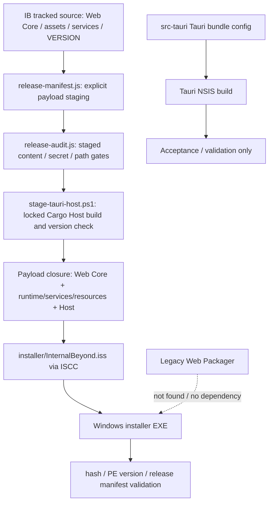

# Legacy Web Packager Retirement Audit and Self-Service Packager Plan

审计日期：2026-09-28
审计范围：`master` / `ca98a4ea42a9aa90180d6c942d1da71d966a711c` 与当前工作区可见内容
本轮性质：只读考古 + 新增本报告；没有改动构建脚本、桌面运行时代码、安装器或发行产物；没有运行安装、构建、发布或清理操作。

### Phase 0 工作区记录

- 分支：`master`；HEAD：`ca98a4ea42a9aa90180d6c942d1da71d966a711c`。
- 开始本轮前已有 **51 个 tracked 文件修改**，`git diff --stat` 为 1,587 insertions / 203 deletions；另有 **43 个 untracked 路径**。改动覆盖主/Recovery HTML、credential 与 Home Node/Bridge 源码、Tauri/Rust、CSS/JS、测试、审计报告和 `tmp/`。
- 本轮只新增本报告；没有 stash、reset、checkout、删除、覆盖或格式化这些已有内容。`src-tauri/tauri.conf.json` 与 `src-tauri/src/lib.rs` 属于已有未提交修改；凡涉及当前 Tauri config 的结论均标为工作区观察，并以未修改的 canonical staging/build 脚本作安装链证据。

> **名称说明：** 本报告把“Legacy Web Packager”限定为旧 Web 架构下将 HTML、JS、CSS、静态资源整理/导出成网页产物的工具。`tools/release-builder` 虽有浏览器 GUI，但它是目前的发布编排工具，不属于这个定义。

## 1. Executive Summary

1. 在 IB 跟踪源码、页面、脚本、Tauri 命令、菜单、设置、构建链、安装器及测试中，没有找到独立的旧式 Web Packager 入口或实现。对这类工具的生产依赖数为 **0**。
2. 仓库中最像“打包器”的正式工具是 `tools/release-builder/`。它提供本地浏览器界面，做版本检查、发行编排、产物校验和显式发布；BUILD 阶段调用既有 `scripts/build-installer.ps1`。它不是静态网页导出器，也不拥有第二套 Windows 安装 authority。
3. `Economy-v1-release/build-package.js` 是当前磁盘上一个被 Git 忽略的 Economy v1 策展快照构建器。历史文档说明该快照不含 `InternalBeyond.html` 应用壳，也不在 IB Windows 安装链内；不能把它当作完整 IB Web 或 Desktop 打包器。
4. 已有 `tools/IB-Release-Builder.exe` 和 `tools/release-builder-runtime/` 在本机工作区出现，说明 Release Builder 可由开发者本机手动启动；它没有产品菜单或运行时入口。其四个测试套件被 `tests/test-all.js` 登记，这是测试依赖，不是产品安装依赖。
5. 决策：`tools/release-builder` **R1 — Keep**，作为现有发布操作界面保留；Legacy Web Packager **未发现，因此退休决策不适用**。不移动、不删除 Economy 快照或研究目录。
6. 未来 Self-Service Packager 应采用 UI → Build Planner → Environment Inspector → Build Executor → Artifact Validator → Artifact Manifest；首个实现目标限定为通过既有 Inno pipeline 生成 Windows Installer。Portable、Web Export 和 Android APK 必须独立定义边界，不能共用“完整桌面包”标签。

## 2. Legacy Packager Inventory

| 文件 / 对象 | 符号或入口 | 原功能 | 当前是否可访问 | 是否被生产代码引用 | 是否仍有价值 / 处置 |
|---|---|---|---|---|---|
| Legacy Web Packager（独立实现） | 未发现 | 旧式 HTML/JS/CSS/静态资源整理或网页导出 | 否；无对应产品入口 | **否，0 个生产引用** | 不创建虚构的退休对象；若将来发现仓外副本，再单独核验 |
| `tools/release-builder/server.js`、`public/index.html`、`public/app.js`、`public/builder.css` | 本地 HTTP 服务与 Release Builder UI | CHECK/BUILD/VERIFY/SEAL/PUBLISH 发布流程界面；服务绑定回环地址并要求启动令牌 | 是；本机存在忽略的 launcher/runtime 产物；也可按 README 从源码启动 | 产品 HTML、Tauri Host、Inno 均不调用它；只由工具自身和测试覆盖 | 当前发布操作工具，保留；不是 Legacy Web Packager |
| `tools/release-builder/lib/{check,build,verify,seal,publish,runner,canonical,env,log,git,notes,plan}.js` | Release Builder 阶段模块 | 预检、调用 canonical build、验证 EXE/manifest/hash、封装日志、显式发布 | 是；由上面的工具入口调用 | `lib/build.js` 调用 `scripts/build-installer.ps1`；反向没有生产构建脚本调用 Release Builder | 保留其“薄编排 + 权威委托”职责；不把它改作任意目录打包 API |
| `tools/release-builder/build.js`、`tools/release-builder/launcher/IB-Release-Builder.cs` | 源码构建脚本与 C# 启动器 | 生成双击启动器和独立工具 runtime copy | 是；当前工作区有忽略的 `tools/IB-Release-Builder.exe`、`tools/release-builder-runtime/` | 不属于 IB 安装载荷；由人工启动或工具测试启动 | 仅服务 Release Builder；产物属于忽略的本机工具产物 |
| `tools/release-builder/tests/*`、`tests/test-all.js` | plan/astages/server/exe 四套件及登记 | 验证 Release Builder 的检查、状态机、HTTP 边界和 EXE 启动 | 测试入口可用；本轮未运行 | 测试 runner 登记了四套件；不是产品代码依赖 | 保留测试证据；不计入生产依赖数 |
| `scripts/release-manifest.js`、`scripts/release-audit.js` | `resolve()` / `stage()` / staged-byte audit | 解析当前产品白名单、物化 staging、检查内容/secret/path/release claim | 是 | `scripts/build-installer.ps1` 与 `scripts/stage-tauri-host.ps1` 直接调用 | 当前产品发布链的 authority，保留；不是旧网页打包器 |
| `scripts/build-installer.ps1`、`scripts/stage-tauri-host.ps1`、`installer/InternalBeyond.iss` | canonical build、Tauri Host staging、Inno Setup source | 生成 Host 与白名单 payload，经 Inno 生成正式 Windows installer | 是 | 当前发行链直接调用 | **Existing Inno Setup = Production Installer Authority**；禁止复制出第二套生产安装器 |
| `Economy-v1-release/build-package.js`（被忽略的本机快照目录） | `node Economy-v1-release/build-package.js` / `--verify` | 从 Economy 冻结清单与 require closure 生成目录形态的组件快照、校验清单和归档 | 当前磁盘可直接执行，但目录在 `.gitignore` 中 | 无当前产品 UI、构建或安装器调用；历史审计明确排除 | 仅作旧 Economy 组件交付物参考；其 closure/hash 思路可研究，不能作为完整桌面打包器 |
| `.dsh-research/reference-spike/mira/.../HtmlPackagerScreen.kt` | 第三方研究副本中的 Android UI | 研究副本描述的是把 HTML 与依赖合成单文件的功能 | 仅本机研究缓存 | 非 IB 跟踪源码；无 IB 生产引用 | 搜索命中但非 IB 代码，不纳入退休对象，不改动 |
| `README.md` §“免安装（ZIP）”、源码运行与结构说明 | 人工 clone/下载仓库后直接开 HTML；旧 VBS/Node 启动说明 | 开发期 / Web Core 基础体验说明 | 可读 | 不调用任何旧 Packager | 不是打包器入口；其中部分启动架构说明与当前 Tauri Host 有漂移，列入文档风险 |

**搜索覆盖：** 跟踪源码和当前工作区的 HTML、JS、CSS、Rust、PowerShell、bat/cmd、Python、JSON、Inno、测试、README/docs、release 与工具目录；检查 UI 菜单/设置/隐藏入口关键词、构建和发行脚本、测试登记、Tauri 配置和 Inno 源码。另用包含忽略目录的文件枚举识别本机生成物与研究副本，并将其与跟踪源码分开分类。

**负面结果的边界：** “未发现”表示当前 Git 跟踪产品源码与本工作区可见路径中无可达的 IB Legacy Web Packager。被忽略的历史快照或仓外副本不因此获得产品身份。

## 3. Historical Architecture and Identity

### 3.1 类型判定

| 候选 | 分类 | 证据与结论 |
|---|---|---|
| Legacy Web Packager | 未发现 A–E 类型实现 | 没有单独的网页静态依赖图构建器、portable Web 包或应用内打包入口。 |
| `tools/release-builder` | **F — 其他：发布工作流编排器** | 浏览器只呈现 localhost UI；它检查发行环境，委托唯一的 `scripts/build-installer.ps1`，重新测量 EXE，再执行独立确认的 GitHub 发布流程。其最终可以促成 D 类 EXE，但 D 类产物由 Inno 生成。 |
| `Economy-v1-release/build-package.js` | **F — 其他：受限的组件快照生成器** | 基于 Economy 冻结文件集与 JS support-plane closure 生成目录快照与校验信息；历史清单说明不包含主 `InternalBeyond.html` 应用壳，不是 Windows installer，也不是完整 Web App。 |

因此，不能因为 Release Builder 的页面使用 HTML/JS/CSS 就把它归为“网页打包器”。**UI 的交付技术与它所构建的产品目标是两回事。**

### 3.2 当前 Release Builder 对现代 IB 概念的支持矩阵

这里的状态评估对象是 `tools/release-builder` 本身；`PARTIAL` 表示它把责任交给现有 canonical pipeline，而不是该 GUI 自己成为对应 authority。

| IB 概念 | 状态 | 证据与边界 |
|---|---|---|
| Tauri Host | PARTIAL | BUILD 调用 `build-installer.ps1`；后者调用 `stage-tauri-host.ps1` 编译、校验版本并把一个 Host EXE 放入 staging。Release Builder 不直接维护 Host 运行契约。 |
| Home Node | PARTIAL | 发布白名单包含 Home Node 服务源码；工具验证 payload contract，不迁移或复制用户 Home Node 数据。 |
| Credential Vault | PARTIAL | staged-byte secret audit 是发布门之一；Release Builder 不读取 Vault、不决定 credential authority，也不把用户 Vault 作为输入。 |
| Bridge | PARTIAL | Bridge 服务属于当前白名单 payload；生命周期和运行状态由产品/安装链负责。 |
| Native commands | PARTIAL | Host 从锁定 Cargo 项目构建；Release Builder 不检查每条 native command 的权限语义。 |
| WebView2 | PARTIAL | Inno source 管理当前安装所需的 WebView2 探测/引导；Release Builder 只编排 canonical installer 构建。 |
| Recovery-only | PARTIAL | Recovery 源文件进入发布闭包；Release Builder 没有 recovery-only 构建目标或模式选择器。 |
| authoritative Inno installer | SUPPORTED（委托） | `lib/build.js` 运行 `scripts/build-installer.ps1`；正式 installer 定义仍在 `installer/InternalBeyond.iss`。 |
| 用户数据目录 / AppData 布局 | ABSENT | 该工具不枚举用户 AppData，也不把已安装用户数据纳入 staging。数据目录规则在安装器/运行时契约中。 |
| SQLite / Home Node 用户存储 | ABSENT | 不将数据库快照作为 installer payload，不负责 schema、备份或迁移。 |
| service lifecycle | PARTIAL | Inno 升级/停止 helper 随 canonical payload 管理；Release Builder 不自行启动或迁移 Home Node/Bridge。 |
| single instance | PARTIAL | 发行/安装器契约有各自互斥机制；Release Builder 没有对应用运行时单实例语义做独立测试。 |
| upgrade / uninstall | PARTIAL | 工具构建由拥有升级、卸载行为的 Inno source 完成；工具本身不实现升级器/卸载器。 |
| credential authority | ABSENT | secret scan 不是 credential authority；Release Builder 不读取或重绑定 Vault。 |
| `.tauri-frontend` | NOT APPLICABLE（当前 Inno staging） | 当前 `build-installer.ps1` 与 host staging 明确不消费 `.tauri-frontend`；Tauri config 的 frontendDist 属于独立 Tauri bundle 配置。 |
| secret routes | ABSENT | 工具没有 Host route/secret route 模型；内容扫描不能代替路由权限校验。 |
| Host origin | ABSENT | 工具没有 origin policy；这属于 Host/runtime 与 WebView 的验证范围。 |

结论：Economy 快照和任何只整理网页资产的工具都不能代表完整 IB Desktop，因为它们没有 Host、native commands、WebView2、Home Node 生命周期、Vault authority、Recovery-only、AppData 和 Inno upgrade/uninstall。`tools/release-builder` 则不是这种旧工具；它通过 canonical pipeline 间接构建当前 Desktop installer。

## 4. Production Reachability Audit

| 路径层 | 旧式 Legacy Web Packager | `tools/release-builder` 现状 |
|---|---|---|
| UI | 未发现产品菜单、设置项、彩蛋、Recovery 或主页面入口 | 独立本地发布 GUI；开发者手动运行 EXE 或 README 命令打开，不从 IB 产品 UI 启动 |
| runtime | 无 Web Packager runtime/API/command | 独立 localhost 服务，绑定 `127.0.0.1`，启动令牌用于请求授权；不是 Home Node/Bridge/Tauri command |
| build | 无 package.json script、构建步骤或 build hook 指向旧网页包 | 人工启动后 BUILD 调用 canonical `scripts/build-installer.ps1`；也可以直接运行 canonical script，不依赖 Release Builder |
| release | 未发现发布 pipeline 调用旧网页包 | Release Builder 有显式 PUBLISH 阶段，可在用户确认后处理 commit/push/tag/GitHub release；这属于发行操作工具，不是被发布产品的构建 authority |
| installer | Inno 和 Tauri config 中无旧网页打包器引用 | 由 `installer/InternalBeyond.iss` 编译；Inno 不调用 Release Builder |
| upgrade / uninstall | 无引用 | 由 Inno/运行时 stop、manifest-diff 与 uninstall 路径负责；Release Builder 不参与安装后的生命周期 |
| 文档 | 没有文档把某个 Legacy Web Packager 认作当前 Desktop installer | Release Builder README 把自己描述为 release orchestrator 并指定 canonical Inno build。仓库根 README 的部分 Web/VBS 说明与当前 Host 架构不一致，但没有把 Web Packager 宣称为生产安装器 |
| tests | 没有旧 Web Packager 测试入口 | `tests/test-all.js` 登记四个 Release Builder 套件；只证明工具受测试覆盖，不构成产品安装运行时依赖 |
| CI / package scripts | 根目录无 `package.json`，无根 `.github` CI workflow 入口 | Release Builder 有自己的 Node CLI/源码启动方式；未发现自动 CI 调用 |

### `PRODUCTION_DEPENDENCIES`

```text
PRODUCTION_DEPENDENCIES = 0
```

计数定义：对“Legacy Web Packager”从当前产品 UI/runtime、canonical build/release、Inno/Tauri build、upgrade/uninstall 计算的生产调用/依赖边。候选实现本身未发现，因此每项均为 0。`tests/test-all.js` 的四个 Release Builder 测试登记不计入生产依赖；Release Builder 调用 canonical installer 的单向边也不反向构成 installer 对它的依赖。

## 5. Reusable Capabilities

| 能力 | 是否仍有价值 | 与旧架构耦合 | 建议 |
|---|---|---|---|
| 文件枚举与显式 payload 白名单 | YES | LOW | reuse `scripts/release-manifest.js` 的 canonical contract；Self-Service UI 只能选择被声明的功能集，不能传任意目录 |
| 静态资源 dependency closure | YES | MEDIUM/HIGH | 现有 installer manifest 的白名单与 Economy snapshot 的 CommonJS closure 解决的问题不同。可 extract 算法和测试；不能把 `require()` closure 当作 HTML/CSS/动态 import 的完整 closure |
| manifest 生成 | YES | LOW | reuse schema-first 思路；新增 artifact manifest 要与客户端消费的 `update-stable.json` 分开 |
| SHA-256 | YES | LOW | reuse标准 hash 实现与对磁盘最终字节重算的做法 |
| ZIP / 压缩 | YES（目标有限） | MEDIUM | 可为 portable/Web 导出单独实现或复用已验证库；Economy `.tar.gz` 生成器不是产品 release authority |
| include/exclude rules | YES | LOW | reuse allowlist + denylist 双重规则；安全目录应默认不在任何 target 文件集合中 |
| 文件完整性检查 | YES | LOW | reuse staging 闭包、missing/denied 检查和最终产物重读 |
| progress UI | YES | MEDIUM | Release Builder 的阶段条、blocked reason、当前步骤可借鉴；新 job 状态由后端决定 |
| build log UI | YES | MEDIUM | reuse可折叠流式日志与可复制结果；所有日志先脱敏 |
| artifact metadata | YES | LOW | 增加目标通用 manifest，不复制发布清单中的下载 URL/Stable 规则 |
| version 注入 | YES | LOW | 保持 root `VERSION` 单一 authority；自定义测试版本仅限 Test 模式与隔离 identity |
| icon/resource processing | PARTIAL | MEDIUM | 当前主要是受控静态资源纳入与 Tauri/Inno 配置引用；没有通用 icon 转换系统。按 target 明确格式处理 |
| portable artifact generation | NO（当前无权威实现） | HIGH | rewrite；先解锁数据、凭据、升级与运行时边界，之后才考虑 directory/zip |
| environment validation | YES | LOW/MEDIUM | reuse target-specific preflight 与 fail-closed 规则，不要求当前流程未用到的工具 |

## 6. Retirement Recommendation

### 决策

- **Legacy Web Packager：未发现；R1–R4 不适用。** 没有文件可安全标记或移动。`PRODUCTION_DEPENDENCIES = 0` 证明它不在产品链中，但不能据此误删功能相邻的当前 Release Builder。
- **`tools/release-builder`：R1 — Keep。** 保留为可选发行编排工具；其价值在于遵守 canonical Inno pipeline、对最终 EXE/清单/hash 做验证并分离 PUBLISH。其 UI 技术采用浏览器不等于它是旧网页包构建器。
- **Economy 快照：不移动、不清理。** 当前 `Economy-v1-release/` 是被忽略的本机快照；既有文档已经说明其旧版本与当前源码 hash 不一致。保留现有证据，未来如需回收应另行确认产物保留策略。
- **命名：不重命名 Release Builder。** `Release Builder` 与其实际职责吻合。若未来新增工具，使用 `IB Self-Service Packager`；如出现历史静态网页工具，统一叫 `Legacy Web Exporter` 或 `Legacy Static Bundle Builder`，避免继续使用模糊的 `IB Packager`。

## 7. Current Packaging Authority



| 层 | authority / 边界 |
|---|---|
| Source and `VERSION` | 仓库源码和根 `VERSION`；单一产品版本源 |
| Web Core/resource payload | `scripts/release-manifest.js` 的逐项白名单与 release audit；不从整个工作目录盲目压缩 |
| Tauri Host | `scripts/stage-tauri-host.ps1` 构建、PE 版本/hash 检查；构建输出仅以 Host EXE 加入 canonical staging |
| Runtime/service closure | 由 payload manifest 和现有生命周期脚本界定；用户运行数据不属于产品源码 staging |
| Windows installer | **Existing Inno Setup = Production Installer Authority**；`scripts/build-installer.ps1` 调用 Inno source `installer/InternalBeyond.iss` |
| Tauri NSIS | **Acceptance / Validation only**；不是 production installer authority |
| Legacy Web Packager | **NOT Desktop Installer Authority**；本次也没有发现可达的旧实现 |

重要细节：当前 Inno build script 明确说明不从 `_up_`、Cargo target 或 `.tauri-frontend` 取 payload；它通过 release manifest staging，再加入独立构建的 Host EXE。Tauri config 中的 `frontendDist` 是另一条 Tauri bundle 配置，不能据此推导 `.tauri-frontend` 是 Inno 安装 payload。当前工作区的 `src-tauri/tauri.conf.json` 有预先存在的未提交修改，此处对其 frontendDist 仅作工作区观察；上述 Inno staging 边界由未修改的 build/stage scripts 支持。

## 8. Self-Service Packager Goals

未来工具面向维护者或获授权的本地开发者，帮助选择一个受支持 target、检查环境、执行确定性 build、验证实际产物并写出可审计 manifest。它不重新定义应用部署 authority，也不承诺任何未经验证的 target。

### Non-Goals

- 不创建第二套 Windows installer、updater、uninstaller 或生产 AppId。
- 不把 Tauri NSIS 升级为生产 authority。
- 不把网页导出称为完整 IB Desktop。
- 不把用户运行数据、credential 或设备本地状态变成 build input。
- 不接受任意 shell、任意目录、任意资源或 Agent 生成的 build 命令。
- 不把 LLM 作为构建判定器；相同源码、版本、target、选项和工具链必须可重复得到相同输入闭包。
- 不在普通 build job 中自动 commit、push、tag、创建 release 或上传 Stable manifest。

## 9. Proposed Architecture

```text
Packager UI
    ↓ typed request (target + mode + approved options)
Build Planner
    ↓ immutable plan + exact input closure
Environment Inspector
    ↓ PASS / WARN / FAIL
Build Executor
    ↓ allowlisted canonical commands + owned job directory
Artifact Validator
    ↓ checks against bytes on disk
Artifact Manifest + result UI
```

### Layer responsibilities

| Layer | 职责 |
|---|---|
| Packager UI | 展示受支持的 target 和 target-specific options；提交结构化 job request，不执行命令 |
| Build Planner | 校验 target/mode/options 组合，解析版本来源，计算 allowlisted payload closure、输出名与预计空间；生成不可变 plan digest |
| Environment Inspector | 按 target 检查工具、版本、源码/资源、Git 状态、空间和输出目录；产出结构化证据 |
| Build Executor | 仅执行 planner 返回的固定步骤和参数；独立 staging/output；串流日志脱敏；支持 cancel 与 process-tree 收尾 |
| Artifact Validator | 重新打开落盘产物，核对 hash、大小、版本、文件 closure、安全策略和 target smoke checks |
| Artifact Manifest | 记录 source、target、mode、options、hash、验证结果、工具链；不含密钥和用户路径 |

### Job contract

```js
{
  id,
  target,
  mode,
  version,
  sourceRevision,
  options,
  status,
  startedAt,
  finishedAt,
  artifact,
  validation
}
```

状态机：

```text
idle → checking → ready → building → validating → success
                    ↘ failed       ↘ failed        ↘ failed
                       ↘ cancelled    ↘ cancelled     ↘ cancelled
```

只有所有 required validation 都通过、manifest 写入并重读成功时才能进入 `success`。`exit code = 0` 但产物缺失、hash/版本不符、payload/secret scan 失败时，job 必须分别显示 build 与 validation 的结果，例如 `Build succeeded / Validation failed`。

Job 还应记录安全脱敏的阶段事件、取消原因和规范化错误码。一个 checkout 同一时刻只允许一个会写源树的 job；优先让构建只写独立 staging/out 目录，不对源码做隐式版本修改。

## 10. Supported Build Targets

| Target | 初始状态 | 设计边界 |
|---|---|---|
| Windows Installer (`.exe`) | **首个支持目标** | 委托 `scripts/build-installer.ps1` → Inno Setup；不复制编译、升级、卸载、manifest 或 AppId 规则。Test build 必须使用已有隔离 test identity/目录，不可冒充 Release。 |
| Windows Portable directory / zip | **未支持，待架构评估** | 不能简单把安装目录压成 ZIP。必须先定义 WebView2 依赖、Host/sidecar 启停、单实例锁、日志、SQLite/Home Node 数据位置、credential authority、Recovery、更新和卸载/清理语义。默认不携带任何现有用户数据。 |
| Web Export | **条件支持** | 仅当 Web Core 有明确的独立静态运行 contract。只包含页面和声明的静态依赖；无 Tauri Host、native commands、Home Node/Bridge、Vault authority、WebView2 安装/恢复生命周期。界面和文档必须明确标记 `Web Export — not Full IB Desktop`。 |
| Android APK | **扩展点 / Coming later** | 当前不声明完成。未来再接 Tauri Android、SDK/NDK/JDK、Rust target 和签名验证；本轮不创建虚假的 PASS/build 按钮。 |

### Portable 的数据边界

portable artifact 默认只含只读应用文件与明确打包的 runtime/resource closure。它不含 `credential-vault.key`、`credential-vault.json`、任何真实 API Key、Home Node SQLite、聊天/Memory、Active 状态、现有 AppData 或浏览器 WebView profile。若未来要迁移这些数据，必须另做显式、加密、预览、用户确认的 Backup/Transfer 产品流程；不能借 build option 带入。

## 11. Security Boundaries

1. **Source allowlist first：** 只从 canonical manifest 和经过审查的 target contract 选文件；不得从当前安装目录、AppData、任意 workspace path 或整个 repository 根目录递归打包。
2. **拒绝敏感路径：** `.env*`、Vault 文件、API 配置明文、用户 SQLite、聊天/Memory、浏览器 profile、日志/恢复现场、测试真实凭据、开发者绝对路径和任意 `tmp` 目录默认拒绝。
3. **secret scanning gate：** 生成 staging 后、压缩/编译前和最终 artifact 可检查层各执行扫描；覆盖已知 secret value、credential 赋值、常见 token 模式、私有路径和不允许的文件名。扫描器不能把“未命中”解释为允许加入任意目录。
4. **不记录 secrets：** 命令、环境摘要、stdout/stderr、失败详情都先过 redactor；环境变量只白名单读取必要的路径/工具变量，不写入普通 build log。
5. **无任意执行面：** UI/Agent 只能提交枚举与受限文本；版本路径、输入根目录、构建命令和 compiler args 由 planner 生成并在 server side 再校验。
6. **Build 与 Backup 分离：** artifact creation 从来不等于导出用户数据。任何未来例外必须是专门的 encrypted Backup/Transfer 流程，有内容预览、明确确认和独立密钥管理。
7. **路径隔离：** 检查 symlink/reparse point、路径穿越和 output 覆盖；只清理由当前 job 创建且有 ownership marker 的临时目录，不对未知 staging 或用户目录做递归删除。

## 12. Environment Preflight

每个 target 使用独立的 dependency profile；无关工具缺失不能阻断不需要它的目标。

| 检查项 | Windows Installer | Web Export | Portable | Android（未来） |
|---|---|---|---|---|
| Node | 验证仓库 pin 的 bundled Node 文件/hash/version；不要以 PATH Node 静默替代产品 runtime | 只在规划器/工具确实需要时要求 Node | 同 Host/build contract | Android tooling 若需要再声明 |
| npm / `package.json` | 当前 root 没有 `package.json`，当前 Inno 路径不要求 npm | 若未来前端 build 增加 package manager，再纳入锁文件和版本检查 | 按实现实际依赖 | 按 Tauri Android toolchain |
| Rust / Cargo | 当前 Host stage 需要 locked Cargo build | 不需要，除非导出器自身改变 | 若包含当前 Host 则需要 | Rust Android targets 与 linker |
| Tauri CLI | 当前 authoritative Host stage 调用 Cargo；Tauri CLI 只对单独 NSIS acceptance build 有关 | 不需要 | 视 target contract | Tauri Android CLI/target required |
| Inno Setup / ISCC | **必需**，版本满足当前 canonical build contract | 不需要 | 不应构造第二个 installer | 不需要 |
| PowerShell | 当前 Windows build script 所需版本与命令可用 | 不需要 | 按构建实现 | Windows host 上的可选工具 |
| WebView2 | Build 时报告安装策略；安装/launch validation environment 必须能测 bootstrap/runtime | 不适用 | 若依赖系统 Evergreen，portable 属性不能宣称完全自包含 | Android WebView/系统依赖另定义 |
| Source / version | 必需文件存在、root `VERSION` 合法、payload manifest 能解析 | Web Core inputs/静态 closure 均存在 | 同 Host + storage contract | Android project / SDK contract |
| Git 状态 | Release 默认要求可审计 revision 与允许的 clean state；Debug/Test 可 WARN 但必须记录 dirty | 记录 revision/dirty state | 同 Release policy | 记录 revision 与 signing context |
| Disk / output | staging、编译、验证预留空间；输出目录可写、未指向源码/用户数据 | 对预计导出大小留余量 | 检查解压与数据策略空间 | SDK/build cache 空间 |

每项结果为 `PASS` / `WARN` / `FAIL`，并带 `checkId`、期望值、实测值、证据路径（manifest 中仅记录相对路径或脱敏标签）和修复建议。关键工具、源码缺失、secret/closure 失败、不可写/危险输出路径均为 `FAIL`；生产 build 遇 `FAIL` 必须停止。

## 13. Artifact Validation

验证器检查最终落盘产物，而不是只读子进程退出码：

- 文件存在、长度大于零且落在 target 合理范围；
- SHA-256 从最终字节重算，并与 manifest/sidecar 对得上；
- target、mode、版本和 PE ProductVersion 一致；安装器文件名、canonical manifest URL/version 关系仍由既有模块校验；
- Required payload closure 完整，不能只验证 whitelist 声明；记录缺失、额外、拒绝文件；
- 重新运行 secret scan 与 forbidden path scan；对可枚举的 installer/ZIP 成员逐项扫描；
- Windows Installer 的后续验证计划包括隔离环境 install smoke、launch/service readiness、同 identity upgrade、uninstall 后个人数据保留契约；
- Portable 验证 fresh profile、单实例、持久化位置、关机/崩溃恢复与卸载/目录删除边界；
- Web Export 验证静态页面加载和明确拒绝 native/Home Node/Vault-only 功能；
- validation 有单独状态，不把“EXE 已生成”直接显示为“可发布”。

Install/upgrade/uninstall smoke 必须在 disposable VM/profile 或隔离测试身份中执行，不对维护者已有的生产安装覆盖测试。

## 14. Artifact Manifest

每个产物旁写一个与客户端更新清单分开的机器可读 sidecar，例如：

```json
{
  "schema": "internalbeyond.artifact-manifest",
  "schemaVersion": 1,
  "product": "Project-IB",
  "version": "1.2.3",
  "revision": "<source commit>",
  "target": "windows-installer",
  "mode": "release",
  "options": {
    "content": ["standard"]
  },
  "createdAt": "2026-09-28T00:00:00Z",
  "artifact": {
    "file": "InternalBeyond-Setup-1.2.3.exe",
    "bytes": 0,
    "sha256": "<64 lowercase hex>"
  },
  "validated": true,
  "validation": {
    "status": "PASS",
    "checks": []
  }
}
```

不写入 API key、Vault 值/文件名、用户数据库值、绝对源路径、环境变量全集、private user name 或聊天内容。允许记录的是受限的相对 artifact path、工具版本、payload digest、target option IDs 和脱敏检查结果。`validated` 仅能由验证器置真。

## 15. UI Information Architecture

建议使用当前 IB 的颜色、字体、控件和状态层级；保留 Release Builder 中“原因可见、原始日志可展开”的优点，但按多 target 工作流重新组织：

1. **Target**：Windows Installer、Windows Portable（未解锁时 disabled + 原因）、Web Export、Android APK（Coming later）。
2. **Build Mode**：Release / Debug / Test；显示该 target 支持的模式及 release-only gate。
3. **Content**：标准资源、可选模型、可选语音、开发工具、示例角色、文档；仅展示该 target contract 实际支持的选项。
4. **Version**：Release 自动读取根 `VERSION`；custom version 仅对隔离的 Test artifact 开放并标记 non-publishable。
5. **Output**：默认 artifact directory；用户可选目录，但先做 canonicalize、权限、剩余空间和 source/data-root exclusion 检查。
6. **Environment**：PASS/WARN/FAIL 清单，说明阻断原因和解决办法；未 PASS 的 Release 不出现可执行 Build 动作。
7. **Build job**：阶段、耗时、取消按钮、脱敏流式日志；所有状态由服务端状态机确认。
8. **Result**：单独显示 Build status、Validation status、artifact 名称/大小/hash、manifest、验证清单与打开输出目录按钮。

## 16. Work Mode / Agent Relationship

- Packager 是 deterministic local tool；Agent 不参与 target 解析、closure、secret 判断或最终成功判定。
- Agent 可在用户允许范围内查看 job ID、状态、脱敏日志和 validation result；不能读取 Vault、AppData、Home Node 数据或未经筛选的 artifact 内容。
- Agent 若发起 build，只能调用同一受限 job API，提交 target/mode/枚举 option；服务端重新校验 policy，不接受 agent 提供 shell argv、文件 glob 或 source path。
- Agent 不能跳过 preflight、audit、validation、发布确认或更改 installer authority；PUBLISH 保持单独、显式的人类确认。
- 初期建议 Agent 只读观察/摘要，不授予启动或发布 job 权限。

## 17. Migration Plan

1. **Freeze this audit:** 保留现有 Release Builder 和 Inno authority；不删除、搬动旧快照或构建输出。
2. **Define target contracts:** 先写 Windows Installer 的 source closure、mode/version 规则、secret denylist、output semantics、validation checks；其他 target 标记 unsupported。
3. **Build read-only Planner + Inspector:** 只计算计划与环境结果，不启动子进程、不改源码、不写用户目录。
4. **Implement one executor path:** Windows Installer job 只调用现有 canonical PowerShell pipeline；不能添加第二份 ISCC args、payload list、version source 或 installer source。
5. **Add validator + sidecar manifest:** 首先验证当前 Inno artifact 与白名单/secret gates；安装 smoke 在隔离环境执行。
6. **Add UI:** 使用强类型 job API；Release Builder 的 progress/log 经验可借鉴，但不把 release publish 逻辑并入 build job。
7. **Expand only after gates:** Web Export 需先完成静态运行与 capability denial；Portable 需解决 user data/Vault/WebView2/service lifecycle；Android 最后按真实 Tauri Android toolchain启用。

本次没有实现以上阶段，也没有修改 P32 installer/upgrade/uninstall 行为。

## 18. Risks

| 风险 | 影响 | 设计控制 |
|---|---|---|
| 把 Release Builder 因 browser UI 误认成过时网页打包器 | 误删当前 release operator UX/校验 | 保留 R1；以实际 BUILD 调用链而非 UI 技术分类 |
| 把 Economy curated snapshot 当成完整产品 | 发布缺 Tauri Host、主应用壳和安装生命周期 | Target-bound manifest、artifact 名称与 UX 明示 Web/组件包边界 |
| 新工具另造 installer | AppId、升级、卸载、数据迁移 authority 分裂 | Windows Installer executor 固定委托 Inno canonical pipeline |
| Portable 包带入或覆盖用户数据/Vault | credential 与聊天数据泄露/破坏 | 构建只读 source allowlist；数据迁移归独立 Backup/Transfer 流程 |
| Web Export 冒充 Desktop | 用户期待 native/Home Node/Vault 后发现不可用 | capability denial + 显式 `not Full IB Desktop` 标识 |
| 只看 exit code | 产生缺 payload、错版本、带 secret 的“成功”包 | Artifact Validator 对最终字节重验并与 Build status 分开 |
| Tauri/Inno staging 概念混淆 | `.tauri-frontend`、`_up_` 或 target internals 被错误当成生产输入 | 固定 authority map；每个 target 列出真实输入，不跨 staging root 猜测 |
| 根 README 的 Web/VBS 描述陈旧 | 开发者可能误判当前桌面入口/静态导出能力 | 后续单独更新 architecture/user guide，并保留 Web Export 与 Desktop 的命名边界 |
| 用户工作区脏状态被误当作本轮变更 | 覆盖其他任务或将混合源码误标为可发布 | 每个 job 固定 source revision/dirty state；release gate 与 test gate 分开 |

## 19. Evidence Anchors

- `tools/release-builder/lib/build.js:6-17,218-235,342`：BUILD 声明并实现调用 `scripts/build-installer.ps1`，不重写 staging/ISCC/hash/manifest。
- `tools/release-builder/server.js:13-19,398-426`：localhost/令牌边界与手动打开 browser 的入口。
- `tools/release-builder/README.md:1-23,91-113`：工具定位、Build 阶段与显式 PUBLISH 分权。
- `tests/test-all.js:109-114,1604-1630`：四套 Release Builder 测试登记。
- `scripts/build-installer.ps1:361-384,386-445,447-465`：白名单 staging、Host staging、payload manifest、staged-byte secret audit、ISCC compile。
- `scripts/stage-tauri-host.ps1:59-84,104-119`：从 whitelist mirror 构建 Host；标明 Tauri target internals、`_up_`、`.tauri-frontend` 不作为安装 payload。
- `installer/InternalBeyond.iss:84-115,157-169,198-261`：per-user Inno 安装、互斥、启动项、WebView2 安装策略。
- `scripts/release-manifest.js:32-84,101-120,167-215` 与 `scripts/release-audit.js:6-12,45-78`：Recovery/service/resource 白名单和 hidden path/secret audit。
- `docs/P32-W5-INSTALLER-AUTHORITY-UX-UNIFICATION.md:107-146`：Existing Inno production authority、canonical build、Tauri NSIS acceptance-only。
- `docs/history/release/RELEASE_PIPELINE_AUDIT.md:303-307`、`.gitignore:33-42`：Economy 快照非产品发布链、忽略且可能过时。
- `README.md:143-168,184-205`：当前普通用户安装入口与源码 Web/VBS 说明；此处只作为文档漂移证据，不据其旧描述改变本报告 authority map。

## 20. Recommended Next Phase

下一阶段先冻结 **Windows Installer Self-Service Target Contract**（输入闭包、Release/Test 模式、检查项、secret policy、输出/manifest schema、验证矩阵），并实现只读的 Planner + Environment Inspector 草案。通过评审后再做唯一的 Windows Installer executor，且它只能委托当前 `scripts/build-installer.ps1`。Portable 与 Web Export 保持 disabled/conditional，Android 保持 Coming later，直到各自的运行时和数据边界有证据闭合。
